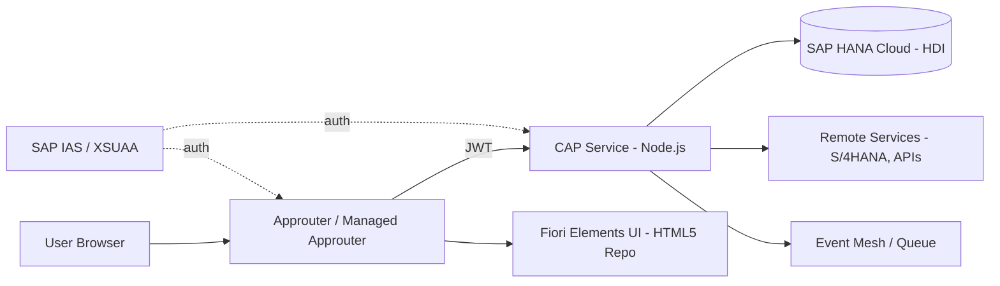
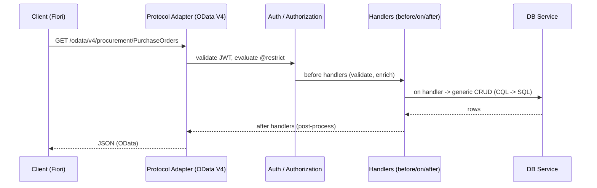
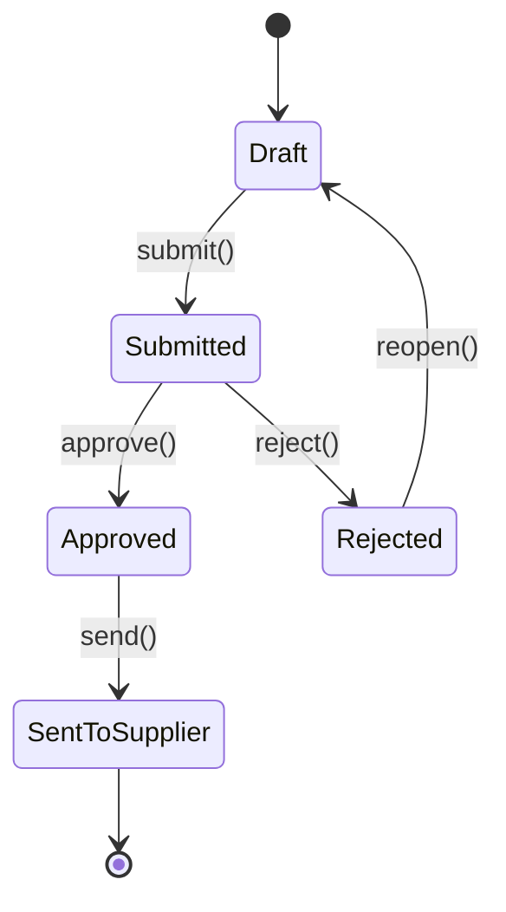
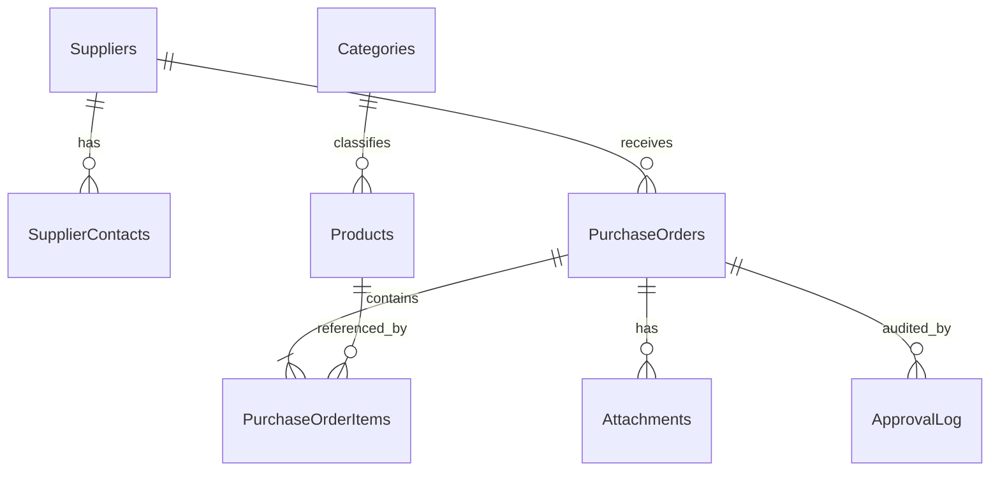
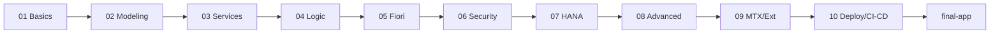
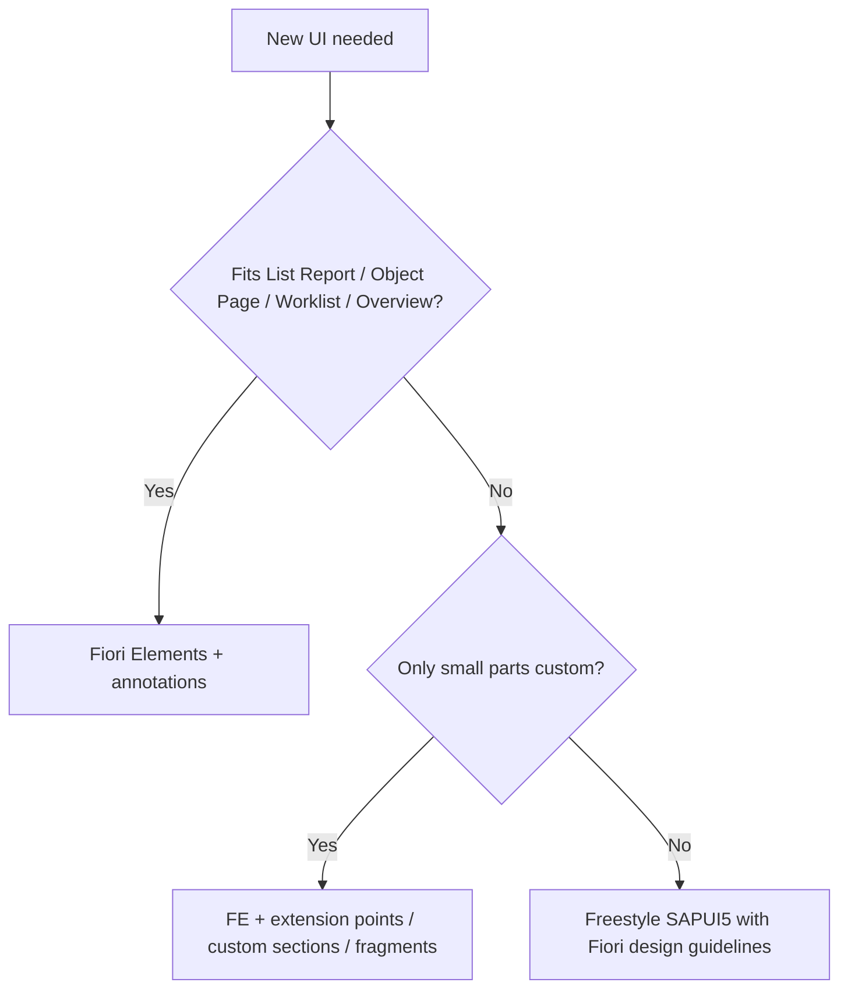
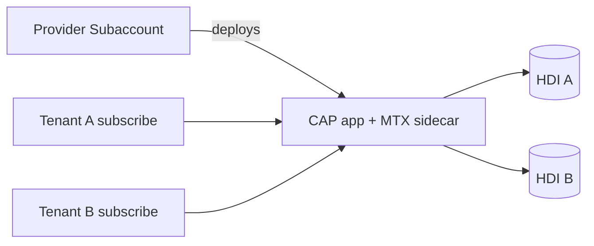
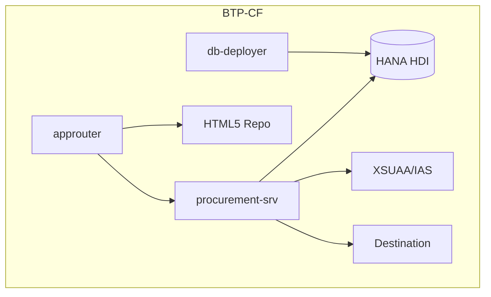

# SAP CAP Complete Development Guide

## 0. HOW TO USE THIS DOCUMENT  [CAP-S00]

### 0.1 Audiences
| Audience | Read |
|---|---|
| Learner | Sections 1–3, then modules in order (Section 5) |
| Code-generating agent | Section 0.3, 4, 5, 6, 7, 8, 9 (follow strictly, in order) |
| RAG / LLM retrieval | Section 11 (Index), 12 (Glossary), 13 (Decision matrix), 14 (FAQ/troubleshooting) |

### 0.2 Conventions
- `[CAP-Mxx]` = module ID. `[CAP-Sxx]` = general section. `[CAP-STAGE-xx]` = buildable stage. `[CAP-DEC-xx]` = decision rule. `[CAP-IMP-xx]` = impact note.
- "MUST" = required for generated code. "SHOULD" = default unless a reason is documented. "MAY" = optional.
- Code paths are relative to the stage folder unless prefixed with `final-app/`.

### 0.3 Instructions for the Code-Generating Agent  [CAP-AGENT]
1. Build stages strictly in order `stage-01` → `stage-10`, then assemble `final-app/`. Do not skip stages.
2. Each stage MUST be a standalone runnable project (own `package.json`) copied forward and extended from the previous stage, so readers can `diff` stage N vs N+1.
3. Before finishing each stage, run the "Acceptance checks" listed in that stage. If a check fails, fix it before moving on.
4. Every folder you create MUST contain a `README.md` following the template in Section 8.
5. Never hard-code secrets, URLs of real systems, or user credentials. Use environment variables and `default-env.json`/`.env` examples (git-ignored) only.
6. Prefer CDS-native features (annotations, `cds-common`, plugins) over custom code. Prefer CQL over raw SQL. Prefer Fiori Elements + annotations over freestyle UI.
7. Pin versions in `package.json` using caret ranges and record the resolved versions in the stage README.
8. When a doc detail is uncertain (CLI flag, plugin name), consult the live docs (Section 0.4) rather than guessing; note the doc URL in the README.
9. Output a `CHANGELOG-STAGE.md` per stage listing files added/changed vs previous stage.

### 0.4 Verification Protocol  [CAP-VERIFY]
CAP evolves quickly (plugins move into `@cap-js/*`, CLI flags change). Before generating each stage:
- Open the matching reference page in Section 10 and confirm: CLI commands, plugin package names, config keys under `cds.requires`, and Node/UI5 versions.
- Run `npx cds version` and `npx cds --help`, and `npx cds add --help` to confirm available facets.
- If the docs and this file disagree, the docs win; record the difference in the stage README under "Deviations".

---

## 1. WHAT IS CAP  [CAP-S01]

CAP (Cloud Application Programming Model) is an opinionated framework of languages (CDS), libraries (Node.js `@sap/cds`, Java SDK) and tools (`cds-dk`) for building enterprise services on SAP BTP.

Core ideas:
- **Domain-first**: model the business domain in CDS; services, DB schema, and UI annotations derive from it.
- **Services everywhere**: everything is a service (your own, DB, remote, messaging). Uniform API: `srv.run(query)`, `srv.send`, `srv.emit`.
- **Convention over configuration**: `db/`, `srv/`, `app/` folders; sensible defaults; "mocked" auth and SQLite in dev.
- **Separation of concerns**: model (CDS) / logic (handlers) / UI (annotations) / deployment (MTA).

### 1.1 Architecture visual


### 1.2 Project folder convention
```
project/
├─ app/        # UI apps (Fiori Elements) + annotations
├─ srv/        # service definitions (*.cds) and handlers (*.js/ts)
├─ db/         # domain model (*.cds), data/ CSVs, native artifacts (src/)
├─ test/       # jest tests (cds.test)
├─ package.json  # includes "cds": {...} configuration
├─ mta.yaml    # added by `cds add mta`
└─ xs-security.json  # added by `cds add xsuaa`
```

### 1.3 Request lifecycle visual


---

## 2. SAMPLE DOMAIN: ACME PROCUREMENT  [CAP-S02]

One domain is evolved through all stages so concepts compound.

### 2.1 Business scenario
Acme buys goods from suppliers. Requesters create **Purchase Orders (PO)** with items. Approvers approve/reject. Buyers send approved POs to suppliers. Finance audits changes. Data privacy applies to supplier contacts.

### 2.2 Entities (final model)
| Entity | Key fields | Notes |
|---|---|---|
| Suppliers | ID, name, country, rating, contacts (composition) | Business Partner sync from S/4 (remote) |
| SupplierContacts | ID, email, phone | Personal data (privacy) |
| Products | ID, name, category, price, currency, stock | `localized` name/description |
| Categories | code, name | Code list (`sap.common.CodeList`) |
| PurchaseOrders | ID, orderNo, supplier, status, totalAmount, currency, items (composition) | Draft-enabled; status lifecycle |
| PurchaseOrderItems | ID, product, quantity, netPrice, itemAmount | Composition of PO |
| Attachments | ID, fileName, mediaType, content | On PO (stage 8) |
| ApprovalLog | ID, po, approver, decision, comment | Audit trail |

### 2.3 PO status lifecycle


### 2.4 ER visual


### 2.5 Roles
| Role | Rights |
|---|---|
| Requester | Create/edit own POs (instance-based), submit |
| Approver | Approve/reject submitted POs |
| Buyer | Send approved POs; manage Suppliers/Products |
| Admin | Everything + tenant admin |
| Auditor | Read-only on all, including ApprovalLog |

---

## 3. LEARNING PATH OVERVIEW  [CAP-S03]

| Level | Stages | Outcome |
|---|---|---|
| 1 Foundations | 01–03 | Model + serve data + initial Fiori list |
| 2 Core dev | 04–05 | Business logic, actions, events, remote services, full Fiori UI |
| 3 Security & data | 06–07 | AuthN/AuthZ, HANA persistence |
| 4 Advanced | 08–09 | Attachments, change tracking, outbox, privacy, MTX, extensibility |
| 5 Delivery | 10 | MTA deployment to BTP CF, CI/CD, monitoring |



---

## 4. REPOSITORY LAYOUT (TARGET OUTPUT)  [CAP-S04]

```
cap-complete-guide/
├─ README.md                         # entry point: overview, index, how to run stages
├─ CAP_DEVELOPMENT_GUIDE.md          # THIS FILE (RAG master)
├─ docs/
│  ├─ README.md
│  ├─ decision-matrix.md             # copy of Section 13
│  ├─ glossary.md                    # copy of Section 12
│  └─ images/                        # screenshots of Fiori UI per stage
├─ stage-01-basics/
├─ stage-02-domain-modeling/
├─ stage-03-services/
├─ stage-04-custom-logic/
├─ stage-05-fiori-elements/
├─ stage-06-security/
├─ stage-07-data-persistence/
├─ stage-08-advanced-features/
├─ stage-09-extensibility-mtx/
├─ stage-10-deploy-cicd/
├─ final-app/
└─ .github/workflows/ci.yml
```
Each stage folder contains: `README.md`, `CHANGELOG-STAGE.md`, `package.json`, `app/`, `srv/`, `db/`, `test/` (as applicable).

---

## 5. MODULES (CONCEPT GUIDE)

Template for each module: **Scenario → When to use / When NOT → Implementation → Visual → Impact → Test → Reference.**

---

### [CAP-M01] Project Setup & Tooling
**Stage:** 01 | **Level:** 1
**Scenario:** Start a new CAP project and run it locally with zero infrastructure.
**When to use:** Always the first step. **When not:** Never skip; even adding CAP to existing project begins with `cds init`.
**Implementation:**
```bash
npm i -g @sap/cds-dk          # CLI (or use npx)
cds init procurement
cd procurement && npm install
cds watch                      # live-reload dev server, SQLite in-memory
```
Key facts: `cds watch` serves at `http://localhost:4004`, auto-detects `db/`, `srv/`, `app/`. Dev DB is in-memory SQLite via `@cap-js/sqlite`.
**Impact:** Fast feedback loop; dev behavior (mock auth, SQLite) differs from prod → covered in M11, M12.
**Test:** `curl localhost:4004` shows service index.
**Reference:** https://cap.cloud.sap/docs/get-started/

### [CAP-M02] Domain Modeling with CDS
**Stage:** 02
**Scenario:** Describe suppliers, products, purchase orders.
**When to use:** Every entity. **Decision:** use **Composition** when child cannot exist without parent (PO→Items: deleted/drafted together); use **Association** for independent references (Item→Product).
**Implementation (db/schema.cds):**
```cds
using { cuid, managed, sap.common.CodeList, Currency } from '@sap/cds/common';
namespace acme.procurement;

entity Suppliers : cuid, managed {
  name     : String(100) @mandatory;
  country  : Country;
  rating   : Integer;
  contacts : Composition of many SupplierContacts on contacts.supplier = $self;
}
entity SupplierContacts : cuid {
  supplier : Association to Suppliers;
  email    : String(255);
  phone    : String(30);
}
entity Categories : CodeList { key code : String(20); }
entity Products : cuid, managed {
  name     : localized String(100);
  descr    : localized String(500);
  category : Association to Categories;
  price    : Decimal(11,2);
  currency : Currency;
  stock    : Integer;
}
type POStatus : String enum { Draft; Submitted; Approved; Rejected; SentToSupplier; }
entity PurchaseOrders : cuid, managed {
  orderNo     : String(20) @readonly;
  supplier    : Association to Suppliers @mandatory;
  status      : POStatus default 'Draft' @readonly;
  totalAmount : Decimal(15,2) @readonly;
  currency    : Currency;
  items       : Composition of many PurchaseOrderItems on items.parent = $self;
}
entity PurchaseOrderItems : cuid {
  parent     : Association to PurchaseOrders;
  product    : Association to Products @mandatory;
  quantity   : Integer @assert.range: [1, 9999];
  netPrice   : Decimal(11,2);
  itemAmount : Decimal(15,2) = quantity * netPrice;   // calculated element
}
```
(Where `Country` is imported from `@sap/cds/common`; add to `using`.)
**Visual:** ER diagram Section 2.4.
**Impact:** Model changes drive DB schema, OData metadata, and UI. Keys: prefer `cuid` (UUID) unless external key is required. Compositions create cascade delete → data-loss risk if misused.
**Test:** `cds compile db/schema.cds --to sql` succeeds; `cds watch` deploys the schema.
**Reference:** https://cap.cloud.sap/docs/guides/domain/

### [CAP-M03] Providing Services & OData
**Stage:** 03
**Scenario:** Expose model through use-case-specific services.
**Decision [CAP-DEC-01]:** One service per use case/audience (e.g. `ProcurementService` for requesters, `AdminService` for master data). **Do not** expose the full DB model as one service.
**Implementation (srv/procurement-service.cds):**
```cds
using { acme.procurement as db } from '../db/schema';

service ProcurementService @(path: '/odata/v4/procurement') {
  @odata.draft.enabled
  entity PurchaseOrders as projection on db.PurchaseOrders;
  entity PurchaseOrderItems as projection on db.PurchaseOrderItems;
  @readonly entity Products as projection on db.Products;
  @readonly entity Suppliers as projection on db.Suppliers { ID, name, country };
}
service AdminService @(path: '/odata/v4/admin') {
  entity Suppliers as projection on db.Suppliers;
  entity Products  as projection on db.Products;
  entity Categories as projection on db.Categories;
}
```
**Notes:** Projections limit fields (security + payload). `@odata.draft.enabled` gives Fiori draft editing (needs `DraftAdministrativeData` tables; automatic).
**Impact:** Draft adds tables/storage and "draft locks" (user holds the lock) — use for complex multi-field editing, not for simple master data tables.
**Test:** `GET /odata/v4/procurement/$metadata`; `GET .../PurchaseOrders?$expand=items`.
**Reference:** https://cap.cloud.sap/docs/guides/providing-services

### [CAP-M04] Initial Data & Testing Basics
**Stage:** 03
**Implementation:** CSV files in `db/data/` named `acme.procurement-Suppliers.csv`; locale texts `...-Products.texts.csv`.
**Test pattern (test/service.test.js):**
```js
const cds = require('@sap/cds');
const { GET, POST, expect } = cds.test(__dirname + '/..');
describe('ProcurementService', () => {
  it('lists products', async () => {
    const { data } = await GET('/odata/v4/procurement/Products');
    expect(data.value.length).to.be.greaterThan(0);
  });
});
```
**Impact:** CSV data deploys to dev DB automatically; in HANA only deploys if included in the `db` module build (use for reference data, not transactional data).
**Reference:** https://cap.cloud.sap/docs/node.js/cds-test

### [CAP-M05] Custom Logic: Handlers & Validation
**Stage:** 04
**Scenario:** Generate order number, compute total, enforce business rules.
**Decision [CAP-DEC-02]:** Order of preference: (1) declarative annotations (`@mandatory`, `@assert.range`, `@readonly`, calculated elements) → (2) handlers for cross-field/cross-entity rules → (3) never put business rules in the UI.
**Implementation (srv/procurement-service.js):**
```js
const cds = require('@sap/cds');
module.exports = class ProcurementService extends cds.ApplicationService {
  async init() {
    const { PurchaseOrders, PurchaseOrderItems, Products } = this.entities;

    this.before('NEW', PurchaseOrders.drafts, async (req) => {
      req.data.orderNo = `PO-${Date.now()}`;   // replace with number-range logic
    });

    this.before(['CREATE','UPDATE'], PurchaseOrderItems, async (req) => {
      if (req.data.product_ID) {
        const p = await SELECT.one.from(Products).columns('price').where({ ID: req.data.product_ID });
        if (!p) return req.error(404, 'PRODUCT_NOT_FOUND', 'product_ID');
        req.data.netPrice ??= p.price;
      }
    });

    this.after('READ', PurchaseOrders, (rows) => { /* post-process if needed */ });
    return super.init();
  }
};
```
Rules: use `req.error(code, message, target)` for validation (collects multiple); `req.reject` aborts immediately. Messages via i18n keys (`_i18n/messages.properties`). Each request runs in its own DB transaction: throwing rolls back.
**Impact:** Handlers run for every request; heavy logic → latency. Avoid N+1 queries; batch with `WHERE ID IN`.
**Test:** POST item with invalid quantity → 400.
**Reference:** https://cap.cloud.sap/docs/node.js/services, https://cap.cloud.sap/docs/guides/providing-services#input-validation

### [CAP-M06] Actions & Functions
**Stage:** 04
**Decision [CAP-DEC-03]:** Use **bound actions** for state transitions of a single entity instance (submit/approve). Use **unbound actions** for cross-entity operations. Use **functions** for read-only computations with no side effects. Do NOT model state transitions as raw PATCH of `status` (bypasses rules, audit).
**Implementation:**
```cds
extend service ProcurementService with {
  extend entity PurchaseOrders with actions {
    action submit();
    action approve(comment: String);
    action reject(comment: String);
    action send();
  };
  function topSuppliers(limit: Integer) returns array of { supplier: String; total: Decimal(15,2); };
}
```
```js
this.on('submit', PurchaseOrders, async (req) => {
  const { ID } = req.params[0];
  const po = await SELECT.one.from(PurchaseOrders).where({ ID });
  if (po.status !== 'Draft') return req.reject(409, 'INVALID_STATE');
  await UPDATE(PurchaseOrders, ID).with({ status: 'Submitted' });
  return this.read(PurchaseOrders, ID);
});
```
Also `@Core.OperationAvailable` / `@Common.SideEffects` annotations to control button availability and refresh.
**Impact:** Actions are the contract for workflow; UI buttons map 1:1 to them.
**Test:** submit twice → second returns 409.

### [CAP-M07] Events & Messaging
**Stage:** 04 (in-process) / 08 (outbox, Event Mesh)
**Scenario:** Notify other components when a PO is approved without coupling.
**Decision [CAP-DEC-04]:** In-process events (same service) for decoupling inside one app; broker (SAP Event Mesh / Advanced Event Mesh) for cross-app. Use **outbox** whenever emitting to a broker/remote system inside a transaction.
**Implementation:**
```cds
event POApproved { ID: UUID; orderNo: String; }
```
```js
await this.emit('POApproved', { ID, orderNo });
this.on('POApproved', async (msg) => { /* handle */ });
```
**Impact:** Without outbox, a rollback may still have sent a message (inconsistency). Outbox persists the message in the same DB transaction and delivers asynchronously (adds a table; at-least-once delivery → handlers must be idempotent).
**Reference:** https://cap.cloud.sap/docs/guides/events/

### [CAP-M08] Consuming Remote Services
**Stage:** 04/08
**Scenario:** Read supplier master data from SAP S/4HANA Business Partner API.
**Decision [CAP-DEC-05]:** Data needed live and small → delegate calls at runtime. Data needed for joins/sorting/large lists → replicate locally (via events / scheduled sync) and keep a local copy.
**Implementation:**
```bash
cds import ./external/API_BUSINESS_PARTNER.edmx   # generates srv/external/*.cds + csn
```
```json
// package.json
"cds": { "requires": { "API_BUSINESS_PARTNER": {
  "kind": "odata-v2",
  "model": "srv/external/API_BUSINESS_PARTNER",
  "[production]": { "credentials": { "destination": "S4_BP", "path": "/sap/opu/odata/sap/API_BUSINESS_PARTNER" } }
}}}
```
```js
const bp = await cds.connect.to('API_BUSINESS_PARTNER');
this.on('READ', 'RemoteSuppliers', req => bp.run(req.query));
```
Mock locally with CSV/`cds mock`. In BTP use Destination service + Connectivity (Cloud Connector for on-prem).
**Impact:** Remote latency & availability affect your service; add resilience (timeouts, retries), do not expose raw remote payloads; mind authorization propagation (principal propagation vs technical user).
**Reference:** https://cap.cloud.sap/docs/guides/using-services

### [CAP-M09] Fiori Elements UI
**Stage:** 05
**Scenario:** List report + object page for POs with draft, actions, value helps.
**Decision [CAP-DEC-06 FE vs Freestyle]:**

**Implementation (app/procurement/annotations.cds):**
```cds
using ProcurementService as service from '../../srv/procurement-service';

annotate service.PurchaseOrders with @(
  UI.HeaderInfo: { TypeName:'Purchase Order', TypeNamePlural:'Purchase Orders',
    Title:{ Value: orderNo }, Description:{ Value: supplier.name } },
  UI.SelectionFields: [ orderNo, supplier_ID, status ],
  UI.LineItem: [
    { Value: orderNo }, { Value: supplier.name }, { Value: status, Criticality: statusCriticality },
    { Value: totalAmount }, 
    { $Type:'UI.DataFieldForAction', Action:'ProcurementService.submit', Label:'Submit' }
  ],
  UI.Facets: [
    { $Type:'UI.ReferenceFacet', Label:'General', Target:'@UI.FieldGroup#General' },
    { $Type:'UI.ReferenceFacet', Label:'Items',   Target:'items/@UI.LineItem' }
  ],
  UI.FieldGroup#General: { Data: [ { Value: supplier_ID }, { Value: currency_code }, { Value: status } ] }
);
annotate service.PurchaseOrders with { supplier @(Common.ValueList:{
  CollectionPath:'Suppliers', Parameters:[
   {$Type:'Common.ValueListParameterInOut', LocalDataProperty:supplier_ID, ValueListProperty:'ID'},
   {$Type:'Common.ValueListParameterDisplayOnly', ValueListProperty:'name'} ]}) };
```
Create the app with SAP Fiori tools (VS Code/BAS "Application Generator" → Fiori Elements → List Report Page) pointing at `ProcurementService`; keep annotations in CDS (`annotations.cds`), not in `manifest.json` or XML annotations.
Add `statusCriticality` as a calculated/virtual element (see handler) to color status.
**Fiori guidelines to enforce:** floorplan consistency; use semantic field roles (`@Common.Label`, `@Measures.ISOCurrency`); i18n for all labels (`i18n/i18n.properties`); responsive; accessibility; no custom CSS unless necessary; use `@Common.SideEffects` to refresh totals after item change.
**Impact:** Annotation-driven UI = low maintenance and upgrade-safe; custom controllers increase upgrade risk.
**Reference:** https://cap.cloud.sap/docs/advanced/fiori ; https://ui5.sap.com (Fiori elements docs); https://experience.sap.com/fiori-design-web/

### [CAP-M10] Fiori Custom Extensions
**Stage:** 05
**Scenario:** Add a custom section (approval history timeline) and custom action.
Use manifest `controlConfiguration` / `content.body.sections` with a fragment and controller extension.
**Decision:** Prefer annotations → manifest settings → fragment → controller extension → freestyle (in that order of increasing cost).
**Impact:** Each extension is code you maintain across UI5 upgrades.

### [CAP-M11] Authentication & Authorization
**Stage:** 06
**Decision [CAP-DEC-07]:** Dev → `mocked` users. Prod on BTP → **IAS** (recommended, current) or **XSUAA**. Check the current docs on which is preferred before generating.
**Implementation:**
```cds
annotate ProcurementService with @(requires: 'authenticated-user');
annotate ProcurementService.PurchaseOrders with @(restrict: [
  { grant: ['READ','CREATE','UPDATE','DELETE'], to: 'Requester', where: 'createdBy = $user' },
  { grant: ['READ','approve','reject'],          to: 'Approver' },
  { grant: ['READ','send'],                      to: 'Buyer' },
  { grant: '*',                                  to: 'Admin' },
  { grant: 'READ',                               to: 'Auditor' }
]);
```
Dev users in `package.json`:
```json
"cds": { "requires": { "auth": { "kind": "mocked", "users": {
  "alice": { "roles": ["Requester"] }, "bob": { "roles": ["Approver"] } } } } }
```
Prod: `cds add xsuaa` (generates `xs-security.json` with scopes/role-templates) or IAS facet; add `approuter`.
**Impact:** Missing `@requires`/`@restrict` = open endpoint (CAP does NOT secure by default in the sense of requiring roles unless declared; but with production auth, unauthenticated is rejected). Instance-based `where` conditions are pushed to the DB (efficient, and safe).
**Test:** alice reads own POs only; bob can approve; unauthenticated → 401; wrong role → 403.
**Reference:** https://cap.cloud.sap/docs/guides/security/

### [CAP-M12] Persistence: SQLite → SAP HANA Cloud
**Stage:** 07
**Implementation:** `cds add hana`. Dev: SQLite (`@cap-js/sqlite`); Prod: HANA (`@cap-js/hana`) via HDI container deployed by `db-deployer` module in MTA. Build: `cds build --production` produces `gen/db` and `gen/srv`.
**Decision [CAP-DEC-08]:** Use CDS-generated artifacts by default. Use native HANA (`db/src/*.hdbview`, calc views, procedures) only for features CDS can't express (e.g., calculation views, full-text search tuning).
**Impact:**
- Schema evolution: additive changes are automatic; destructive changes (drop column/type shrink) may need migration table (`.hdbmigrationtable`) → data loss risk. Always test with data.
- SQLite vs HANA behavior differences (case sensitivity, locking, functions) → run integration tests against HANA in CI (hybrid testing: `cds bind` + `cds watch --profile hybrid`).
**Reference:** https://cap.cloud.sap/docs/guides/databases (and databases-hana)

### [CAP-M13] Advanced Querying & Performance
**Stage:** 07
- Use `@cds.search`, pagination (`$top/$skip`; keep `@cds.query.limit` set), `$select` over `$expand` for large trees, avoid `$count` on huge tables unless needed.
- Add DB indexes via `@sap.index`/native `.hdbindex` where needed.
- Use `SELECT.from(...).columns(...)` not `SELECT *`; use streams for large payloads.
**Impact:** Default max page size protects the DB; deep expands multiply rows.
**Reference:** https://cap.cloud.sap/docs/guides/providing-services#pagination, https://cap.cloud.sap/docs/node.js/cds-ql

### [CAP-M14] Localization (i18n)
**Stage:** 05/07
`localized` elements create `*.texts` tables and `localized.` views; UI labels via `i18n/i18n_<lang>.properties`; use `@title: '{i18n>...}'`.
**Reference:** https://cap.cloud.sap/docs/guides/i18n

### [CAP-M15] Attachments & Media
**Stage:** 08
Use `@cap-js/attachments` plugin (check current name/status in docs) or `LargeBinary` + `@Core.MediaType`, `@Core.ContentDisposition.Filename`. Store large files in Object Store (BTP Object Store service), not HANA, for sizeable volumes.
**Impact:** Storing blobs in DB inflates backups/cost; add AV scanning for uploads.
**Reference:** https://cap.cloud.sap/docs/guides/providing-services#serving-media-data

### [CAP-M16] Change Tracking & Audit Logging
**Stage:** 08
`@cap-js/change-tracking` → annotate with `@changelog` on fields; Fiori object page shows a "Change History" section. `@cap-js/audit-logging` writes personal-data access/modification logs to the BTP Audit Log service.
**Impact:** Extra tables and write overhead; required for compliance scenarios.
**Reference:** https://cap.cloud.sap/docs/plugins/

### [CAP-M17] Data Privacy
**Stage:** 08
Annotate with `@PersonalData.*` (`EntitySemantics`, `FieldSemantics`, `IsPotentiallyPersonal`). Integrates with SAP Personal Data Manager and retention.
**Reference:** https://cap.cloud.sap/docs/guides/data-privacy/

### [CAP-M18] Async Processing: Outbox, Queues, Jobs
**Stage:** 08
`cds.queued(srv)` or config `"outbox": true` per service; `cds.spawn` for background jobs (single instance). For scheduled jobs on BTP use the Job Scheduling Service calling a protected endpoint.
**Decision:** Use queued calls for non-critical remote calls or when you need retry; do not use for requests needing synchronous result.
**Reference:** https://cap.cloud.sap/docs/node.js/queue

### [CAP-M19] Observability
**Stage:** 08/10
Structured logging (`cds.log`), set levels via `CDS_LOG_LEVELS`; `@cap-js/telemetry` (OpenTelemetry) for tracing/metrics; BTP Application Logging + Cloud Logging service in CF.
**Reference:** https://cap.cloud.sap/docs/node.js/cds-log, https://cap.cloud.sap/docs/plugins/

### [CAP-M20] Multitenancy (SaaS)
**Stage:** 09
**Decision [CAP-DEC-09]:** Single-tenant (default) if serving one customer/org. Multitenant SaaS only if multiple customers each need isolated data & lifecycle. MTX adds an operational sidecar and subscription lifecycle.
**Implementation:** `cds add multitenancy` (adds `@sap/cds-mtxs`, sidecar config in MTA, SaaS registry/service manager bindings). Each tenant gets its own HDI container (schema isolation).

**Impact:** Schema upgrades must be rolled to ALL tenants (`cds-mtx upgrade`); cost and operations grow; need tenant-aware testing. Service Manager + SaaS Provisioning services required.
**Reference:** https://cap.cloud.sap/docs/guides/multitenancy/

### [CAP-M21] Extensibility
**Stage:** 09
Tenant-level extensions (add fields/entities/custom logic by subscribers) using `cds-mtxs` extension API; define `cds.requires.extensibility` and restrict allowed namespaces/entities (`extension-allowlist`). Feature toggles (`@cds.features`) for provider-controlled variants.
**Impact:** Opening extensibility increases support surface; restrict via allowlist.
**Reference:** https://cap.cloud.sap/docs/guides/extensibility/

### [CAP-M22] Deployment to BTP Cloud Foundry
**Stage:** 10
```bash
cds add mta,approuter,xsuaa,hana,html5-repo   # confirm facet names with `cds add --help`
npm i -g mbt
mbt build -t gen --mtar procurement.mtar
cf login -a <api-endpoint> --sso
cf deploy gen/procurement.mtar
```
MTA modules: `procurement-srv` (Node), `procurement-db-deployer` (HDI), `procurement-app-deployer` (HTML5), `approuter` (or managed approuter). Resources: HANA HDI container, XSUAA/IAS, destination, html5-repo host/runtime.

**Impact:** Memory/disk quotas per module in `mta.yaml`; set `--production` builds; zero-downtime via blue-green (`cf deploy --strategy blue-green`).
**Reference:** https://cap.cloud.sap/docs/guides/deployment/

### [CAP-M23] CI/CD & Quality Gates
**Stage:** 10
GitHub Actions or SAP CI/CD service: install → `cds lint` → unit/integration tests → `mbt build` → deploy to dev space. Gate on tests and lint.
**Reference:** https://cap.cloud.sap/docs/guides/deployment/cicd

### [CAP-M24] Testing Strategy
**Stage:** all
Pyramid: unit (handlers, `cds.test` with in-memory DB) → integration (HTTP with `GET/POST`) → hybrid (against HANA) → UI (OPA5/wdi5). Aim: every handler path + each authorization rule tested.
**Reference:** https://cap.cloud.sap/docs/node.js/cds-test

---

## 6. STAGE BUILD SPECIFICATIONS (FOR THE CODE GENERATOR)

Each stage lists: **Goal, Files, Steps, Acceptance checks, README must include.**

### [CAP-STAGE-01] stage-01-basics
**Goal:** Running empty-but-valid CAP project with a tiny model and service.
**Files:** `package.json`, `db/schema.cds` (single `Products` entity), `srv/catalog-service.cds`, `db/data/*.csv`, `README.md`, `test/smoke.test.js`.
**Steps:** `cds init`; add Products; expose read-only; add CSV; `cds watch`.
**Acceptance:** `npm test` passes; `GET /odata/v4/catalog/Products` returns CSV rows.
**README must include:** prerequisites (Node LTS, `@sap/cds-dk`), commands, folder explanation, learning goals, link to M01.

### [CAP-STAGE-02] stage-02-domain-modeling
**Goal:** Full domain model from Section 2.
**Files:** `db/schema.cds` (all entities incl. enums, compositions, calculated, localized), `db/data/` CSVs (≥5 suppliers, ≥10 products, categories, texts for `en`,`de`), `README.md` with ER diagram.
**Acceptance:** `cds compile db --to sql` ok; `cds watch` deploys; `cds compile db --to edmx` n/a.
**README:** association vs composition decision, impact notes (cascade delete), model diagram.

### [CAP-STAGE-03] stage-03-services
**Goal:** `ProcurementService`, `AdminService`, draft enabled PO.
**Files:** `srv/procurement-service.cds`, `srv/admin-service.cds`, `test/service.test.js`.
**Acceptance:** `$metadata` valid; READ with `$expand=items`; draft create (`POST` then `draftActivate`) test passes.
**README:** service-per-use-case rationale, draft impact, sample requests (`.http` file in `test/requests.http`).

### [CAP-STAGE-04] stage-04-custom-logic
**Goal:** Handlers, actions, validations, in-process events, remote service mock.
**Files:** `srv/procurement-service.js`, `srv/lib/` helpers, `srv/external/` imported EDMX + mock data, `_i18n/messages*.properties`, tests per action & validation.
**Acceptance:** state machine test (invalid transitions → 409); total computed; error messages localized.
**README:** handler lifecycle sequence diagram, action vs update decision, error handling conventions.

### [CAP-STAGE-05] stage-05-fiori-elements
**Goal:** Fiori Elements List Report + Object Page app `app/procurement`.
**Files:** `app/procurement/webapp/manifest.json`, `Component.js`, `i18n/i18n.properties`, `app/procurement/annotations.cds`, `app/services.cds` (includes), optional `ext/` fragment for custom section, `docs/images/*.png`.
**Steps:** generate via Fiori tools; move annotations to CDS; add value helps, field groups, side effects, criticality, action buttons; add i18n.
**Acceptance:** `cds watch` → open `/procurement/webapp/index.html`; list loads; create draft → add items → submit works; screenshots captured.
**README:** annotation cheat sheet table (annotation → UI effect), FE vs freestyle flowchart, Fiori design guideline checklist.

### [CAP-STAGE-06] stage-06-security
**Goal:** Roles, instance-based restrictions, XSUAA/IAS config, approuter.
**Files:** `srv/authorizations.cds`, `package.json` mocked users, `xs-security.json`, `app/router/` (approuter `xs-app.json`), `test/authz.test.js`.
**Acceptance:** matrix test of role × operation passes (Section 2.5); 401/403 behaviors verified.
**README:** role matrix, auth flow sequence diagram, dev vs prod auth differences, impact of missing restrictions.

### [CAP-STAGE-07] stage-07-data-persistence
**Goal:** HANA-ready persistence, performance tuning.
**Files:** `package.json` (hana profile), `db/src/` (optional native view), `@cds.search` annotations, performance test scripts, `docs/hana-notes.md`.
**Acceptance:** `cds build --production` succeeds; `gen/db` contains HDI artifacts; hybrid run documented (`cds bind`, requires BTP access — mark as manual if unavailable).
**README:** SQLite vs HANA differences table, schema evolution warning, indexing guidance.

### [CAP-STAGE-08] stage-08-advanced-features
**Goal:** Attachments, change tracking, audit logging, privacy annotations, outbox, telemetry, S/4 BP integration.
**Files:** plugin config, `@changelog` annotations, `@PersonalData` annotations, outbox config, `srv/integration/` replication handler, tests with idempotency.
**Acceptance:** change history visible in UI; outbox message persisted then delivered (test with in-memory messaging); attachments upload/download works.
**README:** per-feature "when to use / impact" table; idempotency note.

### [CAP-STAGE-09] stage-09-extensibility-mtx
**Goal:** Multitenant + extensible SaaS app.
**Files:** MTX config, sidecar, extension allowlist, sample extension project `ext-sample/`, tenant lifecycle test scripts (`scripts/subscribe.sh`).
**Acceptance:** local MTX run with two tenants shows isolated data; extension adds a field in tenant A only.
**README:** multitenant topology diagram, upgrade strategy, cost/ops impact.

### [CAP-STAGE-10] stage-10-deploy-cicd
**Goal:** Deployable MTA + pipeline.
**Files:** `mta.yaml`, `xs-security.json`, `app/router`, `.github/workflows/ci.yml`, `scripts/deploy.sh`, `docs/runbook.md`.
**Acceptance:** `mbt build` produces `.mtar`; dry-run `cf deploy --dry-run` (if supported) or documented manual deploy; CI lint+test green.
**README:** deployment diagram, quotas, rollback plan, post-deploy smoke tests.

### [CAP-STAGE-FINAL] final-app
Merge of stages 01–10 as a clean reference with a root README summarizing architecture, how to run locally, how to deploy to BTP CF, and a table mapping each feature to the stage/module where it is taught.

---

## 7. ADDITIONAL STANDALONE SAMPLES  [CAP-S07]
Small focused samples under `samples/` (each with README, tests):
| Sample | Teaches | Module |
|---|---|---|
| `samples/bookshop-minimal` | smallest CAP app | M01–M03 |
| `samples/remote-bp` | remote service + mock + replicate | M08 |
| `samples/draft-workflow` | draft + actions + side effects | M03,M06,M09 |
| `samples/outbox-events` | outbox + idempotent consumer | M07,M18 |
| `samples/multitenant-saas` | MTX | M20 |
| `samples/custom-fiori-section` | FE extension | M10 |
| `samples/attachments` | media/files | M15 |

---

## 8. README TEMPLATE (MANDATORY FOR EVERY FOLDER)  [CAP-S08]
```markdown
# <Folder title>
## Purpose            (1–3 sentences; what this teaches / contains)
## Module reference   (links to [CAP-Mxx] in CAP_DEVELOPMENT_GUIDE.md)
## Prerequisites      (tools, versions, accounts)
## Folder structure   (tree + 1 line per file)
## How to run         (exact commands; expected output)
## How to test        (commands; what passes)
## Key concepts       (bullets with short code excerpts)
## When to use / When not to use
## Impact & trade-offs (performance, security, ops, cost)
## Visuals            (mermaid / screenshots)
## Deviations from guide (if any, with doc URL)
## Troubleshooting    (symptom → cause → fix)
## References         (official doc URLs)
```

---

## 9. DEFINITION OF DONE (PER STAGE)  [CAP-S09]
- [ ] `npm ci && npm test` passes
- [ ] `cds lint` clean (or exceptions documented)
- [ ] `cds watch` starts without errors
- [ ] README complete per template; `CHANGELOG-STAGE.md` written
- [ ] No secrets committed; `.gitignore` covers `node_modules`, `gen`, `default-env.json`, `*.mtar`, `.env`
- [ ] Mermaid diagrams render; screenshots exist for UI stages

---

## 10. REFERENCES  [CAP-S10]
| Topic | URL |
|---|---|
| CAP guides root | https://cap.cloud.sap/docs/guides/ |
| Getting started | https://cap.cloud.sap/docs/get-started/ |
| CDS language | https://cap.cloud.sap/docs/cds/ |
| Domain modeling | https://cap.cloud.sap/docs/guides/domain/ |
| Providing services | https://cap.cloud.sap/docs/guides/providing-services |
| Using services | https://cap.cloud.sap/docs/guides/using-services |
| Events | https://cap.cloud.sap/docs/guides/events/ |
| Security | https://cap.cloud.sap/docs/guides/security/ |
| Databases / HANA | https://cap.cloud.sap/docs/guides/databases |
| Fiori | https://cap.cloud.sap/docs/advanced/fiori |
| Multitenancy | https://cap.cloud.sap/docs/guides/multitenancy/ |
| Extensibility | https://cap.cloud.sap/docs/guides/extensibility/ |
| Deployment | https://cap.cloud.sap/docs/guides/deployment/ |
| Node.js runtime | https://cap.cloud.sap/docs/node.js/ |
| cds.test | https://cap.cloud.sap/docs/node.js/cds-test |
| Plugins | https://cap.cloud.sap/docs/plugins/ |
| Fiori design | https://experience.sap.com/fiori-design-web/ |
| SAP Fiori tools | https://help.sap.com/docs/SAP_FIORI_tools |

---

## 11. MASTER INDEX (RAG LOOKUP)  [CAP-S11]

### 11.1 By module
| ID | Title | Stage | Keywords |
|---|---|---|---|
| CAP-M01 | Project setup & tooling | 01 | cds init, cds watch, cds-dk, SQLite |
| CAP-M02 | Domain modeling | 02 | entity, cuid, managed, composition, association, enum, localized, calculated element |
| CAP-M03 | Services & OData | 03 | projection, service, draft, odata v4, @odata.draft.enabled |
| CAP-M04 | Initial data & testing | 03 | csv, cds.test, jest |
| CAP-M05 | Handlers & validation | 04 | before, on, after, req.error, req.reject, @assert, ApplicationService |
| CAP-M06 | Actions & functions | 04 | bound action, unbound, state machine |
| CAP-M07 | Events & messaging | 04/08 | emit, event mesh, outbox |
| CAP-M08 | Remote services | 04/08 | cds import, edmx, destination, S/4HANA, Business Partner |
| CAP-M09 | Fiori Elements | 05 | List Report, Object Page, @UI.LineItem, @UI.Facets, ValueList, SideEffects |
| CAP-M10 | Fiori extensions | 05 | fragment, controller extension, custom section |
| CAP-M11 | AuthN/AuthZ | 06 | @requires, @restrict, XSUAA, IAS, mocked, approuter, roles |
| CAP-M12 | HANA persistence | 07 | HDI, hdbtable, migration, @cap-js/hana |
| CAP-M13 | Query performance | 07 | pagination, $expand, @cds.search, index |
| CAP-M14 | i18n | 05/07 | localized, texts, properties |
| CAP-M15 | Attachments | 08 | LargeBinary, MediaType, object store |
| CAP-M16 | Change tracking/audit | 08 | @changelog, audit log |
| CAP-M17 | Data privacy | 08 | @PersonalData, GDPR |
| CAP-M18 | Async/outbox | 08 | cds.queued, outbox, spawn, jobs |
| CAP-M19 | Observability | 08/10 | cds.log, telemetry, OpenTelemetry |
| CAP-M20 | Multitenancy | 09 | MTX, tenant, SaaS, Service Manager |
| CAP-M21 | Extensibility | 09 | extension, feature toggle, allowlist |
| CAP-M22 | Deployment | 10 | MTA, mbt, cf deploy, HDI deployer, html5-repo |
| CAP-M23 | CI/CD | 10 | GitHub Actions, cds lint |
| CAP-M24 | Testing strategy | all | unit, integration, hybrid, OPA5 |

### 11.2 By question type ("I want to…")
| Question | Go to |
|---|---|
| Start a project | M01 |
| Model parent-child data | M02, DEC-… (composition vs association) |
| Validate input | M05 |
| Implement approval button | M06 |
| Call S/4HANA | M08 |
| Build the UI | M09 |
| Restrict by user/role | M11 |
| Go to production DB | M12 |
| Upload files | M15 |
| Audit changes | M16 |
| Support many customers | M20 |
| Deploy | M22 |

### 11.3 Decision rules index
| ID | Decision |
|---|---|
| DEC-01 | One service per use case |
| DEC-02 | Annotations before handlers before UI logic |
| DEC-03 | Bound action vs function vs PATCH |
| DEC-04 | In-process events vs broker; outbox |
| DEC-05 | Delegate vs replicate remote data |
| DEC-06 | Fiori Elements vs freestyle |
| DEC-07 | mocked vs IAS vs XSUAA |
| DEC-08 | CDS-generated vs native HANA artifacts |
| DEC-09 | Single-tenant vs multitenant |

---

## 12. GLOSSARY  [CAP-S12]
| Term | Meaning |
|---|---|
| CDS | Core Data Services; CAP's modeling language |
| CQL | CDS Query Language (`SELECT.from(...)`) |
| CSN | Compiled model JSON ("Core Schema Notation") |
| cuid / managed | Aspects adding UUID key / audit fields (createdAt, createdBy, modifiedAt, modifiedBy) |
| Composition | Parent-owned child relationship (cascading lifecycle) |
| Association | Reference relationship |
| Projection | Service entity derived from a DB entity |
| Draft | Server-side saved work-in-progress edit state (Fiori) |
| Bound action | Action on a single entity instance |
| Handler | Function registered via `before/on/after` |
| Outbox | Transactional persistent queue for outgoing messages/calls |
| HDI | HANA Deployment Infrastructure container |
| MTA / mbt | Multitarget application descriptor / build tool |
| MTX | Multitenancy and extensibility library `@sap/cds-mtxs` |
| XSUAA | BTP authorization & trust service (CF) |
| IAS | SAP Cloud Identity Services – Authentication |
| Approuter | Entry point that handles auth and routes to services/UI |
| Fiori Elements | Metadata/annotation-driven UI framework |
| Floorplan | Standard Fiori page type (List Report, Object Page, …) |

---

## 13. DECISION MATRIX: WHEN TO USE & IMPACT  [CAP-S13]

| Feature | Use when | Avoid when | Impact |
|---|---|---|---|
| Draft (`@odata.draft.enabled`) | Complex multi-step edits, long forms | Simple master data, high-volume integration writes | Extra tables, locks, draft cleanup |
| Composition | Child lifecycle tied to parent | Child shared across parents | Cascade delete/draft together |
| Bound action | Entity state transition | Pure read computations | Contract for workflow & UI buttons |
| Handlers | Cross-entity rules | Something annotations can express | Latency, maintenance |
| Remote delegation | Small, fresh, rarely-joined data | Large lists, sort/filter on remote fields | Latency, availability coupling |
| Replication | Joins, offline, perf | Data changes rapidly & must be real-time | Storage, sync complexity |
| Outbox | Messages/remote calls inside tx | Need synchronous response | At-least-once, extra table |
| Fiori Elements | Standard floorplans | Highly custom UX | Low maintenance, upgrade-safe |
| Freestyle UI5 | Unique UX | Standard CRUD | High maintenance |
| IAS/XSUAA | Production | Local dev (use mocked) | Setup complexity |
| Native HANA artifacts | Calc views, special DB features | Anything CDS handles | Less portable, dev≠prod divergence |
| Multitenancy | SaaS, many customers | One customer/org | Ops, upgrade orchestration, cost |
| Extensibility | Customer-specific fields | Closed system | Support surface |
| Attachments in DB | Small files | Large/volume files | DB size, backup time |
| Change tracking | Compliance, audit | High-write low-value data | Write overhead, storage |

---

## 14. TROUBLESHOOTING / FAQ  [CAP-S14]
| Symptom | Likely cause | Fix |
|---|---|---|
| 401 in dev | Auth kind not mocked or user not provided | Use mocked users; send basic auth `alice:` |
| 403 for user | Missing role in `@restrict` / user roles | Check `@restrict` grants and user's roles |
| Draft entity "locked by another user" | Another user has active draft | Cancel/discard draft or wait for lock timeout |
| `cds deploy` fails on HANA with data loss warning | Destructive schema change | Use `.hdbmigrationtable` or add new column + migrate |
| Fiori list shows no data | Missing `@UI.LineItem` or wrong service path in manifest | Check annotations and `dataSources` URI |
| `$expand` slow | Deep expand on large sets | Use `$select`, pagination, separate calls |
| Remote call fails in BTP only | Destination/principal propagation/Cloud Connector config | Verify destination, scopes, `cf logs` |
| Message sent but tx rolled back | Not using outbox | Enable outbox for that service |
| Tenant upgrade fails | Incompatible model change | Test upgrade with sample tenant data; use `cds-mtx` logs |
| `mbt build` fails | Missing `mbt`/`make`, wrong Node version | Install tools; use LTS Node |

---

## 15. EXECUTION CHECKLIST FOR THE AGENT  [CAP-S15]
1. Create repo skeleton (Section 4) + root README.
2. For stage in 01..10: verify docs (0.4) → generate files (Section 6) → run acceptance checks → write README + CHANGELOG-STAGE → commit.
3. Build `samples/` (Section 7).
4. Assemble `final-app/`.
5. Generate `docs/` copies (glossary, decision matrix), capture UI screenshots.
6. Run Definition of Done (Section 9) across all folders; report a table of pass/fail.
7. Report unverified assumptions (anything not confirmed against live docs).
