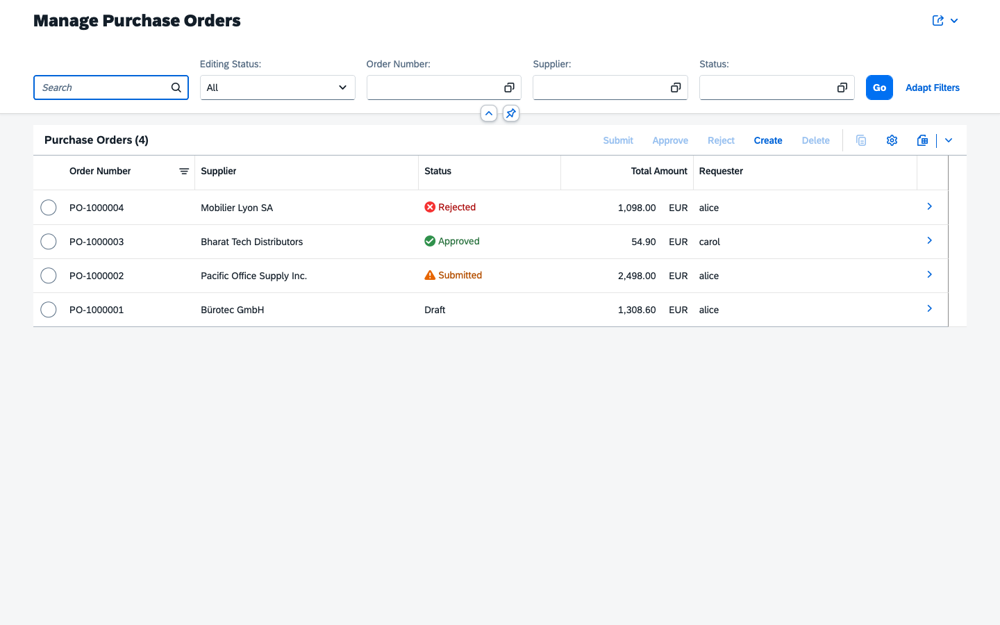
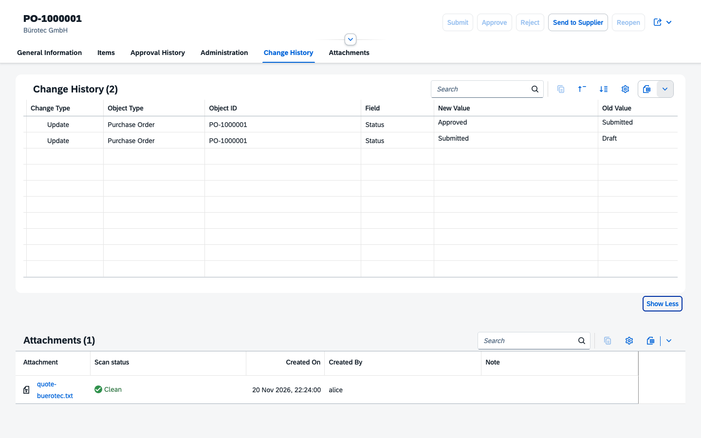

<!--
What: Entry point of the CAP complete guide repository: what it teaches, current build status,
    step-by-step learning path through the stages, how to install, run, test, diff and lint, and the
    exact procedure for building the pending stages, samples and the final app.
Why: [CAP-S04] / [CAP-S15] step 1 - the repository layout requires a root README as overview, index
    and "how to run stages"; contributors need one place that says what is done and what is next.
If missing or unlinked: Newcomers do not know where to start or how the stages relate, and
    contributors continue the guide without the conventions (headers, DoD, stage copying).
-->

# SAP CAP (Node.js) + Fiori Elements - Complete Guide

A hands-on learning path for the **SAP Cloud Application Programming Model (CAP)** on Node.js with
**SAP Fiori Elements**, built around one realistic domain - **ACME Procurement** (suppliers,
products, purchase orders with an approval workflow). Every stage is a standalone, runnable CAP
project that copies the previous stage and adds exactly one topic, so you can learn in order and
`diff` any two stages to see what a topic adds.

The master document is [CAP_DEVELOPMENT_GUIDE.md](CAP_DEVELOPMENT_GUIDE.md): concepts (modules
`[CAP-Mxx]`), decision rules (`[CAP-DEC-xx]`), stage specifications (`[CAP-STAGE-xx]`) and the
Definition of Done. This README tells you how to *use* the repository and how to *continue* it.

---

## Contents

1. [Build status](#1-build-status)
2. [Prerequisites](#2-prerequisites)
3. [Quick start](#3-quick-start)
4. [Repository layout](#4-repository-layout)
5. [Step-by-step learning path](#5-step-by-step-learning-path)
6. [Working with the repository](#6-working-with-the-repository)
7. [Continuing the guide - pending work](#7-continuing-the-guide---pending-work)
8. [How to build the next stage (procedure)](#8-how-to-build-the-next-stage-procedure)
9. [Conventions](#9-conventions)
10. [Troubleshooting](#10-troubleshooting)
11. [References](#11-references)

---

## 1. Build status

| # | Folder | Topic | Modules | Status | Tests |
|---|--------|-------|---------|--------|-------|
| 01 | [stage-01-basics](stage-01-basics) | project setup, first entity and service | M01, M04 | ✅ done | 3 |
| 02 | [stage-02-domain-modeling](stage-02-domain-modeling) | full domain model, CSV data (en/de) | M02 | ✅ done | 7 |
| 03 | [stage-03-services](stage-03-services) | ProcurementService (draft), AdminService | M03, M04 | ✅ done | 8 |
| 04 | [stage-04-custom-logic](stage-04-custom-logic) | handlers, actions, events, number range, remote S/4 BP (mocked) | M05-M08 | ✅ done | 21 |
| 05 | [stage-05-fiori-elements](stage-05-fiori-elements) | List Report / Object Page, annotations, custom section | M09, M10, M14 | ✅ done | 26 |
| 06 | [stage-06-security](stage-06-security) | roles, `@restrict`, instance-based auth, mocked users, XSUAA, approuter | M11 | ✅ done | 47 |
| 07 | [stage-07-data-persistence](stage-07-data-persistence) | SAP HANA Cloud (HDI), production build, native index, search, paging, perf check | M12, M13 | ✅ done | 55 |
| 08 | [stage-08-advanced-features](stage-08-advanced-features) | attachments, change tracking, audit log, privacy, outbox + idempotent consumers, S/4 BP replication, telemetry | M07, M08, M15-M19 | ✅ done | 73 |
| 09 | [stage-09-extensibility-mtx](stage-09-extensibility-mtx) | multitenancy (MTX sidecar, DB per tenant), tenant extensions with rules, extension project | M20, M21 | ✅ done | 80 |
| 10 | [stage-10-deploy-cicd](stage-10-deploy-cicd) | MTA (multitenant SaaS + HTML5 repo + BTP services), `.mtar` build, deploy script, runbook, CI/CD | M22, M23 | ✅ done | 90 |
| - | [samples](samples) | 7 focused standalone samples ([CAP-S07]) | M01-M03, M06-M10, M15, M18, M20 | ✅ done | 45 |
| - | [final-app](final-app) | clean merge of stages 01-10, feature → stage map | all | ✅ done | 90 |
| - | [docs](docs) | glossary, decision matrix, screenshots, DoD report | - | ✅ started | - |
| - | [.github/workflows/ci.yml](.github/workflows/ci.yml) | lint + tests on Node 22/24 | M23 | ✅ done | - |

Verified with `@sap/cds` 10.2.2, `@sap/cds-dk` 10.2.1, `@cap-js/sqlite` 3.1.3, Node 24/26, SAPUI5
1.148 LTS. Details of what is pending: [section 7](#7-continuing-the-guide---pending-work).

---

## 2. Prerequisites

| Tool | Version | Why | Install |
|------|---------|-----|---------|
| Node.js | 22 or 24 LTS (`.nvmrc` = 24) | runtime for CAP | <https://nodejs.org> or `nvm install && nvm use` |
| npm | 10+ (bundled) | workspaces | - |
| Git | any | clone, diff stages | - |
| `@sap/cds-dk` | 10.x | `cds` CLI | installed by `npm install` at the root (use `npx cds ...`); optional global: `npm i -g @sap/cds-dk` |
| VS Code + [SAP CDS Language Support](https://marketplace.visualstudio.com/items?itemName=SAPSE.vscode-cds) | optional | CDS syntax, navigation | - |
| VS Code [REST Client](https://marketplace.visualstudio.com/items?itemName=humao.rest-client) | optional | run `test/requests.http` | - |
| A browser + internet | - | Fiori UI loads UI5 from `ui5.sap.com` (stage 05+) | - |

Stages 01-05 need **no SAP BTP account and no database server** (SQLite in memory, mocked auth,
mocked S/4HANA). From stage 06 on, steps that deploy to SAP BTP need a BTP subaccount with Cloud
Foundry, SAP HANA Cloud and the `cf` CLI; every stage README marks such steps as *manual*.

---

## 3. Quick start

```sh
git clone <this-repo-url> cap-complete-guide
cd cap-complete-guide
nvm use                 # optional - selects Node 24 from .nvmrc
npm install             # installs ALL stages at once (npm workspaces)

npm test                # runs the tests of every stage (~5 s)

cd stage-05-fiori-elements
npm run watch           # = cds watch -> http://localhost:4004
```

Open <http://localhost:4004> for the service index and
<http://localhost:4004/procurement/webapp/index.html> for the Fiori app.
Stop the server with `Ctrl+C`. In development the mocked users are `alice`, `bob`, `carol` ...
with an empty password (from stage 06 each has a role - see [Users in development](#users-in-development)).

---

## 4. Repository layout

```
cap-complete-guide/
├─ README.md                    # this file
├─ CAP_DEVELOPMENT_GUIDE.md     # master guide: concepts, decisions, stage specs, DoD (RAG source)
├─ package.json                 # npm workspaces (stage-*, samples/*, final-app) + repo scripts
├─ package-lock.json            # one lock file for all workspaces
├─ .nvmrc                       # Node version for nvm (24)
├─ eslint.config.js             # ESLint + @sap/eslint-plugin-cds rules for every project
├─ .github/workflows/ci.yml     # CI: npm ci, lint, test on Node 22 + 24
├─ scripts/
│  ├─ copy-stage.js             # npm run next-stage  - copy stage N to N+1
│  ├─ check-file-headers.js     # part of npm run lint - every file needs What/Why/If missing
│  └─ dod-report.js             # npm run dod        - Definition-of-Done table -> docs/dod-report.md
├─ docs/                        # glossary, decision matrix, screenshots, DoD report
├─ stage-01-basics/ ... stage-10-deploy-cicd/      # the 10 stages
├─ samples/                     # 7 focused standalone samples
└─ final-app/                   # clean reference app (merge of all stages)
```

Every stage folder is a complete CAP project:

```
stage-NN-topic/
├─ README.md            # 13 sections: purpose, run, test, concepts, trade-offs, visuals, troubleshooting ...
├─ CHANGELOG-STAGE.md   # files added/changed vs the previous stage
├─ package.json         # own dependencies and scripts (watch, start, test) + cds config
├─ db/                  # domain model (*.cds) and initial data (data/*.csv)
├─ srv/                 # services (*.cds) and their implementation (*.js)
├─ app/                 # Fiori apps and UI annotations (stage 05+)
├─ _i18n/               # localized messages (stage 04+)
└─ test/                # node:test + cds.test tests, requests.http samples
```

---

## 5. Step-by-step learning path

Work through the stages in order. For each stage: **read** the module(s) in the master guide,
**read** the stage README, **run** it, **send** the sample requests, **read** the tests, then
**diff** it with the previous stage.

```mermaid
flowchart LR
 S1[01 Basics] --> S2[02 Modeling] --> S3[03 Services] --> S4[04 Logic] --> S5[05 Fiori] --> S6[06 Security] --> S7[07 HANA] --> S8[08 Advanced] --> S9[09 MTX/Ext] --> S10[10 Deploy/CI-CD] --> F[final-app]
 classDef done fill:#d4edda,stroke:#28a745;
 classDef todo fill:#fff3cd,stroke:#ffc107;
 class S1,S2,S3,S4,S5,S6,S7,S8,S9,S10,F done;
```



### Step 1 - Basics ([stage-01-basics](stage-01-basics/README.md)) · [CAP-M01], [CAP-M04]

You learn: the `db/` `srv/` `test/` convention, `cds watch`, CSV initial data, `cds.test`.

```sh
cd stage-01-basics
npm run watch
curl http://localhost:4004/odata/v4/catalog/Products
npm test
```

Look at: `db/schema.cds` (one entity), `srv/catalog-service.cds` (a `@readonly` projection),
`db/data/acme.procurement-Products.csv` (file name = `<namespace>-<Entity>.csv`).

### Step 2 - Domain modeling ([stage-02-domain-modeling](stage-02-domain-modeling/README.md)) · [CAP-M02]

You learn: `cuid` / `managed` aspects, **composition vs association**, enums, code lists,
`localized` texts, calculated elements, CSV data in two languages.

```sh
cd stage-02-domain-modeling
npx cds compile db --to sql        # see the generated tables and views
npm run watch
curl "http://localhost:4004/odata/v4/catalog/Products?sap-locale=de"
```

Look at: `db/schema.cds` - every relationship has a comment saying *why* it is a composition or
an association. Exercise: change `items` to an association and run the tests - what breaks?

### Step 3 - Services ([stage-03-services](stage-03-services/README.md)) · [CAP-M03], [CAP-M04]

You learn: one service per use case ([CAP-DEC-01]), projections, `@odata.draft.enabled`, the draft
round trip (`POST` → `draftActivate`), `$metadata`, `$expand`.

```sh
cd stage-03-services
npm run watch
# open test/requests.http in VS Code and click "Send Request" on 1-8
npm test
```

### Step 4 - Custom logic ([stage-04-custom-logic](stage-04-custom-logic/README.md)) · [CAP-M05]-[CAP-M08]

You learn: `before` / `on` / `after` handlers, draft events, validation with `req.error` /
`req.reject` and localized messages, bound actions as a state machine (409 on invalid
transitions), a four-eyes rule (403), functions, in-process events, consuming a remote OData V2
service (S/4HANA Business Partner) mocked from CSV.

```sh
cd stage-04-custom-logic
npm run watch                       # note "mocking API_BUSINESS_PARTNER" in the log
# requests.http 9-14: submit as alice, approve as bob, invalid transition in German, remote suppliers
npm test                            # 21 tests
```

Look at: `srv/procurement-service.js`, `srv/lib/status.js` (the state machine as a table),
`_i18n/messages*.properties`.

### Step 5 - Fiori Elements ([stage-05-fiori-elements](stage-05-fiori-elements/README.md)) · [CAP-M09], [CAP-M10], [CAP-M14]

You learn: List Report + Object Page from annotations, value helps, side effects, criticality,
action buttons with `Core.OperationAvailable`, i18n labels, a custom section (XML fragment).

```sh
cd stage-05-fiori-elements
npm run watch
open http://localhost:4004/procurement/webapp/index.html          # macOS; or paste into a browser
open "http://localhost:4004/procurement/webapp/index.html?sap-language=de"
npm test                            # 26 tests incl. annotation and draft UI flow
```

Try: Create → pick supplier → add item (price is defaulted, total refreshes) → Save → Submit →
open a private window, log in as `bob` → Approve. The README has an annotation → UI cheat sheet.



### Step 6 - Security ([stage-06-security](stage-06-security/README.md)) · [CAP-M11]

You learn: `@requires` and `@restrict` (role × operation), instance-based rules with `where:
'createdBy = $user'` (pushed into SQL), path conditions for child entities, mocked users per role,
401 vs 403 vs 404, XSUAA scopes/role templates (`cds add xsuaa`), the application router
(`cds add approuter`), and UI hints so Fiori shows only allowed buttons.

```sh
cd stage-06-security
npm run watch
# browser: log in as alice (Requester), bob (Approver), carol (Buyer), dave (Admin), erin (Auditor) - empty password
# requests.http 18-24: 401 / 404 / 403 cases
npm test                            # 47 tests incl. the role x operation matrix
```

Look at: `srv/authorizations.cds`, `test/authz.test.js` (the matrix), `xs-security.json`.

### Step 7 - Data persistence ([stage-07-data-persistence](stage-07-data-persistence/README.md)) · [CAP-M12], [CAP-M13]

You learn: SQLite in development vs SAP HANA Cloud in production (profiles), `cds build
--production` and the HDI deployment module, native HANA artefacts in `db/src` ([CAP-DEC-08]),
`@cds.search`, `@cds.query.limit`, the cost of `$count` / `$expand`, schema-evolution risks.

```sh
cd stage-07-data-persistence
npm run build                       # = cds build --production -> gen/db (HDI), gen/srv
npm run perf                        # timings of the Fiori queries on 20,000 orders
npm test                            # 55 tests incl. search, paging and the production build
```

Look at: `srv/query-options.cds`, `db/src/`, [docs/hana-notes.md](stage-07-data-persistence/docs/hana-notes.md)
(SQLite vs HANA, data-loss warning). Deploying to HANA is a *manual* step (needs BTP).

### Step 8 - Advanced features ([stage-08-advanced-features](stage-08-advanced-features/README.md)) · [CAP-M15]-[CAP-M19]

You learn: `@cap-js` plugins - attachments (upload/download, malware-scan status), change
tracking (`@changelog`, DB triggers, Change History facet), audit logging with `@PersonalData`,
telemetry; the transactional outbox (message commits/rolls back with the data), idempotent
consumers, replicating S/4HANA business partners ([CAP-DEC-05]) and using the local copy for a
business rule (blocked suppliers).

```sh
cd stage-08-advanced-features
NO_TELEMETRY=true npm run watch     # without NO_TELEMETRY: a trace per request
# requests.http 29-39: change history, attachments, notifications, replication, audit log
npm test                            # 73 tests incl. outbox commit/rollback and idempotency
```

Look at: `db/extensions.cds`, `db/change-tracking.cds`, `db/data-privacy.cds`, `srv/integration/`.



### Step 9 - Multitenancy & extensibility ([stage-09-extensibility-mtx](stage-09-extensibility-mtx/README.md)) · [CAP-M20], [CAP-M21]

You learn: when SaaS multitenancy pays off ([CAP-DEC-09]), the MTX sidecar, subscribing tenants
(one database each), tenant isolation, upgrading all tenants, tenant-specific extensions with
provider rules (`x_` prefix, allowlist) and the customer's extension project (`cds pull` / `cds push`).

```sh
cd stage-09-extensibility-mtx
npm run watch:sidecar               # terminal 1 (port 4005)
npm run subscribe && npm run watch:mtx   # terminal 2: tenants t1, t2; app on 4004
npm test                            # 80 tests incl. a two-tenant end-to-end run
```

Look at: `mtx/sidecar/package.json`, `ext-sample/`, `test/mtx.test.js`.

### Step 10 - Deployment & CI/CD ([stage-10-deploy-cicd](stage-10-deploy-cicd/README.md)) · [CAP-M22], [CAP-M23]

You learn: the MTA descriptor for a multitenant SaaS app (service, sidecar with tenant-upgrade
hook, approuter, HTML5 repository, BTP services), building the `.mtar` with `mbt`, deploying with
`cf deploy` (blue-green), operating with a runbook, and CI/CD pipelines with test gates.

```sh
cd stage-10-deploy-cicd
npm run build:mtar                  # -> mta_archives/procurement-stage-10_1.0.0.mtar (2-3 min)
npm test                            # 90 tests incl. static checks of mta.yaml, routes and workflows
# manual (BTP): cf login ... && npm run deploy  - see docs/runbook.md
```

Look at: `mta.yaml`, `scripts/`, `docs/runbook.md`, `.github/workflows/`.

### The final app ([final-app](final-app/README.md))

All stages merged into one clean reference with neutral names and a feature → stage → module
table. Use it as a template; use the stages to learn.

---

## 6. Working with the repository

### npm workspaces

The root `package.json` declares every stage, sample and `final-app` as a workspace, so one
`npm install` at the root installs everything (shared `node_modules`, one `package-lock.json`).
Each folder still has its own `package.json` and can be copied out as an independent project
(run `npm install` inside the copy).

| Task | Command (from the root) |
|------|-------------------------|
| install everything | `npm install` |
| test everything | `npm test` |
| test one stage | `npm test -w stage-04-custom-logic` |
| run one stage | `cd stage-04-custom-logic && npm run watch` (or `npm run watch -w stage-04-custom-logic`) |
| run with a fresh in-memory DB, mocks, other port | `cd <stage> && npx cds serve all --with-mocks --in-memory --port 4005` |
| lint (ESLint + CDS rules + file headers) | `npm run lint` |
| CDS lint for one stage | `cd <stage> && npx cds lint .` |
| Definition-of-Done report | `npm run dod` (all) / `npm run dod -- --only stage-05-fiori-elements` / `npm run dod -- --skip-tests` |
| start a new stage | `npm run next-stage -- <from> <to> "description"` |

### Compare two stages

```sh
git diff --no-index stage-03-services stage-04-custom-logic            # everything
git diff --no-index --stat stage-04-custom-logic stage-05-fiori-elements
git diff --no-index stage-04-custom-logic/srv stage-05-fiori-elements/srv
```

Each `CHANGELOG-STAGE.md` lists the same changes with the reason for each file.

### Sample requests

Every stage from 03 has `test/requests.http` (VS Code *REST Client* or IntelliJ HTTP client). Start
the stage with `npm run watch`, open the file, click **Send Request**. Requests that need a user
carry `Authorization: Basic alice:` (mocked auth, empty password).

### Tests

Tests use Node's built-in runner (`node --test`) with `cds.test` from `@cap-js/cds-test`, which
starts the stage in-process on a fresh in-memory SQLite database. Stages that use the remote
Business Partner API start with `cds.test(dir, '--with-mocks')`.

### Users in development

Stages 01-05: mocked authentication accepts any user name with an empty password (`alice:`,
`bob:`, `carol:`). From stage 06 only the configured users exist, each with a business role
(`package.json` → `cds.requires.auth.users`):

| User | Role(s) |
|------|---------|
| `alice`, `fred` | Requester |
| `bob` | Approver |
| `carol` | Buyer |
| `dave` | Admin |
| `erin` | Auditor |
| `gina` | Requester + Approver |

---

## 7. Continuing the guide - pending work

Checklist derived from [CAP_DEVELOPMENT_GUIDE.md](CAP_DEVELOPMENT_GUIDE.md) Sections 4, 6, 7 and 15.
Build in this order; each stage starts as a copy of the previous one.

### 7.1 Stages

- [x] **stage-06-security** ([CAP-STAGE-06], [CAP-M11], [CAP-DEC-07]) - done; notes below kept for reference
  - `srv/authorizations.cds`: `@requires: 'authenticated-user'` on the services; `@restrict` on
    `PurchaseOrders` per role (Requester: own orders `where: 'createdBy = $user'`; Approver:
    `READ`, `approve`, `reject`; Buyer: `READ`, `send`, master data; Admin: `*`; Auditor: `READ`
    incl. `ApprovalLog`); AdminService for Buyer/Admin.
  - `package.json`: `cds.requires.auth` mocked users per role (alice=Requester, bob=Approver,
    carol=Buyer, dave=Admin, erin=Auditor); `[production]` auth `xsuaa` (or `ias` - check docs).
  - `xs-security.json` (`cds add xsuaa`, scopes + role templates), `app/router/` (`xs-app.json`,
    approuter `package.json`), `test/authz.test.js` - role × operation matrix, 401 / 403.
  - README: role matrix, auth flow sequence diagram, dev vs prod auth, impact of missing restrictions.
- [x] **stage-07-data-persistence** ([CAP-STAGE-07], [CAP-M12], [CAP-M13], [CAP-DEC-08]) - done
  - `cds add hana` (`@cap-js/hana`, `[production]` db kind `hana`); `@cds.search` on POs and
    products; `@cds.query.limit`; optional native artefact in `db/src/`; performance test script;
    `docs/hana-notes.md`.
  - Acceptance: `cds build --production` creates `gen/db` with HDI artefacts; hybrid run
    (`cds bind`, `cds watch --profile hybrid`) documented as *manual* (needs BTP).
  - README: SQLite vs HANA differences, schema-evolution warning (`.hdbmigrationtable`), indexes.
- [x] **stage-08-advanced-features** ([CAP-STAGE-08], [CAP-M07], [CAP-M15]-[CAP-M19]) - done
  - Attachments (`@cap-js/attachments` or `LargeBinary` + `@Core.MediaType`), change tracking
    (`@cap-js/change-tracking`, `@changelog`), audit logging (`@cap-js/audit-logging`),
    `@PersonalData` on `SupplierContacts`, outbox for `POApproved` / remote calls, telemetry
    (`@cap-js/telemetry`), `srv/integration/` Business Partner replication handler (idempotent).
  - Acceptance: change history visible in the UI; outbox message persisted then delivered;
    attachment upload/download; idempotency test; screenshots.
- [x] **stage-09-extensibility-mtx** ([CAP-STAGE-09], [CAP-M20], [CAP-M21], [CAP-DEC-09]) - done
  - `cds add multitenancy` (`@sap/cds-mtxs`, sidecar), extensibility with `extension-allowlist`,
    sample extension project `ext-sample/`, `scripts/subscribe.sh` for local tenants.
  - Acceptance: local MTX with two tenants shows isolated data; extension field in tenant A only.
- [ ] **stage-10-deploy-cicd** ([CAP-STAGE-10], [CAP-M22], [CAP-M23])
  - `cds add mta,approuter,xsuaa,hana,html5-repo` (check facet names with `npx cds add --help`),
    `mta.yaml`, `scripts/deploy.sh`, `docs/runbook.md`, stage CI workflow.
  - Acceptance: `mbt build` produces an `.mtar`; deployment documented (manual without BTP); CI green.
  - README: deployment diagram, quotas, rollback (blue-green), post-deploy smoke tests.

### 7.2 Samples ([CAP-S07])

| Folder | Teaches | Module | Tests |
|--------|---------|--------|-------|
| [x] [samples/bookshop-minimal](samples/bookshop-minimal/README.md) | smallest CAP app | M01-M03 | 5 |
| [x] [samples/remote-bp](samples/remote-bp/README.md) | remote service + mock + replicate | M08 | 7 |
| [x] [samples/draft-workflow](samples/draft-workflow/README.md) | draft + actions + side effects | M03, M06, M09 | 8 |
| [x] [samples/outbox-events](samples/outbox-events/README.md) | outbox + idempotent consumer | M07, M18 | 6 |
| [x] [samples/multitenant-saas](samples/multitenant-saas/README.md) | MTX | M20 | 6 |
| [x] [samples/custom-fiori-section](samples/custom-fiori-section/README.md) | Fiori Elements extension | M10 | 6 |
| [x] [samples/attachments](samples/attachments/README.md) | media / files | M15 | 7 |

Each sample: own `package.json` (picked up by the `samples/*` workspace), README per template,
tests, `.gitignore`.

### 7.3 Final app and wrap-up ([CAP-STAGE-FINAL], [CAP-S15])

- [ ] `final-app/` - clean copy of stage 10 with a README: architecture, run locally, deploy to
  BTP CF, and a table *feature → stage → module*.
- [ ] `docs/images/` - screenshots for every UI stage (06+, final app, UI samples).
- [ ] Run `npm run dod` and commit `docs/dod-report.md` (pass/fail table for every folder).
- [ ] Report unverified assumptions (anything not checked against the live CAP docs) - each stage
  README's *Deviations from guide* section.
- [ ] Update the status table in [section 1](#1-build-status) and the learning path in
  [section 5](#5-step-by-step-learning-path) as stages are finished.

---

## 8. How to build the next stage (procedure)

The same loop for every stage ([CAP-S15] step 2). Example: stage 10 (the next pending one).

1. **Read the spec** - [CAP-STAGE-10] in Section 6 of the master guide and the modules it names
   ([CAP-M22], [CAP-M23]). Note the *Files*, *Acceptance* and *README must include* lists.
2. **Verify against the live docs** ([CAP-VERIFY]) - CAP changes quickly:
   ```sh
   npx cds version
   npx cds add --help          # available facets (xsuaa, ias, hana, mta, multitenancy, ...)
   ```
   Open the reference URL of the module. If docs and guide disagree, **the docs win** - record it
   under *Deviations from guide* in the stage README.
3. **Copy the previous stage**:
   ```sh
   npm run next-stage -- stage-09-extensibility-mtx stage-10-deploy-cicd \
     "ACME Procurement - stage 10: MTA deployment to SAP BTP Cloud Foundry and CI/CD."
   npm install                 # links the new workspace and updates package-lock.json
   ```
   The script skips `node_modules`, `gen/` and archives, and renames the package
   (`procurement-stage-10`) and the stage name in its header; local credential files
   (`default-env.json`, `.env`, `.cdsrc-private.json`) are not copied.
4. **Implement** the files from the spec. Prefer `cds add <facet>` where a facet exists, then adapt.
   Prefer CDS-native features over code ([CAP-AGENT] rule 6). No secrets, no real URLs - use
   environment variables / git-ignored `default-env.json` / `.env`.
5. **Give every new file a header** with `What:`, `Why:` and `If missing ...:` (see
   [Conventions](#9-conventions)).
6. **Write tests for each acceptance check** in `test/*.test.js`, then:
   ```sh
   npm test -w stage-10-deploy-cicd
   ```
7. **Document**: rewrite the copied `README.md` with all 13 template sections ([CAP-S08]) incl. at
   least one mermaid diagram; rewrite `CHANGELOG-STAGE.md` against the previous stage
   (`git diff --no-index --stat stage-09-extensibility-mtx stage-10-deploy-cicd`); update
   `test/requests.http`.
8. **UI stages**: capture screenshots to `docs/images/<folder>-<view>.png` (see [docs/README.md](docs/README.md)).
9. **Check the Definition of Done** ([CAP-S09]):
   ```sh
   npm run lint
   npm run dod -- --only stage-10-deploy-cicd
   ```
   All columns must be ✅ (or *n/a*).
10. **Update this README** (status table, learning path) and commit one stage per commit:
    ```sh
    git add -A && git commit -m "Stage 10: MTA deployment and CI/CD"
    ```

---

## 9. Conventions

| Convention | Rule | Checked by |
|------------|------|------------|
| File headers | every file starts with a comment containing `What:`, `Why:`, `If missing or unlinked:` (JSON: a `"//"` array; exceptions: CSV data, lock files, `.nvmrc`, `xs-security.json`, the master guide) | `npm run lint` (`scripts/check-file-headers.js`) |
| README template | 13 sections: Purpose, Module reference, Prerequisites, Folder structure, How to run, How to test, Key concepts, When to use / When not to use, Impact & trade-offs, Visuals, Deviations from guide, Troubleshooting, References | `npm run dod` |
| CHANGELOG-STAGE.md | per stage, table file → change → why | `npm run dod` |
| IDs | reference `[CAP-Mxx]`, `[CAP-DEC-xx]`, `[CAP-STAGE-xx]` from the master guide in headers and READMEs | review |
| Messages | user-facing errors are i18n keys in `_i18n/messages*.properties` (en + de) | tests |
| Data | CSV files use `;` and are named `<namespace>-<Entity>.csv`; translations `..._texts.csv` | `cds watch` |
| Package names | `procurement-stage-NN`; versions as caret ranges | `npm run next-stage` |
| `.gitignore` | `node_modules`, `gen`, `default-env.json`, `*.mtar`, `.env` in every project | `npm run dod` |
| Secrets | never committed; bindings / env vars only | `npm run dod` (secret scan) |
| Commits | one stage per commit: `Stage NN: <what was added>` | review |

---

## 10. Troubleshooting

| Symptom | Cause | Fix |
|---------|-------|-----|
| `npm error missing: procurement-stage-NN` / `ELSPROBLEMS` | new workspace not in the lock file | `npm install` at the root |
| `EADDRINUSE :4004` | another `cds watch` is running | stop it, or `npx cds watch --port 4005` |
| `No credentials configured for "API_BUSINESS_PARTNER"` | remote service not mocked | `cds watch` mocks automatically; in tests use `cds.test(dir, '--with-mocks')`; with `cds serve` add `--with-mocks` |
| Fiori page blank | no internet (UI5 from CDN) or browser blocks it | check network; open the browser console |
| `401` in development | request without user on a protected action | send `Authorization: Basic alice:` / log in with an empty password |
| `node:sqlite` errors | Node too old | use Node 22.13+ or 24 (`nvm use`) |
| header check fails | new file without `What:` / `Why:` / `If missing` | add the header comment |
| more | per stage | see the *Troubleshooting* section of each stage README and [CAP-S14] in the master guide |

---

## 11. References

- Master guide: [CAP_DEVELOPMENT_GUIDE.md](CAP_DEVELOPMENT_GUIDE.md) - index [CAP-S11], glossary
  ([docs/glossary.md](docs/glossary.md)), decision matrix ([docs/decision-matrix.md](docs/decision-matrix.md)),
  FAQ [CAP-S14]
- CAP documentation: <https://cap.cloud.sap/docs/>
- CAP guides: <https://cap.cloud.sap/docs/guides/>
- CAP Node.js runtime: <https://cap.cloud.sap/docs/node.js/>
- CAP plugins: <https://cap.cloud.sap/docs/plugins/>
- SAP Fiori elements / SAPUI5: <https://ui5.sap.com>
- SAP Fiori design guidelines: <https://experience.sap.com/fiori-design-web/>
- SAP Fiori tools: <https://help.sap.com/docs/SAP_FIORI_tools>
