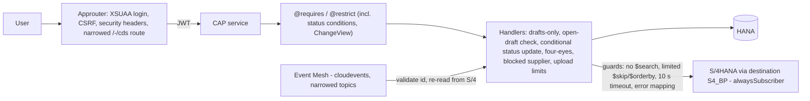

<!--
What: Security and S/4HANA-access guardrails of the ACME Procurement app: results of the code
    review (what was found and fixed, with the regression tests that prove it) and the prioritized
    checklist of guardrails that must be in place before production, including S/4HANA identity,
    connectivity, resilience and data protection.
Why: [CAP-M11] [CAP-M08] [CAP-M17] [CAP-M22] - the stages teach features one at a time; this page
    is the cross-cutting view an architect or security officer needs before go-live, and the
    checklist contributors walk through when they add features (README section 8, step 8).
If missing or unlinked: Fixed findings lose their context, and the open production guardrails
    (destinations, principal propagation, Event Mesh rules, CI secrets ...) are easy to forget.
-->

# Security and S/4HANA access guardrails

Scope: `final-app/` (all application code), the stages where the same code first appears, and the
samples. Reviewed on 2026-11-21/22 with three independent read-only reviews (application security,
S/4HANA access, correctness), each finding reproduced against the running app before it was fixed.
Versions: `@sap/cds` 10.2.2, `@cap-js/attachments` 4.0.0, `@cap-js/change-tracking` 2.2.3,
SAP Cloud SDK 4.10.

Legend: **Fixed** = changed in code and covered by a regression test in `test/guardrails.test.js`
(or the sample's tests). **Required** = must be done in configuration, BTP or S/4HANA before
production - it cannot be verified without those systems.

---

## 1. Findings fixed in code

### 1.1 Application security

| # | Severity | Finding (before) | Fix | Where | Test |
|---|----------|------------------|-----|-------|------|
| S1 | High | A requester could `DELETE` an item of their **approved** order (204) - the order kept its old total; attachments could be added/deleted after submission | item writes only while `parent.status = 'Draft'`; direct deletes of active items refused (409); attachment writes refused unless the order is a Draft | `srv/authorizations.cds`, `srv/procurement-service.js` | *items and attachments are frozen after submission* |
| S2 | Medium | `/PurchaseOrders(<other user's order>)/changes` returned the change history (values, approver IDs) to a requester who cannot read the order | `@restrict` on `sap.changelog.ChangeView`: Approver, Buyer, Admin, Auditor only | `srv/authorizations.cds` | *does not show the change history ...* |
| S3 | Medium | Mocked users with empty passwords (incl. an Admin) were part of the production configuration (`cds env --profile production`); safety depended on `NODE_ENV` alone | mocked users moved to `[development]`; startup guard refuses to start on Cloud Foundry unless auth is `xsuaa` | `package.json`, `srv/lib/startup-guard.js` | *ships mocked users only in development*, *refuses to start ...* |
| S4 | Medium | Attachments accepted any type and 400 MB - HTML/script files could be uploaded | `@Validation.Maximum: '10MB'`, `@Core.AcceptableMediaTypes` (PDF, images, text, Office) | `db/extensions.cds` | *accepts only allowed attachment types* |
| S5 | Medium | Approuter route `^/-/cds/.*` without approuter authentication exposed the whole sidecar API on every tenant host | narrowed to `^/-/cds/(login\|extensibility)/.*` (what `cds pull/push` need) | `.deploy/app-router/xs-app.json` | *hardens ... for production* |
| S6 | Medium | No security headers | `httpHeaders`: `X-Frame-Options: DENY`, `X-Content-Type-Options: nosniff`, HSTS, `Referrer-Policy`; `SESSION_TIMEOUT: 30` | `mta.yaml` (approuter) | *hardens ... for production* |
| S7 | Medium | A forged "order approved" message created a "send to supplier" notification for any order | consumer re-reads the order and acts only if it is `Approved`/`SentToSupplier`; order number from the DB | `srv/integration/approval-notifications.js` | *does not trust the payload* (advanced tests) |
| S8 | Medium | Event Mesh `subscribeFilter: ["*"]` - the app could read every namespace of the broker | `["${namespace}/*", "sap/S4HANAOD/*"]` | `event-mesh.json` | *hardens ... for production* |
| S9 | Low | Four-eyes rule covered `approve` only - a Requester+Approver could `reject` their own order | rule applies to `approve` and `reject` | `srv/procurement-service.js` | *applies the four-eyes rule to reject* |
| S10 | Low | User IDs in logs and notification texts | removed (approver ID no longer logged or embedded) | `srv/procurement-service.js`, consumer | - |
| S11 | Medium (sample) | `samples/attachments`: size/type checks ran only on `PUT .../content`; a JSON `POST` with base64 content or a `PATCH` of `mimeType` bypassed them | content only via the media path; `mimeType` validated on every write; size reset on removal | `samples/attachments/srv/document-service.js` | `test/metadata.test.js` |
| S12 | Medium (sample) | `samples/remote-bp`: replication actions callable without login | service `@requires: 'authenticated-user'`, actions `@requires: 'admin'` | `samples/remote-bp/srv/partner-service.cds` | `test/guardrails.test.js` |

### 1.2 Business integrity and correctness

| # | Severity | Finding (before) | Fix | Test |
|---|----------|------------------|-----|------|
| C1 | High | Saving an edit draft **reverted** a status change made meanwhile by an action (approve → draft saved → back to Submitted, approval log says Approved) | status actions refused (409 `ORDER_BEING_EDITED`) while an edit draft exists; same in `samples/draft-workflow` | *refuses status actions while an edit draft is open* |
| C2 | High (sample) | `samples/draft-workflow`: approved reports could be edited (Edit → change amount → Save) | `before('EDIT')` allows drafts only; `UI.UpdateHidden/DeleteHidden` for non-drafts | sample tests |
| C3 | Medium | Check-then-update race in status actions (two decisions could both succeed on HANA) | conditional `UPDATE ... WHERE status = <read status>`; 409 if nothing changed (also in `outbox-events`, `draft-workflow`) | *lets exactly one of two concurrent decisions win* (SQLite serialises - the guard matters on HANA) |
| C4 | Medium | Blocked supplier checked only on create/edit - approve and send still worked | check also in `submit`, `approve`, `send` | *checks the supplier block in approve and send* |
| C5 | Medium | `topSuppliers` grouped by **name** and summed **mixed currencies** | grouped by supplier ID, name and currency; returns `supplierID`, `currency` | *ranks suppliers by ID and currency* |
| C6 | Low | Items without quantity could be submitted (total 0) | submit requires quantity ≥ 1 on every item | *refuses to submit items without a quantity* |
| C7 | Low | Status buttons enabled inside an open draft (409 on click); Edit/Delete hint stale after actions | `Core.OperationAvailable` also requires `IsActiveEntity`; side effects refresh `canEdit` | checked in the UI |
| C8 | Info | Number range documented as "gap-free" | wording corrected: sequential and collision-free, discarded drafts leave gaps | - |
| C9 | Low (sample) | `bookshop-minimal`: books with a non-existing author | `@assert.target` | sample test |

### 1.3 S/4HANA access

| # | Severity | Finding (before) | Fix | Test |
|---|----------|------------------|-----|------|
| B1 | High | Replication skipped same-day changes (`LastChangeDate` has day precision) - a block set later the same day never arrived, orders kept flowing to a blocked supplier | stale only if S/4 is *older*; on the same day re-read and compare content | *replicates a block set later on the same day* (app and `remote-bp`) |
| B2 | High | Multitenant destination lookup used the default `subscriberFirst` strategy - a tenant without own `S4_BP` silently used the **provider's** S/4 | `destinationOptions.selectionStrategy: 'alwaysSubscriber'` | *hardens ... for production* |
| B3 | High | Sidecar did not declare the destination service as subscription dependency | `cds.requires.destinations: true` in `mtx/sidecar/package.json` | *hardens ... for production* |
| B4 | High | Production messaging without `format: 'cloudevents'` - S/4 business-partner events (CloudEvents topics) would never match | `[production]` messaging `format: 'cloudevents'` | *hardens ... for production* |
| B5 | Medium | Remote calls waited 60 s (CAP default) - longer than the approuter timeout | `credentials.requestTimeout: 10000` | *hardens ... for production* |
| B6 | Medium | Every remote error became 502 - S/4 403 or a bad query looked like an outage; full error (with URL incl. filter values) logged | mapped: 400 → 400, 401/403 → 403, timeout → 504, else 502; only status/code logged | - |
| B7 | Medium | Clients could push `$search` (S/4 full-text), deep `$skip`, `$orderby` on any field to S/4 | `$search`, `$skip > 1000` and sorting on fields other than `ID`/`name` rejected (400); `@cds.query.limit {20, 50}` on `RemoteSuppliers` | *rejects query options that would make S/4HANA scan* |
| B8 | Medium | Full load read all partners (persons too) in one unbounded call | paged (500), organisations only (`BusinessPartnerCategory = '2'`) | existing replication tests |
| B9 | Low | Event payload not validated | partner number must match `^\d{1,10}$`; data is always re-read from S/4 | - |

---

## 2. How the guardrails are enforced



Run the checks:

```sh
npm test -w final-app                     # incl. test/guardrails.test.js (17 tests)
npx cds env requires --profile production # in final-app: xsuaa, no users, S/4 timeout + alwaysSubscriber, cloudevents
npm run lint                              # ESLint + CDS lint + file headers
```

---

## 3. Guardrails required before production

Ordered by priority. Items marked ⚠ are blockers.

### 3.1 S/4HANA access

1. ⚠ **Decide and configure the identity towards S/4HANA** - two destinations:

   | Destination | Used by | Authentication | Effect |
   |-------------|---------|----------------|--------|
   | `S4_BP` | live reads (`RemoteSuppliers`) on behalf of the user | **principal propagation**: `PrincipalPropagation` (on-premise via Cloud Connector) or `OAuth2SAMLBearerAssertion` (S/4HANA Cloud) | S/4 enforces the user's own roles and business-partner authorization groups |
   | `S4_BP_TECH` (to add) | replication (events, full load) - no user token exists there | `OAuth2ClientCredentials` or `ClientCertificateAuthentication`; communication arrangement **SAP_COM_0008**, read-only, restricted to supplier business partners | least-privilege technical access, auditable in S/4 |

   Code change for the second destination: a second `cds.requires` entry (e.g.
   `API_BUSINESS_PARTNER_TECH` with the same `model` and `[production].credentials.destination:
   'S4_BP_TECH'`) used by `srv/integration/bp-replication.js`.
2. ⚠ **Destination per tenant** - each consumer subaccount defines its own `S4_BP` (the app never
   falls back to the provider's, B2). Destination URL = host only (the service path is in
   `package.json`); set `sap-client` as destination property where needed.
3. ⚠ **On-premise S/4HANA** - add the Connectivity service (`connectivity`, plan `lite`) to
   `mta.yaml`, bind it to `-srv` and `-mtx`, add `"connectivity": true` to the sidecar `cds.requires`,
   and expose only `/sap/opu/odata/sap/API_BUSINESS_PARTNER` in the Cloud Connector (no `/` prefix).
4. **Run replication in the tenant's context** - events and jobs carry no user; process them per
   tenant (`cds.spawn({ tenant })` / `cds.tx({ tenant })`) so the subscriber destination and database
   are used. Verify tenant routing of inbound S/4 events with your Event Mesh plan.
5. **Resilience** - keep `requestTimeout` below the approuter timeout; add a circuit breaker around
   `bp.run` (e.g. `circuitBreaker` from `@sap-cloud-sdk/resilience`); retry only idempotent reads,
   replication retries through the outbox.
6. **Full load as a background job** - run `replicateAll` via the outbox or SAP Job Scheduling
   (return 202), one transaction per page, with counters for failed partners; better read
   `A_Supplier` / supplier roles (FLVN00/FLVN01) instead of all organisations; also handle
   `LastChangeTime` and supplier-specific blocks (`A_Supplier` purchasing/posting block).
7. **Event Mesh** - adapt `sap/S4HANAOD/*` in `event-mesh.json` to the namespace of your S/4 system;
   configure the S/4 topic prefix for CAP messaging; add a dead-message queue, maximum redelivery and
   alerting.
8. **Data minimization** - replicate organisations with supplier role only (done for category);
   if persons are ever replicated: `@PersonalData` on `Suppliers.name` (`IsPotentiallyPersonal`) and
   `bpNumber` (`DataSubjectID`); reconcile deletions / end-of-purpose blocks from S/4.
9. **Writes to S/4** (if added later) - enable CSRF (`"csrf": true, "csrfInBatch": true` on the
   `cds.requires` entry) and use a write-scoped communication arrangement.
10. **Rate limiting** - limit calls of `RemoteSuppliers` per user at the approuter / API management.
11. **Mock data** - `srv/external/data/*.csv` ends up in `gen/srv`; exclude it from the production
    build (move the mock data to `test/` or a build `ignore`).

### 3.2 Authentication, authorization and tenants

1. ⚠ **Role collections** - assign `Requester`, `Approver`, `Buyer`, `Admin`, `Auditor` in each
   consumer subaccount; treat `ExtensionDeveloper` as an **admin-level** role (see 3.2.4).
2. ⚠ **Custom domain and redirect URIs** - replace `https://*~{app-uri}/**` with
   `https://*.<custom-domain>/**`; on a shared `cfapps` domain anyone can map a matching host.
   Escape the dots in `TENANT_HOST_PATTERN`.
3. **Trim XSUAA `authorities`** - remove `$XSAPPNAME.cds.ExtensionDeveloper` and
   `$XSAPPNAME.mtcallback` from the app's own client unless an app-to-sidecar call needs them (a
   leaked binding secret would allow pushing extensions or subscribing tenants); prefer x509
   credentials only.
4. **Extension validator** - the allowlist cannot forbid association/composition fields or
   annotation overrides. Add a custom `cds.xt.ExtensibilityService` handler that rejects
   `Association`/`Composition` elements and overrides of `@PersonalData*`, `@restrict`,
   `@requires`, `@cds.*`, `@changelog`, `@assert*`, `@mandatory`, `@readonly` (reviewed: an
   extension could expose `SupplierContacts` via a new association, or switch off privacy
   annotations for its tenant).
5. **Draft administrative data** - `.../DraftAdministrativeData` of another user's draft is
   readable (user IDs of the draft owner); add a `before READ` check on the owning root if this
   matters for you.
6. **Internal service** - keep `IntegrationService` at `@protocol: 'none'`; never expose it.

### 3.3 Data protection and audit

1. **User IDs are personal data** - annotate `ApprovalLog.approver`, `managed` fields
   (`createdBy`, `modifiedBy`) and change-log users according to your data-protection concept.
2. **Retention** - define deletion periods for `ApprovalLog`, `Notifications`,
   `sap.changelog.Changes`, attachments and the outbox table; schedule the deletion.
3. **Audit log** - bind the Audit Log service (done in `mta.yaml`); verify in the Audit Log Viewer
   that `PersonalDataModified` arrives for supplier contacts; mark truly sensitive fields
   `IsPotentiallySensitive` if read access must be logged.
4. **Malware scanning** - keep `scan: true` (production default); scanning does not detect HTML or
   scripts - the MIME allowlist (S4) does.

### 3.4 Supply chain and CI/CD

1. ⚠ **Protect production deployments** - GitHub *Environments* with required reviewers for
   `Production`, deploy only from `main`/release tags; use a technical CF user, never a personal
   password; prefer OIDC/short-lived credentials.
2. **Pin what runs with secrets** - pin GitHub actions by commit SHA (`cap-js/cf-setup`,
   `actions/*`), pin the `mbt` version in `scripts/build-mtar.sh`, commit a lock file and use
   `npm ci` in the pipelines of the stand-alone app.
3. **Dependency hygiene** - keep `npm audit` / Dependabot on; avoid open ranges like `>=`.
4. **Secrets** - never commit `default-env.json`, `.env*`, `.cdsrc-private.json` (all git-ignored;
   `npm run dod` scans for keys, client secrets and passwords in JSON, YAML and `.env` form).

### 3.5 Operations

1. Run the smoke tests of the [runbook](../stage-10-deploy-cicd/docs/runbook.md#4-smoke-tests-after-every-deployment)
   after every deployment.
2. Alert on: outbox rows older than N minutes, 502/504 rates of `RemoteSuppliers`, failed tenant
   upgrades, dead-message queue size.
3. Test tenant upgrades with an **extended** tenant before rolling out model changes.

---

## 4. Accepted limitations (by design or low risk)

| Item | Why accepted |
|------|--------------|
| Concurrency test passes on SQLite also without the fix | SQLite serialises writes; the conditional update protects HANA |
| Drafts-only guard relies on the CQN shape of `draftActivate` (`req.subject.ref[0].where`) | covered by tests; re-check on every `@sap/cds` upgrade |
| Virtual elements (`statusCriticality`, `canEdit`) cannot be filtered/sorted and are not computed in `$expand` | UI hints only; filtering on them answers an error |
| Deep create of a draft with items (API clients only) skips price defaulting | Fiori never deep-creates; activation computes the total |
| Order numbers can have gaps (discarded drafts) | documented; draw at activation if required |
| Create button visible for roles that cannot create | role-based app assignment in the launchpad (see stage 06) |

## 5. References

- https://cap.cloud.sap/docs/guides/security/
- https://cap.cloud.sap/docs/guides/using-services#using-destinations
- https://cap.cloud.sap/docs/guides/multitenancy/#dependencies
- https://cap.cloud.sap/docs/guides/messaging/event-mesh
- https://cap.cloud.sap/docs/guides/extensibility/customization#restrictions
- https://sap.github.io/cloud-sdk/docs/js/features/connectivity/destinations
- https://help.sap.com/docs/btp (Connectivity, Destination, Cloud Connector, Event Mesh, XSUAA)
- SAP Business Accelerator Hub: Business Partner (A2X) API, communication scenario SAP_COM_0008
