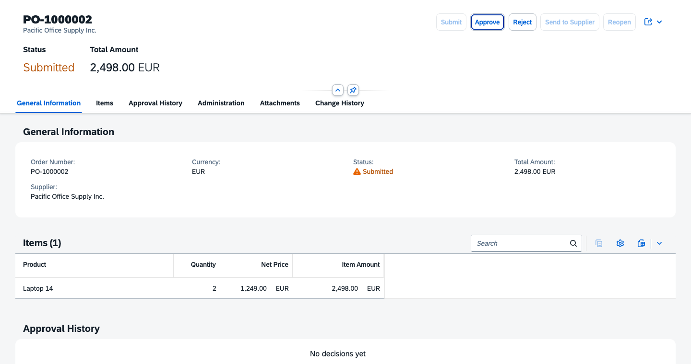
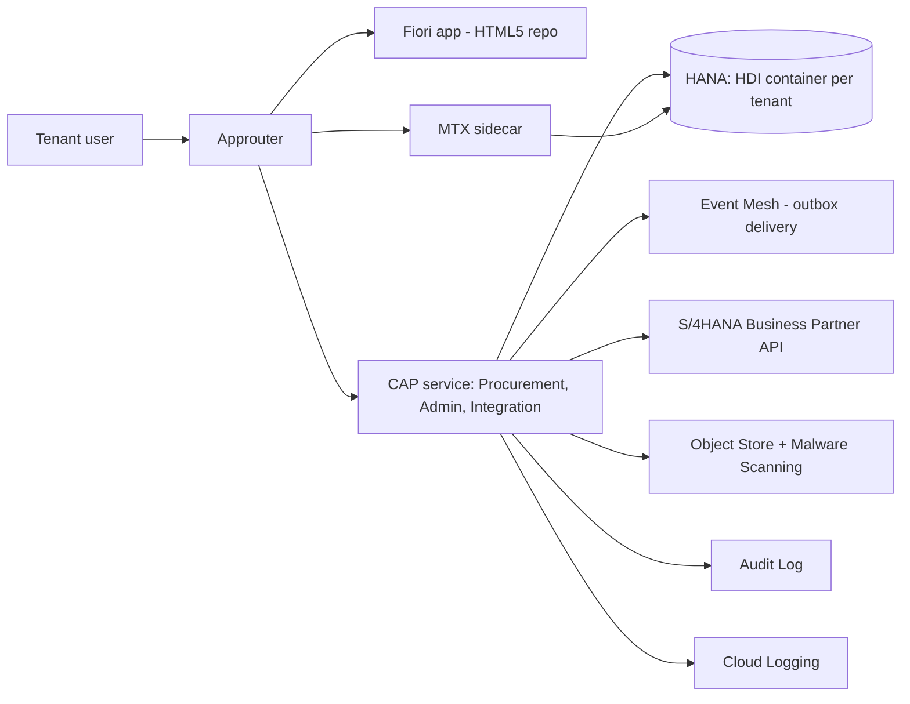
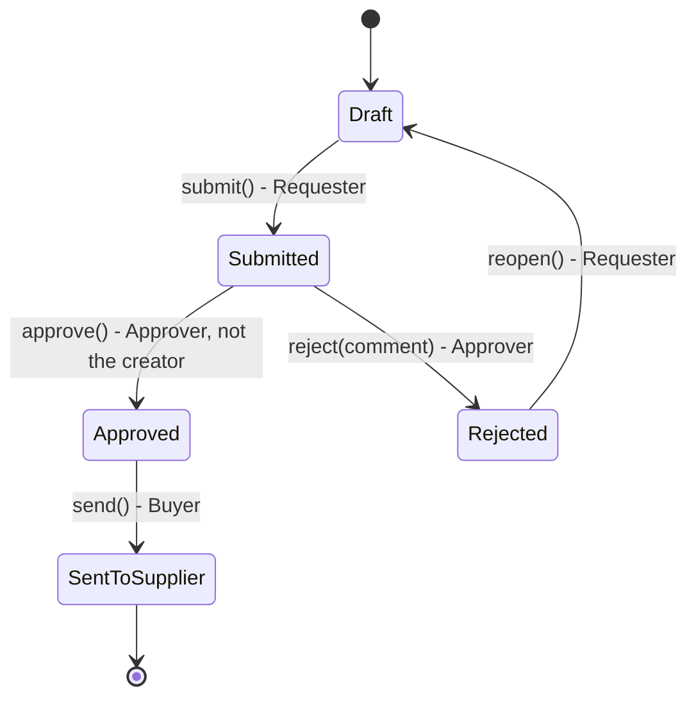

<!--
What: README of the final ACME Procurement reference app: architecture, how to run it locally
    (single- and multitenant), how to deploy it to SAP BTP Cloud Foundry, and a map from every
    feature to the stage and module where it is taught.
Why: [CAP-STAGE-FINAL] the final app is the merge of stages 01-10 as one clean reference; its README
    is the entry point for people who want the result, not the learning path.
If missing or unlinked: The reference app is a large folder without orientation, and the DoD report
    marks it incomplete.
-->

# ACME Procurement - final reference app

## Purpose

The complete result of the guide in one project: a multitenant SAP CAP (Node.js) + SAP Fiori
Elements app for purchase orders with approval workflow, ready to deploy to SAP BTP Cloud Foundry.
It is identical in behaviour to [stage 10](../stage-10-deploy-cicd/README.md), with neutral names
(`acme-procurement` in the MTA) and without stage changelogs. Learn *why* each part exists in the
stage READMEs linked in [Key concepts](#key-concepts).

## Module reference

All modules [CAP-M01]-[CAP-M24] of [CAP_DEVELOPMENT_GUIDE.md](../CAP_DEVELOPMENT_GUIDE.md); see the
feature map below.

## Prerequisites

| Tool | Version | For |
|------|---------|-----|
| Node.js | 22 or 24 LTS | everything |
| `npm install` at the repository root | - | dependencies (npm workspaces) - or `npm install` here after copying the folder out |
| browser + internet | - | Fiori UI (SAPUI5 1.148 from the CDN) |
| `make`, network | - | `npm run build:mtar` |
| SAP BTP subaccount, `cf` CLI + MultiApps plugin | - | deployment ([docs/runbook.md](docs/runbook.md)) |

## Folder structure

```
final-app/
├─ db/                     # domain model, number ranges, extensions, change tracking, privacy, native HANA index
├─ srv/                    # ProcurementService, AdminService, IntegrationService, authorizations, query options
│  ├─ lib/                 #   status machine, number range, totals, permissions
│  ├─ integration/         #   S/4HANA BP replication, approval-message consumer
│  └─ external/            #   imported S/4HANA Business Partner API + mock data
├─ app/procurement/        # Fiori Elements app (annotations, manifest, custom section, UI5 build)
├─ _i18n/, app/_i18n/      # messages and labels (en, de)
├─ mtx/sidecar/            # MTX sidecar: tenants, upgrades, extension rules
├─ ext-sample/             # sample tenant extension project
├─ .deploy/app-router/     # approuter
├─ mta.yaml, xs-security.json, event-mesh.json   # deployment descriptor and service configuration
├─ scripts/                # subscribe.sh (local tenants), build-mtar.sh, deploy.sh
├─ docs/runbook.md         # operations
├─ .github/workflows/      # test, deploy, release pipelines (active when this folder is its own repo)
└─ test/                   # 108 tests + requests.http + perf benchmark
```

## How to run

```sh
cd final-app
npm run watch                         # single-tenant, SQLite in memory, mocked users and S/4HANA
```

Open <http://localhost:4004/procurement/webapp/index.html>, log in with an empty password as
`alice` (Requester), `bob` (Approver), `carol` (Buyer), `dave` (Admin), `erin` (Auditor).

Multitenant (like production):

```sh
npm run watch:sidecar                 # terminal 1 - MTX sidecar on 4005
npm run subscribe && npm run watch:mtx    # terminal 2 - tenants t1, t2; app on 4004
```

Deploy to SAP BTP Cloud Foundry (*manual*, see [docs/runbook.md](docs/runbook.md)):

```sh
npm run build:mtar                    # mta_archives/acme-procurement_1.0.0.mtar
cf login -a <api-endpoint> --sso
npm run deploy                        # STRATEGY=blue-green npm run deploy for zero downtime
```



## How to test

```sh
npm test            # 108 tests (incl. 17 guardrail regression tests): logic, actions, authorization, UI annotations, persistence, plugins, outbox, MTX, deployment
npm run perf        # query timings on 20,000 orders
npx cds lint .
```

## Key concepts

Feature → where it is taught:

| Feature | Files here | Stage | Module |
|---------|-----------|-------|--------|
| project setup, `cds watch`, CSV data, `cds.test` | `package.json`, `db/data/`, `test/` | [01](../stage-01-basics/README.md) | M01, M04 |
| domain model: compositions, associations, enums, code lists, localized, calculated | `db/schema.cds` | [02](../stage-02-domain-modeling/README.md) | M02 |
| services per use case, projections, draft | `srv/procurement-service.cds`, `srv/admin-service.cds` | [03](../stage-03-services/README.md) | M03 |
| handlers, validation, localized messages, number range | `srv/procurement-service.js`, `srv/lib/`, `_i18n/` | [04](../stage-04-custom-logic/README.md) | M05 |
| bound actions as state machine, four-eyes rule, function | `srv/lib/status.js`, `changeStatus()` | [04](../stage-04-custom-logic/README.md) | M06 |
| in-process event `POApproved` | `srv/procurement-service.*` | [04](../stage-04-custom-logic/README.md) | M07 |
| remote S/4HANA API: import, mock, delegation | `srv/external/`, `RemoteSuppliers` | [04](../stage-04-custom-logic/README.md) | M08 |
| Fiori Elements List Report / Object Page, value helps, side effects, criticality | `app/procurement/annotations.cds` | [05](../stage-05-fiori-elements/README.md) | M09, M14 |
| custom section (approval history) | `app/procurement/webapp/ext/` | [05](../stage-05-fiori-elements/README.md) | M10 |
| roles, `@restrict`, instance-based authorization, XSUAA, approuter, UI hints | `srv/authorizations.cds`, `srv/lib/permissions.js`, `xs-security.json`, `.deploy/app-router/` | [06](../stage-06-security/README.md) | M11 |
| HANA, HDI build, native index, search, paging, performance | `db/src/`, `srv/query-options.cds`, `test/perf/` | [07](../stage-07-data-persistence/README.md) | M12, M13 |
| attachments, change tracking, audit log, privacy | `db/extensions.cds`, `db/change-tracking.cds`, `db/data-privacy.cds` | [08](../stage-08-advanced-features/README.md) | M15-M17 |
| transactional outbox, idempotent consumers, BP replication, telemetry | `srv/integration/`, `cds.requires.messaging` | [08](../stage-08-advanced-features/README.md) | M07, M08, M18, M19 |
| multitenancy (sidecar, DB per tenant), tenant extensions with rules | `mtx/sidecar/`, `ext-sample/`, `test/mtx.test.js` | [09](../stage-09-extensibility-mtx/README.md) | M20, M21 |
| MTA, HTML5 repository, BTP services, build/deploy scripts, runbook, pipelines | `mta.yaml`, `scripts/`, `docs/runbook.md`, `.github/workflows/` | [10](../stage-10-deploy-cicd/README.md) | M22, M23 |
| testing pyramid: unit, integration, end-to-end processes, static deployment checks | `test/` | all | M24 |

## When to use / When not to use

Use it as a **reference and template** for CAP + Fiori Elements SaaS apps on Cloud Foundry, or to
look up how a feature is wired in context. To **learn**, follow the stages - each adds one topic
with the reasoning. For a single-customer app, start from stage 08 instead (no MTX overhead,
[CAP-DEC-09]).

## Impact & trade-offs

Everything of stages 06-10 applies: ~11 BTP service instances (HANA Cloud the largest), one HDI
container per tenant, three apps plus upgrade tasks, schema changes rolled out to all tenants,
extension contracts with customers. Details: [decision matrix](../docs/decision-matrix.md) and the
*Impact & trade-offs* sections of the stage READMEs.

## Visuals





## Deviations from guide

Same as stages 01-10 (each stage README lists its deviations). Specific to the final app: the MTA
ID, modules and services are named `acme-procurement*` instead of `procurement-stage-10*`; the
extension project extends `procurement-final-app`. Not verified on BTP (no access while writing):
deployment, subscriptions and the bound BTP services - see stage 10.

## Troubleshooting

| Symptom | Fix |
|---------|-----|
| any startup or test problem | see the *Troubleshooting* section of the stage that introduced the feature (table above) |
| `EADDRINUSE :4004` / `:4005` | stop the other `cds watch` / sidecar, or use `--port` |
| very noisy console | `NO_TELEMETRY=true npm run watch` |
| `Cannot find module '@opentelemetry/...'` | `rm -rf node_modules` here and run `npm install` at the repository root |
| deployment | [docs/runbook.md § 8](docs/runbook.md#8-incidents) |

## References

- [CAP_DEVELOPMENT_GUIDE.md](../CAP_DEVELOPMENT_GUIDE.md) and [docs/](../docs/README.md)
- https://cap.cloud.sap/docs/
- https://ui5.sap.com
- https://help.sap.com/docs/btp
