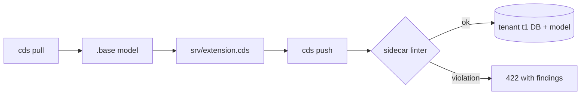

<!--
What: Guide for the sample tenant extension project: how a subscriber pulls the base model,
    writes an extension and pushes it to its own tenant.
Why: [CAP-M21] / [CAP-STAGE-09] "sample extension project ext-sample/" - the customer side of
    extensibility, complementing the provider configuration in ../mtx/sidecar/package.json.
If missing or unlinked: Learners see the extension file but not the pull / install / push cycle.
-->

# ext-sample - a tenant extension

## Purpose

What a *subscriber* of the SaaS app does to add their own fields: this project adds a **delivery
note** to purchase orders and shows it on the object page - for the tenant it is pushed to only.

## Module reference

- [CAP-M21 Extensibility](../../CAP_DEVELOPMENT_GUIDE.md#cap-m21-extensibility)

## Prerequisites

The multitenant app running locally (see [stage 09 README](../README.md#how-to-run)): sidecar on
port 4005 with tenant `t1` subscribed. User `dave` (tenant t1) has the role
`cds.ExtensionDeveloper`.

## Folder structure

```
ext-sample/
├─ package.json        # "extends": "procurement-stage-09", workspace .base
├─ srv/extension.cds   # the extension: x_deliveryNote + UI annotation
├─ .gitignore          # .base, node_modules, gen
└─ .base/              # created by cds pull - the tenant's current base model (not committed)
```

## How to run

```sh
cd stage-09-extensibility-mtx/ext-sample
npx cds pull --from http://localhost:4005 -u dave:   # base model -> .base/
npm install                                           # links .base as package procurement-stage-09
npx cds push --to http://localhost:4005 -u dave:      # build gen/extension.tgz, validate, activate
```

Expected: `Pushing extension 'ext-sample' ... Activation succeeded.` About 10 s later (tenant model
check interval) the object page of tenant t1 shows **Delivery Note** in *General Information*;
tenant t2 does not.

## How to test

Covered by `../test/mtx.test.js` (same extension pushed via the Extensions API). Manually:
`GET http://localhost:4004/odata/v4/procurement/$metadata` as `dave` contains `x_deliveryNote`, as
`erin` (t2) it does not.

## Key concepts

- `using from 'procurement-stage-09'` refers to the **pulled** base model, not to the provider's
  sources - the extension compiles against what the tenant really runs.
- `extend ... with { x_... }` adds elements; `annotate ... { Data: [ ..., {...} ] }` appends to an
  existing UI annotation (the `...` keeps the provider's entries).
- `cds push` runs the provider's linter in the sidecar first (prefix, allowlist, blocklist).

## When to use / When not to use

Use for customer-specific fields, UI tweaks and small entities. Do not use for logic that must
run for every customer (change the app) or to bypass provider rules.

## Impact & trade-offs

The provider must keep extended entities stable (renames break tenant extensions); every push
changes the tenant's database schema.

## Visuals



## Deviations from guide

Generated with `cds init ext-sample --add extension`; the generated `.vscode/`, `eslint.config.mjs`
and `readme.md` were dropped (the repository's ESLint config applies).

## Troubleshooting

| Symptom | Cause | Fix |
|---------|-------|-----|
| `The SaaS application base model is missing` | `.base` not linked | `cds pull`, then `npm install` |
| `403 lacking required roles` | user is no extension developer | use `dave` (t1) |
| `422 ... must start with x_` / `must not be extended` | provider rules | rename the field / extend an allowlisted entity |
| field not visible in the app | app caches tenant models | wait ~10 s or restart `npm run watch:mtx` |

## References

- https://cap.cloud.sap/docs/guides/extensibility/customization
- https://cap.cloud.sap/docs/guides/extensibility/customization#restrictions
