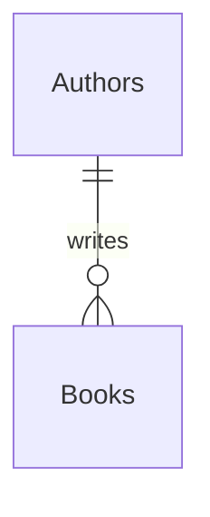

<!--
What: Guide for the bookshop-minimal sample: the smallest complete CAP app with two entities, two
    services, CSV data and tests.
Why: [CAP-S07] standalone sample for [CAP-M01]-[CAP-M03]; a quick reference without the
    procurement domain of the stages.
If missing or unlinked: The sample has no explanation and the DoD report marks it incomplete.
-->

# Sample: bookshop-minimal

## Purpose

The smallest useful CAP application: `Authors` and `Books`, a read-only `CatalogService` for
readers and an `AdminService` for maintenance, initial data from CSV and five tests - all you need
to see the `db/` → `srv/` → OData path in one screen of code.

## Module reference

- [CAP-M01 Project Setup & Tooling](../../CAP_DEVELOPMENT_GUIDE.md#cap-m01-project-setup--tooling)
- [CAP-M02 Domain Modeling](../../CAP_DEVELOPMENT_GUIDE.md#cap-m02-domain-modeling-with-cds)
- [CAP-M03 Providing Services](../../CAP_DEVELOPMENT_GUIDE.md#cap-m03-providing-services--odata) - [CAP-DEC-01]
- [CAP-M04 Initial Data & Testing](../../CAP_DEVELOPMENT_GUIDE.md#cap-m04-initial-data--testing-basics)

## Prerequisites

Node.js 22 or 24, `npm install` at the repository root (or inside this folder when copied out).
`@sap/cds` 10, `@cap-js/sqlite` 3, `@cap-js/cds-test` 1. No BTP account.

## Folder structure

```
bookshop-minimal/
├─ package.json                          # scripts watch / start / test
├─ db/schema.cds                         # Authors, Books
├─ db/data/sample.bookshop-*.csv         # 2 authors, 3 books (file name = <namespace>-<Entity>.csv)
├─ srv/services.cds                      # CatalogService (read-only), AdminService
└─ test/bookshop.test.js                 # 5 tests
```

## How to run

```sh
cd samples/bookshop-minimal
npm run watch
curl "http://localhost:4004/odata/v4/catalog/Books?\$expand=author"
```

## How to test

```sh
npm test      # 5 tests pass
```

## Key concepts

- `cuid` / `managed` aspects give a UUID key and `createdAt/By`, `modifiedAt/By`.
- `Association to many Books on books.author = $self` - the back link without a foreign key.
- Projections select columns and add `@readonly` per use case:
  ```cds
  @readonly entity Books as projection on db.Books { ID, title, author, price, stock };
  ```
- `@mandatory` and `@assert.range` are checked by CAP before any handler runs (400).

## When to use / When not to use

Use as a starting point or scratch pad for CAP features. Not a template for real apps: no
authorization, no UI, no draft - see the stages for those.

## Impact & trade-offs

| Aspect | Impact |
|--------|--------|
| Security | no `@requires` - every endpoint is open (fine for a sample, never for production) |
| Data | in-memory SQLite: data resets on every restart |

## Visuals



## Deviations from guide

None - the guide only names the sample; content chosen to match [CAP-M01]-[CAP-M03].

## Troubleshooting

| Symptom | Cause | Fix |
|---------|-------|-----|
| no data | CSV file name does not match `<namespace>-<Entity>.csv` | rename to `sample.bookshop-Books.csv` |
| 405 on POST to the catalog | `@readonly` | use `/odata/v4/admin` |

## References

- https://cap.cloud.sap/docs/get-started/
- https://cap.cloud.sap/docs/guides/domain/
- https://cap.cloud.sap/docs/guides/providing-services
