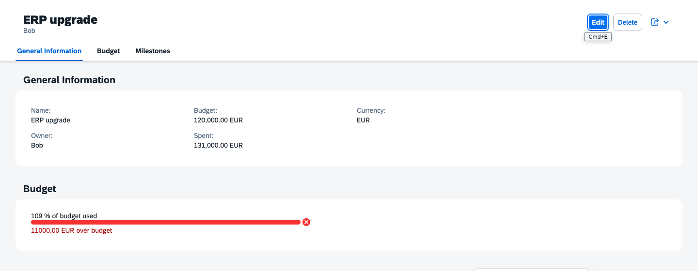
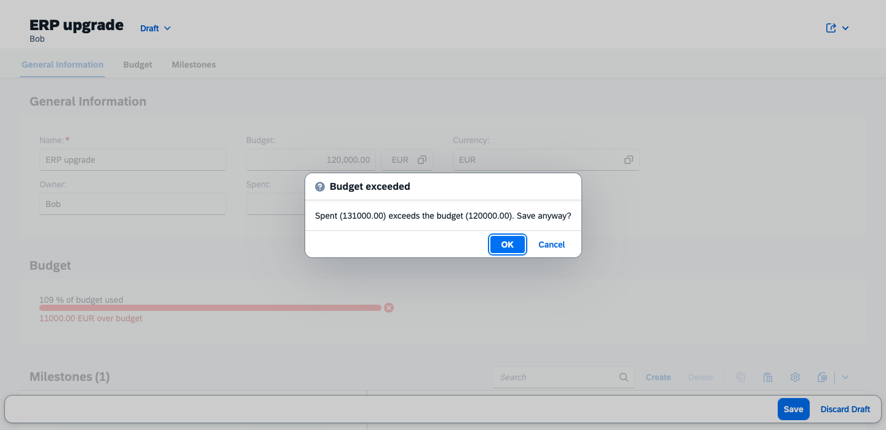
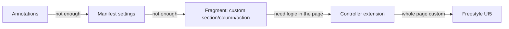
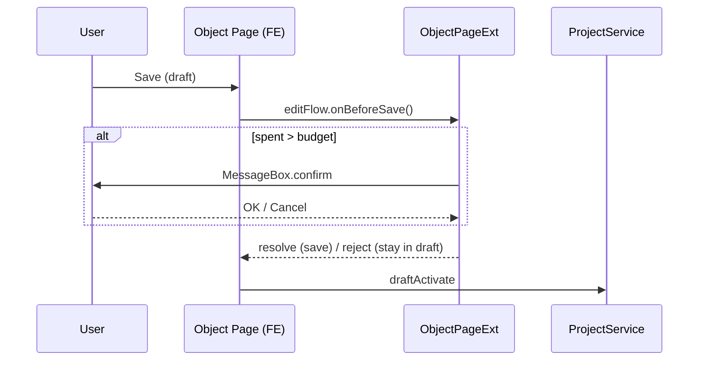

<!--
What: Guide for the custom-fiori-section sample: a Fiori Elements Object Page extended with a
    custom "Budget" section (XML fragment + formatter module) and a controller extension that asks
    for confirmation before saving an over-budget project.
Why: [CAP-S07] standalone sample for [CAP-M10] - the two most common Fiori Elements extension
    points, kept small enough to read in a few minutes.
If missing or unlinked: The sample has no explanation and the DoD report marks it incomplete.
-->

# Sample: custom-fiori-section

## Purpose

Show how to go beyond annotations in a Fiori Elements app **without** leaving Fiori Elements: a
custom Object Page section that visualises budget vs. spent as a progress bar, and a controller
extension that hooks into the standard save flow. Everything else stays annotation-driven.

## Module reference

- [CAP-M10 Fiori Custom Extensions](../../CAP_DEVELOPMENT_GUIDE.md#cap-m10-fiori-custom-extensions)
- [CAP-M09 Fiori Elements UI](../../CAP_DEVELOPMENT_GUIDE.md#cap-m09-fiori-elements-ui) - [CAP-DEC-06]
- Full-size version: the Approval History section of [stage 05](../../stage-05-fiori-elements/README.md)

## Prerequisites

Node.js 22 or 24, `npm install` at the repository root (or in this folder when copied out), a
browser with internet access (SAPUI5 1.148 from the CDN). No BTP account, no authentication.

## Folder structure

```
custom-fiori-section/
├─ db/schema.cds                                   # Projects (budget, spent) with Milestones
├─ db/data/*.csv                                   # 3 projects: under, near and over budget
├─ srv/project-service.cds                         # draft-enabled ProjectService
├─ app/services.cds                                # loads the app annotations
├─ app/projects/annotations.cds                    # standard UI: list, header, General, Milestones
├─ app/_i18n/i18n.properties                       # annotation labels
└─ app/projects/webapp/
   ├─ index.html, Component.js, i18n/              # standalone FE app
   ├─ manifest.json                                # registers section + controller extension
   ├─ ext/fragment/Budget.fragment.xml             # the custom section
   ├─ ext/fragment/BudgetFormatter.js              # formatters (percent, state, label, remaining)
   └─ ext/controller/ObjectPageExt.controller.js   # editFlow.onBeforeSave confirmation
test/extensions.test.js                            # formatter unit tests + served files + manifest wiring
```

## How to run

```sh
cd samples/custom-fiori-section
npm run watch
```

Open <http://localhost:4004/projects/webapp/index.html>, open **ERP upgrade** (131,000 spent of
120,000) → the Budget section is red; **Edit** → **Save** asks for confirmation; *Cancel* keeps the
draft open.

| Budget section | Save confirmation |
|---|---|
|  |  |

## How to test

```sh
npm test
```

6 tests: the formatter functions (percentage capped at 100, value states at 90 % / 100 %,
remaining vs. over budget), that manifest, fragment, formatter and controller extension are served,
that the section is anchored after an existing facet ID, and that the standard UI stays in
annotations. The visual result is checked with the screenshots above.

## Key concepts

- **Custom section** - registered in `manifest.json`, positioned relative to an annotation facet
  `ID` (`General`), rendered from an XML fragment bound to the page's object:
  ```json
  "content": { "body": { "sections": { "Budget": {
    "template": "sample.projects.ext.fragment.Budget", "position": { "placement": "After", "anchor": "General" } } } } }
  ```
- **Formatters via `core:require`** - no controller needed; `targetType: 'any'` passes raw decimals
  instead of locale-formatted strings.
- **Controller extension** - `sap.ui.controllerExtensions` + `override.editFlow.onBeforeSave`;
  returning a rejected promise cancels the save. It is a UX warning only - real rules belong in the
  service ([CAP-DEC-02]).

## When to use / When not to use



Use extensions for small gaps in standard floorplans. Do not use them for business validation
(server side) or to rebuild what an annotation already offers.

## Impact & trade-offs

| Aspect | Impact |
|--------|--------|
| Maintenance | every fragment/extension is code you own across UI5 upgrades |
| Upgrade safety | extension points are public API; avoid accessing internal controls by ID |
| Testing | formatters unit-testable in Node; fragments/extensions need screenshots or OPA5/wdi5 tests |
| Security | client-side checks can be bypassed - mirror any rule on the server |

## Visuals



## Deviations from guide

None. The guide names "custom section and custom action"; this sample uses a custom section and a
controller extension of the save flow (the more common real-world need).

## Troubleshooting

| Symptom | Cause | Fix |
|---------|-------|-----|
| "could not find fragment" | `template` does not equal `sap.app.id` + path | `sample.projects.ext.fragment.Budget` |
| formatter receives "131,000.00" | type formatting applied before the formatter | `targetType: 'any'` in the binding parts |
| `core:require` ignored | placed on `FragmentDefinition` | put it on the first control (VBox) |
| no confirmation on save | controllerExtensions key does not match the page ID | `sap.fe.templates.ObjectPage.ObjectPageController#<app id>::<target id>` |

## References

- https://ui5.sap.com/#/topic/03265b0408e2432c9571d6b3feb6b1fd (SAP Fiori elements for OData V4 - extension points)
- https://cap.cloud.sap/docs/advanced/fiori
- https://experience.sap.com/fiori-design-web/
