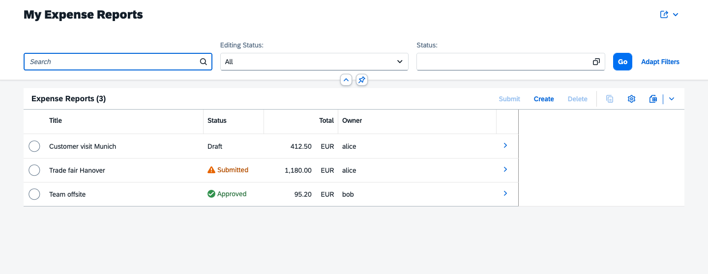
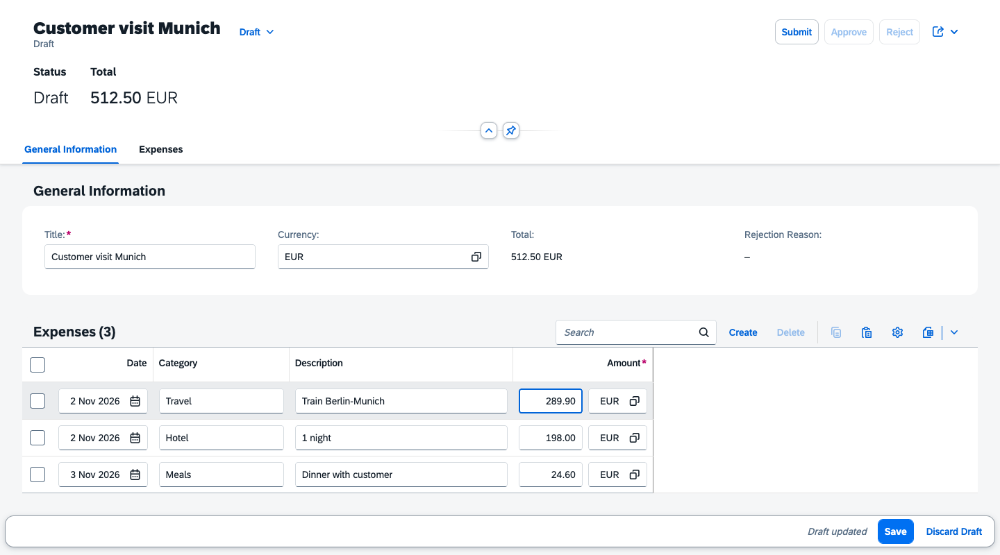
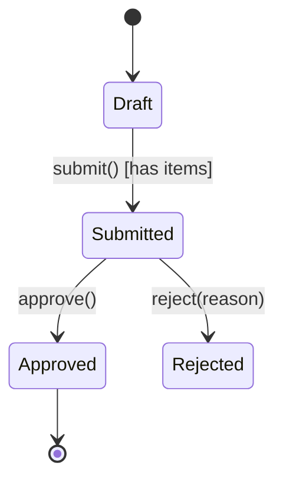
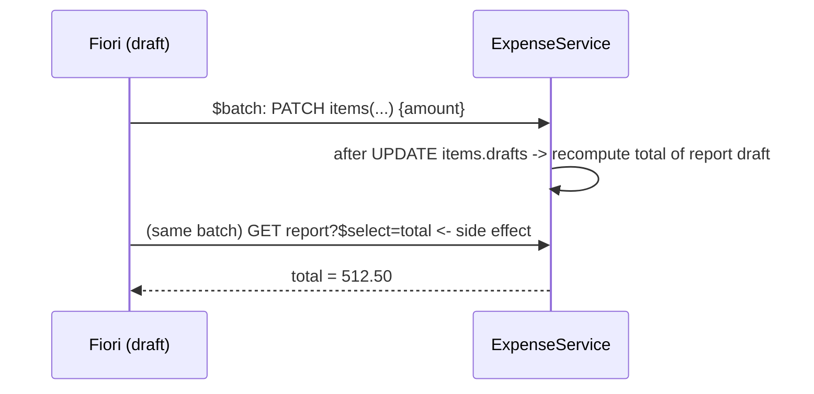

<!--
What: Guide for the draft-workflow sample: expense reports with draft editing, a submit / approve /
    reject state machine as bound actions, and a total that refreshes live through side effects.
Why: [CAP-S07] standalone sample for [CAP-M03] (draft), [CAP-M06] (actions) and [CAP-M09] (side
    effects, action availability) in under 200 lines of model and code.
If missing or unlinked: The sample has no explanation and the DoD report marks it incomplete.
-->

# Sample: draft-workflow

## Purpose

Show the three things that make a Fiori Elements transactional app feel right, in isolation:
**draft** editing of a parent with children, state changes only through **bound actions**, and
**side effects** that re-read a server-computed total while the user types.

## Module reference

- [CAP-M03 Providing Services & OData](../../CAP_DEVELOPMENT_GUIDE.md#cap-m03-providing-services--odata) - draft
- [CAP-M06 Actions & Functions](../../CAP_DEVELOPMENT_GUIDE.md#cap-m06-actions--functions) - [CAP-DEC-03]
- [CAP-M09 Fiori Elements UI](../../CAP_DEVELOPMENT_GUIDE.md#cap-m09-fiori-elements-ui) - side effects, `Core.OperationAvailable`
- Full-size version of the same ideas: [stage 04](../../stage-04-custom-logic/README.md) and [stage 05](../../stage-05-fiori-elements/README.md)

## Prerequisites

Node.js 22 or 24, `npm install` at the repository root (or in this folder when copied out). A
browser with internet access (UI5 1.148 from the CDN). No BTP account, no authentication.

## Folder structure

```
draft-workflow/
├─ db/schema.cds                     # ExpenseReports (status, total) + ExpenseItems (composition)
├─ db/data/*.csv                     # 3 reports, 6 items
├─ srv/expense-service.cds           # draft-enabled projection, actions submit/approve/reject
├─ srv/expense-service.js            # live draft total, total on activation, state machine
├─ app/services.cds                  # includes the annotations
├─ app/_i18n/i18n.properties         # annotation labels
├─ app/expenses/annotations.cds      # list, object page, side effects, action availability
├─ app/expenses/webapp/              # index.html, Component.js, manifest.json, i18n
└─ test/draft-workflow.test.js       # 8 tests
```

## How to run

```sh
cd samples/draft-workflow
npm run watch
```

Open <http://localhost:4004/expenses/webapp/index.html>. Open *Customer visit Munich* → **Edit** →
change an amount → the **Total** in the header changes immediately (no save) → **Save** →
**Submit** (enabled only in *Draft*) → **Approve** or **Reject** (reason required).

| List Report | Side effect: total re-read after an amount change |
|---|---|
|  |  |

## How to test

```sh
npm test
```

8 tests pass: live total while adding, changing and deleting draft items; activation; validation of
`@assert.range` on save; submit/approve/reject incl. 409 on invalid transitions, 400 without items
or reason; actions refused on drafts; `@readonly` status ignored in a PATCH; app and annotations in
`$metadata`.

## Key concepts

- **Draft** - `@odata.draft.enabled` on the root; items are part of the same draft because they are
  a composition. Creating a draft = `NEW`, editing items = `NEW`/`UPDATE`/`DELETE` on `.drafts`,
  saving = `draftActivate` → `CREATE`/`UPDATE` of the active entity with all items.
- **Validation timing** - draft data may be invalid; `@mandatory` / `@assert.range` are checked
  when the draft is **activated** (errors become draft messages in the UI).
- **Derived, stored total** - computed in handlers (`after` item changes on drafts, `before`
  activation) so it can be sorted and filtered, but never typed in (`@readonly`).
- **Side effects** - the server changed `total`; the UI must be told to re-read it:
  ```cds
  annotate service.ExpenseItems with @Common.SideEffects #Amount: {
    SourceProperties: [ amount ], TargetProperties: [ 'report/total' ] };
  ```
  Fiori sends the PATCH and `GET ...?$select=total` in one `$batch` (verified in the screenshot run).
- **Actions as state machine** - `status` is `@readonly`; only `submit`/`approve`/`reject` change
  it; `@Core.OperationAvailable: ($self.status = 'Draft')` enables the buttons accordingly.

## When to use / When not to use

| Use | Avoid |
|-----|-------|
| draft for documents with children edited together over several minutes | draft for simple master data or system-to-system writes |
| bound actions for every status change | PATCH of `status` |
| side effects for every server-computed field shown in the UI | client-side calculations of business values |

## Impact & trade-offs

| Aspect | Impact |
|--------|--------|
| Storage | draft tables per entity, draft administrative data, abandoned drafts until cleanup |
| Requests | each field change is a PATCH; side effects add a read in the same batch |
| Consistency | totals computed twice (draft and activation) by the same rule |
| Locking | an open draft locks the document for other users |

## Visuals





## Deviations from guide

None - this is a new sample listed in [CAP-S07]. Simplifications: no authentication and no
four-eyes rule (see stage 06 for both).

## Troubleshooting

| Symptom | Cause | Fix |
|---------|-------|-----|
| total changes only after Save | side effect missing / wrong target path | `TargetProperties: [ 'report/total' ]` on the item, `SourceEntities: [ items ]` on the report |
| invalid amount accepted in the draft | validation runs on activation | expected - Save shows the error |
| 501 on submit in edit mode | action called on the draft | expected 409 here: save first |
| "locked by another user" | open draft of another session | discard the draft or wait for the lock timeout |

## References

- https://cap.cloud.sap/docs/advanced/fiori#draft-support
- https://cap.cloud.sap/docs/guides/providing-services#actions-functions
- https://ui5.sap.com/#/topic/03265b0408e2432c9571d6b3feb6b1fd (SAP Fiori elements - side effects)
