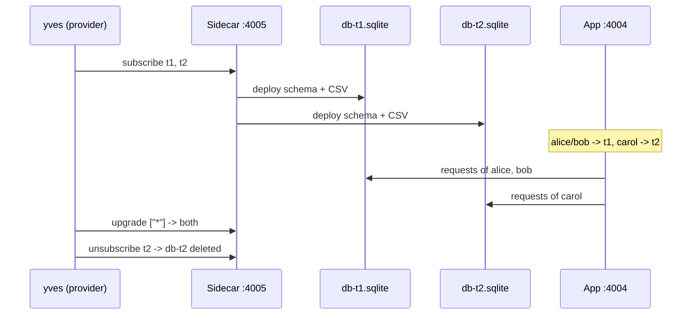

<!--
What: Guide for the multitenant SaaS sample: the smallest CAP app with an MTX sidecar - tenant
    subscription with one database per tenant, isolation, upgrade of all tenants, tenant extensions
    with a naming rule, unsubscription.
Why: [CAP-S07] sample `samples/multitenant-saas` for [CAP-M20] - multitenancy without the
    procurement domain, so only the moving parts of MTX remain.
If missing or unlinked: Learners have to extract the MTX setup from stage 09 themselves, and the
    DoD report marks the sample incomplete.
-->

# Sample - multitenant SaaS (MTX)

## Purpose

Show multitenancy in isolation: one trivial entity (`Notes`), one service, and the MTX sidecar.
Two tenants subscribe, each gets its own database, each sees only its own notes; the provider
upgrades all tenants at once and can offboard a tenant (its database is deleted).

## Module reference

- [CAP-M20 Multitenancy (SaaS)](../../CAP_DEVELOPMENT_GUIDE.md#cap-m20-multitenancy-saas) - [CAP-DEC-09]
- [CAP-M21 Extensibility](../../CAP_DEVELOPMENT_GUIDE.md#cap-m21-extensibility) (one naming rule)
- Full version in the procurement app: [stage 09](../../stage-09-extensibility-mtx/README.md)

## Prerequisites

Node.js 22/24 and `npm install` at the repository root (provides `@sap/cds`, `@sap/cds-mtxs`,
`@cap-js/sqlite`). No BTP account; two terminals for the manual run.

## Folder structure

```
samples/multitenant-saas/
├─ package.json              # profiles with-mtx-sidecar / [with-mtx] / [production], users with tenants, scripts
├─ db/schema.cds             # entity sample.saas.Notes
├─ db/data/sample.saas-Notes.csv   # initial note, deployed into every new tenant
├─ srv/notes-service.cds     # NotesService at /odata/v4/notes (authenticated users)
├─ mtx/sidecar/package.json  # MTX sidecar: tenant lifecycle + extension rules (x_ prefix, allowlist)
├─ scripts/subscribe.sh      # subscribe t1 and t2 to the local sidecar
├─ test/saas.test.js         # end-to-end: sidecar + app processes, 2 tenants
└─ .gitignore                # incl. *.sqlite, *.sqlite-* (tenant databases)
```

## How to run

```sh
cd samples/multitenant-saas
npm run watch:sidecar        # terminal 1: sidecar on http://localhost:4005
npm run subscribe            # terminal 2: tenants t1, t2 -> db-t1.sqlite, db-t2.sqlite
npm run watch:mtx            # terminal 2: app on http://localhost:4004
```

| User (empty password) | Tenant | Role |
|-----------------------|--------|------|
| alice | t1 | `cds.ExtensionDeveloper` |
| bob | t1 | - |
| carol | t2 | - |
| yves | - | `internal-user` (subscribe, upgrade, unsubscribe) |

```sh
curl -u alice: -H 'Content-Type: application/json' -d '{"text":"only for t1"}' localhost:4004/odata/v4/notes/Notes
curl -u bob:   localhost:4004/odata/v4/notes/Notes     # t1: sees it
curl -u carol: localhost:4004/odata/v4/notes/Notes     # t2: does not
curl -u yves: -H 'Content-Type: application/json' -d '{"tenants":["*"]}' localhost:4005/-/cds/saas-provisioning/upgrade
curl -u yves: -H 'Content-Type: application/json' -d '{"tenant":"t2"}'   localhost:4005/-/cds/deployment/unsubscribe
```

Without `--profile with-mtx` (`npm run watch`) the app runs single-tenant on an in-memory database.
Reset: stop both processes, delete `db*.sqlite*`.

## How to test

```sh
npm test
```

6 tests pass (~2 s). The test starts the sidecar and the app as child processes (port 0, tenant
databases in a temp folder via `CDS_REQUIRES_DB_CREDENTIALS_URL`) and checks: one database per
tenant with initial data, isolation, 401 without user, upgrade of all tenants (data survives), the
`x_` extension rule (422 / 200), unsubscribe deletes the tenant's database.

## Key concepts

- **Two processes** - the app serves business requests; the sidecar (`@sap/cds-mtxs`) runs the
  tenant lifecycle: `POST /-/cds/deployment/subscribe|unsubscribe {tenant}`,
  `POST /-/cds/saas-provisioning/upgrade {tenants:["*"]}`.
- **Profiles** - `"profile": "with-mtx-sidecar"` plus `[with-mtx]: { multitenancy: true }`: plain
  `cds watch` stays single-tenant; `--profile with-mtx` is local SaaS mode; `[production]` is always
  multitenant (with XSUAA instead of mocked users).
- **Tenant from the user** - mocked users carry `tenant`; on BTP it is the JWT's zone. The service
  code never mentions tenants.
- **Sidecar config** - the sidecar reads the app model from `../..` and, in development, the app's
  users; extension rules (`cds.xt.ExtensibilityService`) live in the sidecar's `package.json`. Once
  a rule is set, only allowlisted entities may be extended.

## When to use / When not to use

Use multitenancy when several customers each need isolated data and their own subscription
lifecycle ([CAP-DEC-09]). Do not use it for one organisation - a single-tenant app with
instance-based authorization is far cheaper to run.

## Impact & trade-offs

| Aspect | Impact |
|--------|--------|
| Operations | two apps, asynchronous subscription/upgrade jobs, per-tenant monitoring |
| Cost | one database container per tenant (HDI on SAP HANA Cloud) |
| Schema changes | every deployment must upgrade all tenants; a failing tenant needs follow-up |
| Offboarding | unsubscribe deletes the tenant's data - keep exports/backups per contract |

## Visuals



## Deviations from guide

| Guide | Here | Reason |
|-------|------|--------|
| `cds-mtx upgrade` | `POST /-/cds/saas-provisioning/upgrade` | same API locally and on BTP; `/-/cds/deployment/upgrade` takes a single tenant (see stage 09) |
| `cds subscribe` | test calls `POST /-/cds/deployment/subscribe` directly; `scripts/subscribe.sh` uses `cds subscribe` | no CLI process per tenant in tests |
| deployment to BTP | not included | see [stage 10](../../stage-10-deploy-cicd/README.md) for the MTA of a multitenant app |

Not verified on BTP: SaaS registry callbacks and HDI containers via Service Manager.

## Troubleshooting

| Symptom | Cause | Fix |
|---------|-------|-----|
| 401 / tenant errors in `--profile with-mtx` | tenant not subscribed | `npm run subscribe` (sidecar running) |
| `port 4005 in use` | sidecar already running | stop it |
| extension rejected: `must not be extended` | entity not in `extension-allowlist` | add it in `mtx/sidecar/package.json` |
| `403 lacking required roles` on the sidecar | user lacks `internal-user` / `cds.ExtensionDeveloper` | use yves / alice (dev users come from the app's `package.json`) |
| old data after restart | tenant files survive | delete `db*.sqlite*` |

## References

- https://cap.cloud.sap/docs/guides/multitenancy/
- https://cap.cloud.sap/docs/guides/multitenancy/mtxs
- https://cap.cloud.sap/docs/guides/extensibility/customization#restrictions
