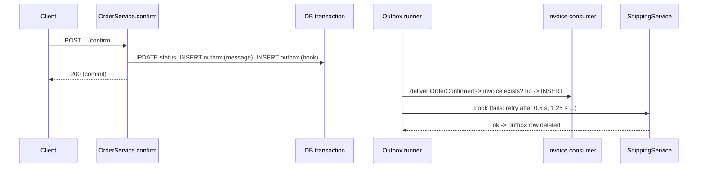

<!--
What: Guide for the outbox-events sample: transactional outbox for messages and service calls,
    idempotent consumers, retries with backoff and dead letters.
Why: [CAP-S07] focused sample for [CAP-M07] / [CAP-M18] / [CAP-DEC-04] - the reliability rules of
    asynchronous processing in one small app.
If missing or unlinked: Learners use messaging without the outbox and lose or duplicate messages,
    and the DoD report marks the sample incomplete.
-->

# Sample: outbox-events - reliable asynchronous processing

## Purpose

Confirming an order must change its status, notify invoicing and book a shipment - reliably:
**all or nothing** with the database transaction, **delivered even if the receiver is down**, and
**no duplicates** when a message is delivered twice. The transactional outbox gives the first two;
idempotent consumers give the third.

## Module reference

- [CAP-M07 Events & Messaging](../../CAP_DEVELOPMENT_GUIDE.md#cap-m07-events--messaging) - [CAP-DEC-04]
- [CAP-M18 Async Processing: Outbox, Queues, Jobs](../../CAP_DEVELOPMENT_GUIDE.md#cap-m18-async-processing-outbox-queues-jobs)
- In context: [stage 08](../../stage-08-advanced-features/README.md) (approval message → notifications)

## Prerequisites

Node.js 22/24 and `npm install` at the repository root. No broker, no BTP account.

## Folder structure

```
outbox-events/
├─ package.json                    # cds.requires.messaging: local-messaging, queued: true
├─ db/schema.cds                   # Orders, Invoices (consumer), ShipmentBookings (queued call)
├─ db/data/sample.outbox-Orders.csv
├─ srv/order-service.cds / .js     # confirm action, OrderConfirmed consumer
├─ srv/shipping-service.cds / .js  # internal "carrier API", called via cds.queued()
└─ test/outbox.test.js, test/requests.http
```

## How to run

```sh
cd samples/outbox-events
npm run watch
```

Run `test/requests.http` 2-4: after the confirm, `Invoices` and `ShipmentBookings` each contain one
row for the order - written asynchronously, after the request has committed.

## How to test

```sh
npm test
```

6 tests pass (~3 s): delivery after commit, both entries in `cds.outbox.Messages` inside the
transaction, nothing delivered on rollback, redelivery ignored, a failing call retried twice then
successful, an unrecoverable call dead-lettered (`attempts` = `maxAttempts`, `lastError` set).

## Key concepts

- **Queued messaging** - `"messaging": { "kind": "local-messaging", "queued": true }`; brokers
  (Event Mesh, Kafka, ...) are queued by default. `emit` inserts into `cds.outbox.Messages` in the
  current transaction; a runner delivers after commit.
- **Queued service calls** - `cds.queued(srv)` gives the same guarantee for any service call:
  ```js
  const shipping = cds.queued(await cds.connect.to('ShippingService'))
  await shipping.send('book', { order: ID })
  ```
- **Retries** - failed deliveries are retried with exponential backoff (0.5 s, 1.25 s, 2.4 s, ...)
  up to `cds.requires.queue.maxAttempts` (10).
- **Dead letters** - errors with `unrecoverable: true` (and programming errors) stop retrying; the
  row stays with `attempts = maxAttempts` and `lastError` for an operator.
- **Idempotent consumers** - at-least-once delivery: derive the key from the message (the order)
  and check before writing.

## When to use / When not to use

| Use the outbox when | Do not when |
|---------------------|-------------|
| a message or remote call belongs to a business transaction | the caller needs the result synchronously |
| the receiver may be temporarily unavailable | the call is a read (no side effects) |
| duplicates are handled by an idempotent consumer | the consumer cannot be made idempotent and exactly-once is required |

[CAP-DEC-04]: in-process `srv.emit` for decoupling inside one app (stage 04); a broker plus outbox
across apps.

## Impact & trade-offs

| Aspect | Impact |
|--------|--------|
| Consistency | message and data commit together - no "sent but rolled back" |
| Latency | delivery is asynchronous; the user's request does not wait for the receiver |
| Duplicates | at-least-once - consumers must be idempotent |
| Storage | one row per pending message; dead letters stay until handled |
| Operations | monitor `cds.outbox.Messages` for growing rows and dead letters |

## Visuals



## Deviations from guide

| Guide | Here | Reason |
|-------|------|--------|
| config `"outbox": true` | `"queued": true` | `outbox` is deprecated in CAP 10 (`queued` is the new name) |
| Event Mesh | `local-messaging` | no broker needed to show the outbox; switch `kind` for production |
| remote carrier API | internal `ShippingService` (`@protocol: 'none'`) | same `cds.queued` behaviour without a remote system |

## Troubleshooting

| Symptom | Cause | Fix |
|---------|-------|-----|
| invoice never appears | messaging not queued, or consumer throws | `npx cds env requires.messaging` shows `queued: true`; check the log for retries |
| duplicate invoices | consumer not idempotent | key derived from the message, check before insert |
| rows stay in `cds.outbox.Messages` with `attempts` 10 | dead letters | read `lastError`, fix, reset `attempts` to 0 to retry |
| retries take long | exponential backoff | expected - waits grow as (1.5^n - 1) s: ~37 s before the 9th retry, capped at ~25 min |

## References

- https://cap.cloud.sap/docs/node.js/queue
- https://cap.cloud.sap/docs/guides/events/
- https://cap.cloud.sap/docs/guides/messaging/
