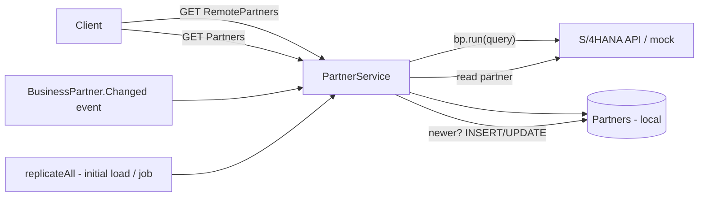

<!--
What: Guide for the remote-bp sample: consuming the S/4HANA Business Partner API with CAP - live
    delegation, local mocking and idempotent replication (initial load and events).
Why: [CAP-S07] focused sample for [CAP-M08] / [CAP-DEC-05], small enough to read in one sitting.
If missing or unlinked: Learners see the code without the decision "delegate or replicate" and
    the DoD report marks the sample incomplete.
-->

# Sample: remote-bp - delegate or replicate remote data

## Purpose

Use one remote OData V2 API (S/4HANA Business Partner) in the two ways CAP supports: **delegate**
reads live to the remote system, or **replicate** partners into a local table - idempotently,
from a full load or from business events. Runs locally against a mock; no S/4HANA needed.

## Module reference

- [CAP-M08 Consuming Remote Services](../../CAP_DEVELOPMENT_GUIDE.md#cap-m08-consuming-remote-services) - [CAP-DEC-05]
- In context: [stage 04](../../stage-04-custom-logic/README.md) (delegation) and
  [stage 08](../../stage-08-advanced-features/README.md) (replication into Suppliers)

## Prerequisites

Node.js 22/24 and `npm install` at the repository root (installs this workspace). No BTP account.

## Folder structure

```
remote-bp/
├─ package.json                                  # cds.requires.API_BUSINESS_PARTNER (+ production destination), messaging
├─ db/schema.cds                                 # Partners - the replicated copy
├─ db/data/sample.remotebp-Partners.csv          # 2 partners already replicated (one outdated)
├─ srv/partner-service.cds                       # RemotePartners (live), Partners (local), replicate actions
├─ srv/partner-service.js                        # delegation, replication, event subscription
├─ srv/external/API_BUSINESS_PARTNER.edmx        # remote metadata (subset)
├─ srv/external/API_BUSINESS_PARTNER.cds         # generated by cds import --as cds
├─ srv/external/data/*.csv                       # mock data of the remote API
└─ test/remote-bp.test.js, test/requests.http
```

## How to run

```sh
cd samples/remote-bp
npm run watch      # log: "mocking API_BUSINESS_PARTNER"
```

Then run `test/requests.http` (1-5), e.g. `POST /odata/v4/partners/replicateAll` →
`{ created: 4, updated: 1, unchanged: 1 }`, and again → all `unchanged`.

## How to test

```sh
npm test
```

9 tests pass (2 files, incl. `test/guardrails.test.js`: login/admin required, same-day replication): delegation with `$filter`/`$select`, full load counts, idempotent second load,
unknown partner, event replication with duplicate and stale events, and 502 for live reads while
the replicated copy keeps working when S/4HANA is down.

## Key concepts

- **Import** - `cds import srv/external/API_BUSINESS_PARTNER.edmx --as cds` creates the CDS model
  and the `cds.requires` entry; `[production]` adds the destination.
- **Mock** - `cds watch` (and `cds.test(dir, '--with-mocks')`) serves the remote service locally
  from `srv/external/data/*.csv`.
- **Delegation** - project the remote entity and forward the query:
  ```js
  this.on('READ', RemotePartners, (req) => bp.run(req.query))
  ```
- **Replication** - copy into a local table; idempotent by comparing `LastChangeDate`:
  ```js
  if (local?.lastChanged >= partner.LastChangeDate) return 'unchanged'
  ```
- **Events** - `messaging.on('sap.s4.beh.businesspartner.v1.BusinessPartner.Changed.v1', ...)`
  triggers the same replication for one partner.

## When to use / When not to use

| Delegate (RemotePartners) | Replicate (Partners) |
|---------------------------|----------------------|
| small, rarely used data that must be fresh | data joined with local entities, sorted, filtered, validated |
| remote API supports the query options you need | many reads, value helps, lists |
| no storage / sync effort wanted | must work while the remote system is down |
| **not** for large lists or cross-system joins | **not** when data must be real-time to the second |

## Impact & trade-offs

| Aspect | Delegate | Replicate |
|--------|----------|-----------|
| Latency | every read pays the remote round trip | local read |
| Availability | coupled to S/4HANA (→ 502) | independent once replicated |
| Freshness | always current | as fresh as the last event / load |
| Effort | small | sync logic, idempotency, storage, data-privacy duties for the copy |

## Visuals



## Deviations from guide

| Guide | Here | Reason |
|-------|------|--------|
| EDMX from SAP | hand-written subset (same names/types), copied from stage 04 | full file requires a SAP Business Accelerator Hub login |
| messaging broker | `local-messaging` | no broker needed to show the event path; production: Event Mesh (see stage 08/10) |
| replication job | action `replicateAll` | a scheduler (Job Scheduling Service) would call it in production |

## Troubleshooting

| Symptom | Cause | Fix |
|---------|-------|-----|
| `No credentials configured for "API_BUSINESS_PARTNER"` | not mocked | `cds watch`, or `cds.test(dir, '--with-mocks')` |
| RemotePartners empty / 501 | no `READ` handler | delegation handler in `srv/partner-service.js` |
| replication changes nothing | local copy already as new as the remote | expected (idempotent) - change `LastChangeDate` in the mock |
| 502 in production | destination `S4_BP` / Cloud Connector | check the destination and connectivity |

## References

- https://cap.cloud.sap/docs/guides/using-services
- https://cap.cloud.sap/docs/guides/using-services#replicated-data
- https://api.sap.com/api/API_BUSINESS_PARTNER/overview
