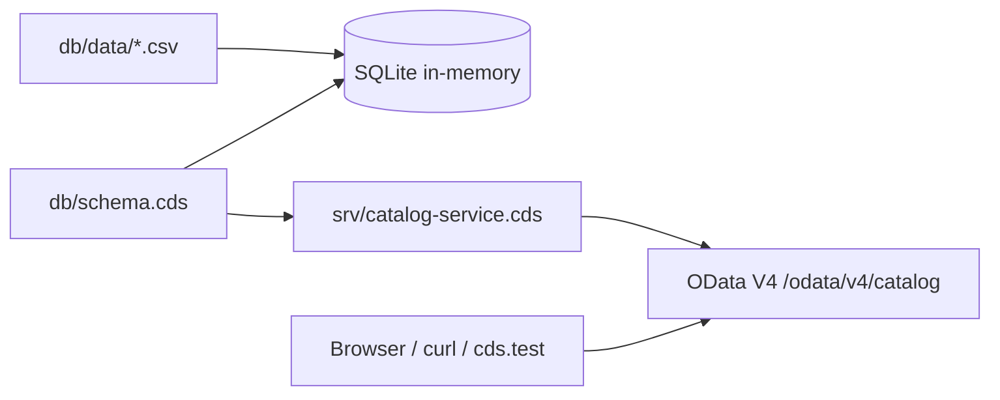

<!--
What: Guide for stage 01 (basics): the smallest runnable CAP project - one entity, one read-only
    service, CSV data and a smoke test.
Why: [CAP-STAGE-01] / [CAP-M01] starting point of the ACME Procurement learning path; every later
    stage is a copy of this folder extended by one topic.
If missing or unlinked: Learners have no explanation of the first stage, and the DoD report marks
    the stage as incomplete.
-->

# Stage 01 - Basics

## Purpose

Create and run the smallest useful CAP project with zero infrastructure: a `Products` entity,
a read-only `CatalogService` exposed over OData V4, CSV sample data and one automated test.

## Module reference

- [CAP-M01 Project Setup & Tooling](../CAP_DEVELOPMENT_GUIDE.md#cap-m01-project-setup--tooling)
- [CAP-M04 Initial Data & Testing Basics](../CAP_DEVELOPMENT_GUIDE.md#cap-m04-initial-data--testing-basics) (CSV + `cds.test` preview)

Learning goals: understand the `db/` - `srv/` - `test/` convention, what `cds watch` does, how CSV
files become initial data, and how `cds.test` starts the app in-process.

## Prerequisites

| Tool | Version used | Install |
|------|--------------|---------|
| Node.js | 24 LTS (22 also works) | `nvm use` in the repo root (`.nvmrc`) |
| `@sap/cds-dk` | 10.2.1 | installed with the repo (`npm install` at the root); or `npm i -g @sap/cds-dk` |
| `@sap/cds` | 10.2.2 | dependency |
| `@cap-js/sqlite` | 3.1.3 | dev dependency (uses Node's built-in `node:sqlite`, no native build) |
| `@cap-js/cds-test` | 1.0.2 | dev dependency |

No SAP BTP account is needed.

## Folder structure

```
stage-01-basics/
├─ package.json                         # scripts (watch/start/test) and dependencies
├─ db/schema.cds                        # domain model: Products
├─ db/data/acme.procurement-Products.csv# 5 sample products (file name = <namespace>-<Entity>.csv)
├─ srv/catalog-service.cds              # CatalogService, @readonly projection on Products
├─ test/smoke.test.js                   # node:test + cds.test smoke tests
├─ CHANGELOG-STAGE.md                   # files added vs. the empty project
└─ .gitignore                           # node_modules, gen, credentials
```

## How to run

```sh
cd stage-01-basics
npm run watch           # = cds watch
```

Expected output:

```
[cds] - connect to db > sqlite { url: ':memory:' }
  > init from db/data/acme.procurement-Products.csv
/> successfully deployed to in-memory database.

[cds] - using auth strategy { kind: 'mocked' }
[cds] - serving CatalogService {
  at: [ '/odata/v4/catalog' ],
  decl: 'srv/catalog-service.cds:10'
}
[cds] - server listening on { url: 'http://localhost:4004' }
```

Try it:

```sh
curl http://localhost:4004/odata/v4/catalog/Products
curl "http://localhost:4004/odata/v4/catalog/Products?\$select=name,price&\$orderby=price desc&\$top=2"
curl http://localhost:4004/odata/v4/catalog/\$metadata
```

`http://localhost:4004` in a browser shows the service index with links to every entity.

## How to test

```sh
npm test
```

Passes 3 tests: service index 200, 5 products from CSV, POST rejected with 405 (`@readonly`).

## Key concepts

- **Model first** - `db/schema.cds` defines the entity; CAP derives the SQLite table, the OData
  entity set and the `$metadata` from it.
  ```cds
  entity Products : cuid { name : String(100) @mandatory; price : Decimal(11,2); ... }
  ```
- **`cuid` aspect** from `@sap/cds/common` adds `key ID : UUID`.
- **Service = projection** - the service decides what is exposed; the model stays internal.
  ```cds
  service CatalogService @(path: '/odata/v4/catalog') { @readonly entity Products as projection on db.Products; }
  ```
- **CSV initial data** - `db/data/<namespace>-<Entity>.csv`, `;` or `,` separated, header = element names.
- **`cds watch`** - restarts on file changes, uses an in-memory SQLite database and mocked
  authentication in development.
- **Decimals are strings** in OData JSON (`"price": "189.90"`) to avoid floating-point rounding.
- **`cds.test`** starts the server in the test process and gives `GET/POST/...` helpers that throw
  for 4xx/5xx responses (`err.status`).

## When to use / When not to use

- **Use** this layout for every new CAP project; start with `cds init` and grow with `cds add`.
- **Do not** put business logic or UI here yet - and do not expose the whole model one-to-one in
  real projects (see stage 03, decision CAP-DEC-01).

## Impact & trade-offs

| Aspect | Note |
|--------|------|
| Performance | In-memory SQLite: instant start, data reset on every restart |
| Security | Development defaults (mocked auth); nothing here is production-ready |
| Operations | No infrastructure; same project later deploys to BTP unchanged except configuration |
| Cost | None |

## Visuals



## Deviations from guide

| Guide says | Actual (CAP 10.2) | Source |
|------------|-------------------|--------|
| `cds init procurement` then `npm install` | `cds init` in cds-dk 10 creates only folders, `readme.md` and `.gitignore` - no `package.json`. This stage contains the `package.json` that `cds add nodejs` would add. | `cds init` output, `cds add --help` |
| Tests with Jest | `node:test` runner + `cds.test` (`@cap-js/cds-test` 1.x); `expect` comes from `cds.test` (chai-compatible). No extra test framework. | https://cap.cloud.sap/docs/node.js/cds-test |
| Products has `localized` name, category, etc. | Kept minimal here; the full model comes in stage 02 as the guide's stage spec requires. | [CAP-STAGE-01] |

## Troubleshooting

| Symptom | Cause | Fix |
|---------|-------|-----|
| `EBADENGINE` during install | Node 26 - SAP libraries support 22/24 | `nvm use 24` |
| `No service definitions found` | `srv/` file not found or syntax error | `npx cds compile srv` shows the error |
| CSV rows missing | file name does not match `<namespace>-<Entity>.csv` | rename to `acme.procurement-Products.csv` |
| Port 4004 in use | another `cds watch` running | `cds watch --port 4005` |

## References

- https://cap.cloud.sap/docs/get-started/
- https://cap.cloud.sap/docs/cds/cdl
- https://cap.cloud.sap/docs/guides/databases#providing-initial-data
- https://cap.cloud.sap/docs/node.js/cds-test
