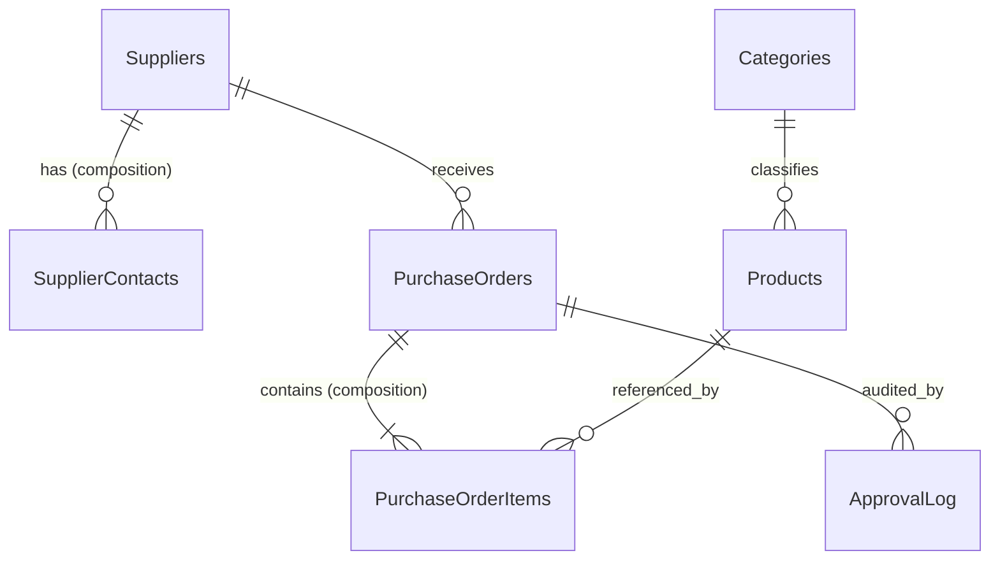
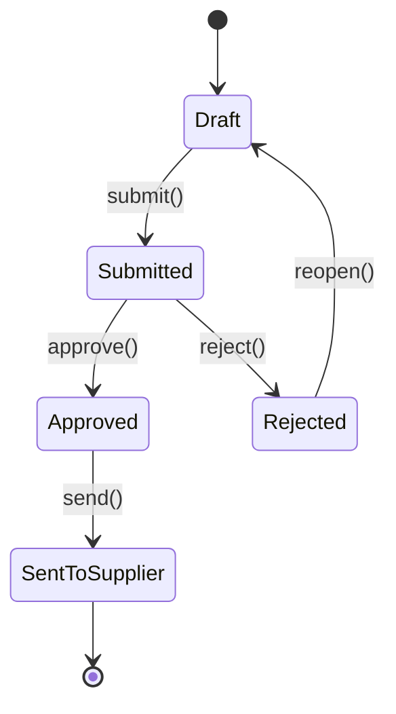

<!--
What: Guide for stage 02 (domain modeling): the complete ACME Procurement model with compositions,
    associations, enums, code lists, localized and calculated elements, plus sample data.
Why: [CAP-STAGE-02] / [CAP-M02] - the model is the foundation every later stage projects, secures
    and annotates; its design decisions are explained here once.
If missing or unlinked: Learners see the CDS file without the reasoning (composition vs.
    association, cascade impact) and the DoD report marks the stage incomplete.
-->

# Stage 02 - Domain modeling

## Purpose

Model the whole ACME Procurement domain in CDS: suppliers and their contacts, categories,
products, purchase orders with items, the PO status lifecycle and an approval log - with realistic
sample data in English and German.

## Module reference

- [CAP-M02 Domain Modeling with CDS](../CAP_DEVELOPMENT_GUIDE.md#cap-m02-domain-modeling-with-cds)
- [CAP-M04 Initial Data](../CAP_DEVELOPMENT_GUIDE.md#cap-m04-initial-data--testing-basics), [CAP-M14 Localization](../CAP_DEVELOPMENT_GUIDE.md#cap-m14-localization-i18n)
- Business scenario: guide Section 2 ([CAP-S02])

## Prerequisites

Same as [stage 01](../stage-01-basics/README.md): Node.js 24 (or 22), `npm install` at the repo root.
Versions: `@sap/cds` 10.2.2, `@sap/cds-dk` 10.2.1, `@cap-js/sqlite` 3.1.3, `@cap-js/cds-test` 1.0.2.

## Folder structure

```
stage-02-domain-modeling/
├─ db/schema.cds                                  # the complete domain model
├─ db/data/acme.procurement-Suppliers.csv          # 5 suppliers (DE, US, FR, IN, JP)
├─ db/data/acme.procurement-SupplierContacts.csv   # 6 contacts (composition children)
├─ db/data/acme.procurement-Categories(_texts).csv # 4 categories + German texts
├─ db/data/acme.procurement-Products(_texts).csv   # 10 products + German texts
├─ db/data/acme.procurement-PurchaseOrders.csv     # 4 orders in different statuses
├─ db/data/acme.procurement-PurchaseOrderItems.csv # 5 items
├─ db/data/acme.procurement-ApprovalLog.csv        # 2 decisions
├─ db/data/sap.common-Countries(_texts).csv        # code-list content for Country
├─ db/data/sap.common-Currencies(_texts).csv       # code-list content for Currency
├─ srv/catalog-service.cds                         # read-only Products + Categories
├─ test/model.test.js                              # 7 model tests
└─ CHANGELOG-STAGE.md, README.md, package.json, .gitignore
```

## How to run

```sh
cd stage-02-domain-modeling
npx cds compile db --to sql        # DDL: 13 tables, 4 localized views
npm run watch
```

```sh
curl "http://localhost:4004/odata/v4/catalog/Products?\$expand=category&\$top=3"
curl "http://localhost:4004/odata/v4/catalog/Products?sap-locale=de&\$select=name"
curl -H "Accept-Language: de" "http://localhost:4004/odata/v4/catalog/Categories"
```

## How to test

```sh
npm test
```

7 tests pass: generated SQL, CSV volumes, calculated `itemAmount`, localized texts (en/de),
association navigation, composition cascade delete vs. association, enum default.

## Key concepts

- **Aspects** - `cuid` (UUID key), `managed` (`createdAt/By`, `modifiedAt/By` filled automatically).
- **Composition vs. association** (decision below):
  ```cds
  items     : Composition of many PurchaseOrderItems on items.parent = $self;  // owned
  approvals : Association to many ApprovalLog on approvals.po = $self;         // referenced
  ```
- **Enum type** with default: `type POStatus : String(20) enum { Draft; Submitted; ... }` and
  `status : POStatus default 'Draft'`.
- **Code lists** - `Categories : CodeList { key code : String(20); }` adds localized `name`/`descr`;
  `Currency` and `Country` from `@sap/cds/common` are associations to `sap.common` code lists.
- **Localized elements** - `name : localized String(100)` creates `Products_texts` and a
  `localized_...` view; the request locale (`sap-locale`, `Accept-Language`) selects the language,
  falling back to the default text.
- **Calculated element** - `itemAmount : Decimal(15,2) = quantity * netPrice;` is computed on read,
  never stored.
- **Declarative constraints** - `@mandatory`, `@assert.range: [1, 9999]`, `@readonly`.
- **CSV conventions** - foreign keys as `<assoc>_<key>` (`supplier_ID`, `currency_code`); texts in
  `<Entity>_texts.csv` with a `locale` column.

### Decision: Composition or Association?

| Question | Composition | Association |
|----------|-------------|-------------|
| Can the child exist without the parent? | no | yes |
| Deleted with the parent? | yes (cascade) | no |
| Edited in the same draft / deep insert? | yes | no |
| ACME examples | PO → items, supplier → contacts | item → product, PO → supplier, PO → approval log |

The approval log points to the order but is an association on purpose: an audit trail must not
disappear when an order is deleted or re-drafted.

## When to use / When not to use

- **Use** `cuid` keys unless an external key is mandated; `managed` on every business entity.
- **Use** compositions only for true ownership; **avoid** them for shared data (a product is
  referenced by many orders - composition would delete or duplicate it).
- **Use** `localized` only for texts shown to users; it costs a join per read.
- **Use** calculated elements for derived values; **do not** store totals that can be derived -
  `totalAmount` is the exception (computed in handlers in stage 04 for sorting and filtering).

## Impact & trade-offs

| Aspect | Impact |
|--------|--------|
| Data loss | Compositions cascade-delete (proved by the test) - a wrong composition deletes data |
| Schema evolution | every model change changes DB, OData `$metadata` and UI; renames are breaking for API consumers |
| Performance | localized views and calculated elements add joins/expressions to every query |
| Storage | `managed` adds 4 columns; texts tables grow with languages |

## Visuals

ER model (guide Section 2.4):



PO status lifecycle (implemented as actions in stage 04):



## Deviations from guide

| Guide | Here | Reason |
|-------|------|--------|
| `SupplierContacts` has email, phone | adds `name` | contact persons need a name; used for privacy annotations in stage 08 |
| `ApprovalLog` fields: po, approver, decision, comment | adds `managed` and a `decision` enum | timestamp of the decision; only valid decisions |
| `Attachments` in the final model | added in stage 08 | guide table marks it "(stage 8)" |
| status enum `String` | `String(20)` | explicit length for HANA column sizing |
| Acceptance "`cds compile db --to edmx` n/a" | not run | EDMX needs a service; `$metadata` is checked from stage 03 |

## Troubleshooting

| Symptom | Cause | Fix |
|---------|-------|-----|
| German texts not shown | locale not sent | add `?sap-locale=de` or `Accept-Language: de` |
| CSV foreign key ignored | column named `supplier` instead of `supplier_ID` | use `<association>_<key>` |
| `itemAmount` is `null` | `netPrice` or `quantity` empty | calculated elements propagate `null` |
| Delete of a supplier fails in HANA later | orders still reference it | associations do not cascade - delete or reassign orders first |

## References

- https://cap.cloud.sap/docs/guides/domain/
- https://cap.cloud.sap/docs/cds/cdl#calculated-elements
- https://cap.cloud.sap/docs/cds/common
- https://cap.cloud.sap/docs/guides/i18n#localized-data
- https://cap.cloud.sap/docs/guides/databases#providing-initial-data
