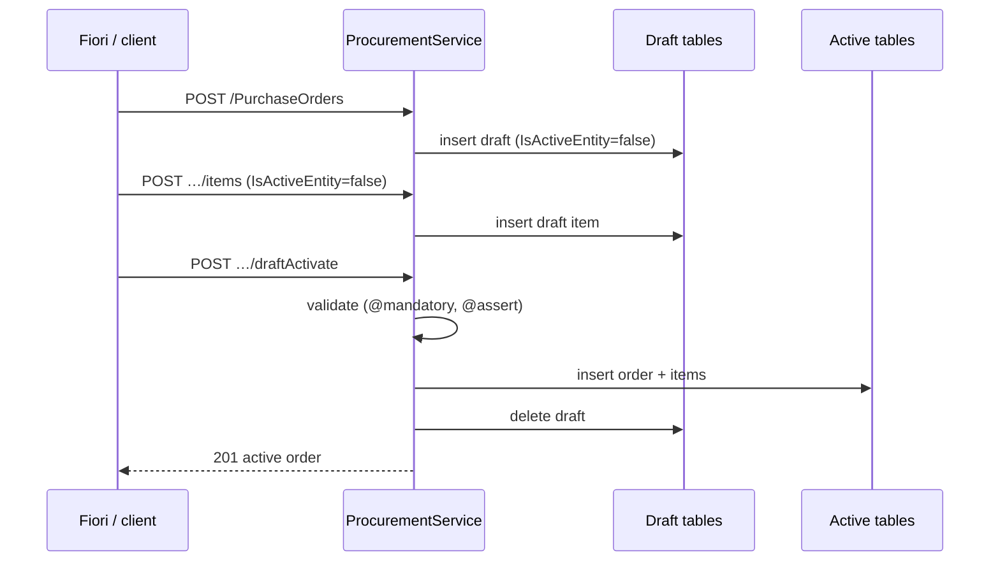
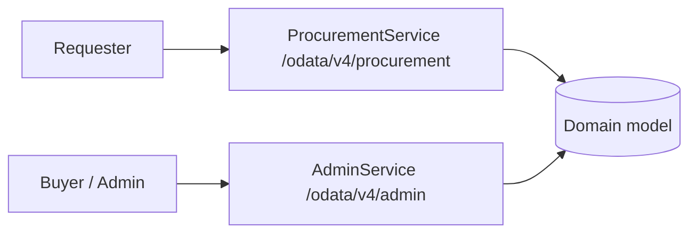

<!--
What: Guide for stage 03 (services): use-case specific OData V4 services - ProcurementService with
    draft-enabled purchase orders and AdminService for master data - with tests and sample requests.
Why: [CAP-STAGE-03] / [CAP-M03] explains service-per-use-case, projections and the draft protocol
    before any custom logic is written.
If missing or unlinked: Learners see two CDS files without the reasoning, the draft URLs or the
    impact of draft, and the DoD report marks the stage incomplete.
-->

# Stage 03 - Services

## Purpose

Expose the domain model through two use-case services: `ProcurementService` for requesters
(draft-enabled purchase orders with items) and `AdminService` for master data - and learn the OData
draft protocol that Fiori Elements uses.

## Module reference

- [CAP-M03 Providing Services & OData](../CAP_DEVELOPMENT_GUIDE.md#cap-m03-providing-services--odata) - decision [CAP-DEC-01]
- [CAP-M04 Initial Data & Testing Basics](../CAP_DEVELOPMENT_GUIDE.md#cap-m04-initial-data--testing-basics)

## Prerequisites

As [stage 01](../stage-01-basics/README.md). Optional: VS Code extension "REST Client" (or any
HTTP client) for `test/requests.http`.

## Folder structure

```
stage-03-services/
├─ db/                          # unchanged from stage 02 (model + CSV data)
├─ srv/procurement-service.cds  # requester service: draft POs, read-only master data
├─ srv/admin-service.cds        # master-data service: suppliers (+contacts), products, categories
├─ test/service.test.js         # 8 API tests incl. draft round trip
├─ test/requests.http           # sample requests to click through
└─ CHANGELOG-STAGE.md, README.md, package.json, .gitignore
```

## How to run

```sh
cd stage-03-services
npm run watch
```

The log lists both services:

```
[cds] - serving AdminService { at: [ '/odata/v4/admin' ] ... }
[cds] - serving ProcurementService { at: [ '/odata/v4/procurement' ] ... }
```

Then run the requests in `test/requests.http`, or:

```sh
curl "http://localhost:4004/odata/v4/procurement/PurchaseOrders?\$expand=items"
curl "http://localhost:4004/odata/v4/procurement/\$metadata"
```

## How to test

```sh
npm test
```

8 tests pass: `$metadata` with `Common.DraftRoot`, `$expand`, draft create → add item →
`draftActivate`, `draftEdit` on an active order, activation blocked by `@mandatory`, read-only
products, deep insert of supplier contacts, `@assert.range` rejection.

## Key concepts

- **One service per use case** ([CAP-DEC-01]) - requesters and administrators get different
  entity sets, fields and (stage 06) authorizations. The database model is never exposed 1:1.
- **Projections shape the API**:
  ```cds
  @readonly entity Suppliers as projection on db.Suppliers { ID, name, country };
  ```
  Contacts (personal data) are simply not part of the requester API.
- **Auto-exposed code lists** - `Currencies`, `Countries` and `_texts` entity sets appear
  automatically because the model references them.
- **Draft** - `@odata.draft.enabled` on the root; compositions (items) are drafted with it.

  | Step | Request |
  |------|---------|
  | create draft | `POST /PurchaseOrders` |
  | change draft | `PATCH /PurchaseOrders(ID=…,IsActiveEntity=false)` |
  | add child | `POST /PurchaseOrders(ID=…,IsActiveEntity=false)/items` |
  | save | `POST …(IsActiveEntity=false)/ProcurementService.draftActivate` |
  | edit active | `POST …(IsActiveEntity=true)/ProcurementService.draftEdit` |
  | discard | `DELETE /PurchaseOrders(ID=…,IsActiveEntity=false)` |

  Validations such as `@mandatory` run on activation, not on every draft change.
- **Deep insert** - compositions can be created in one POST (`contacts: [...]`).

## When to use / When not to use

| Use draft when | Avoid draft when |
|----------------|------------------|
| multi-step editing of an object with children (PO + items) | simple master data (`AdminService`) |
| users need to leave and continue later | high-volume system-to-system writes (draft locks, extra calls) |

## Impact & trade-offs

| Aspect | Impact |
|--------|--------|
| Storage | draft adds shadow tables (`..._drafts`) and `DraftAdministrativeData` |
| Concurrency | a draft locks the object for other users until activated or discarded (timeout) |
| API consumers | integrations must use the draft protocol or a separate non-draft service |
| Security | projections reduce exposed fields; still open to everyone until stage 06 adds `@restrict` |

## Visuals





## Deviations from guide

| Guide | Here | Reason |
|-------|------|--------|
| ProcurementService lists POs, items, Products, Suppliers | also `Categories` and `ApprovalLog` (read-only) | value helps (stage 05) and the approval history need them |
| Jest-style test | `node:test` + `cds.test` | see stage 01 |

## Troubleshooting

| Symptom | Cause | Fix |
|---------|-------|-----|
| `404` on `PurchaseOrders(<id>)` | draft entities need both keys | use `PurchaseOrders(ID=<id>,IsActiveEntity=true)` |
| `409` "draft locked" | another user has a draft of the order | discard it or wait for the lock timeout |
| new draft appears without data in a list | list shows active entities by default | filter `IsActiveEntity eq false` or use Fiori's "Own drafts" |
| `400` on `draftActivate` | `@mandatory` or `@assert` failed | read the error `target` (e.g. `supplier_ID`) |

## References

- https://cap.cloud.sap/docs/guides/providing-services
- https://cap.cloud.sap/docs/advanced/fiori#draft-support
- https://cap.cloud.sap/docs/guides/providing-services#deep-insert
- https://cap.cloud.sap/docs/node.js/cds-test
