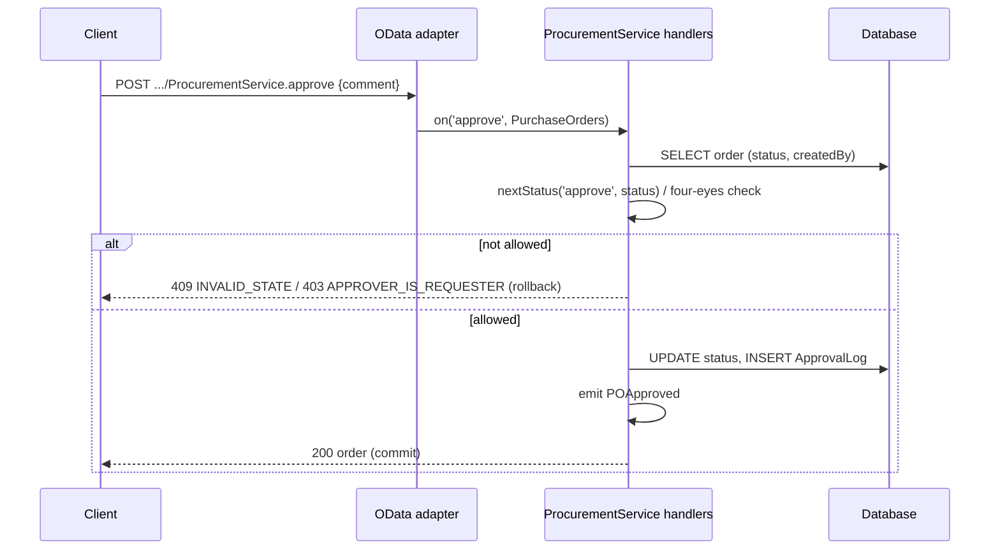
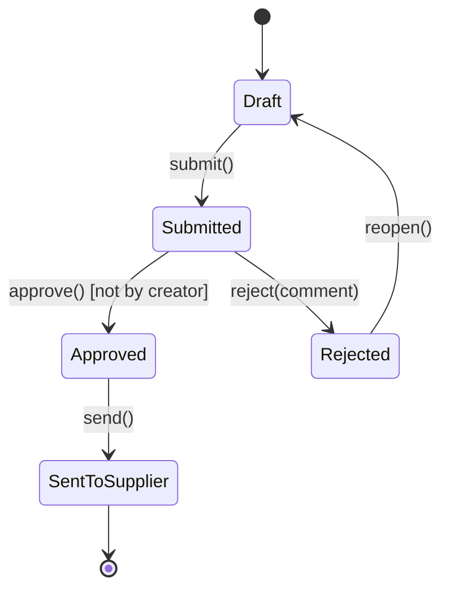

<!--
What: Guide for stage 04 (custom logic): event handlers, validation, the purchase-order status
    actions, a number range, in-process events, localized messages and a mocked S/4HANA Business
    Partner remote service.
Why: [CAP-STAGE-04] / [CAP-M05..M08] - this is where business rules live; the README explains the
    handler lifecycle, when to use actions instead of updates, and the error conventions.
If missing or unlinked: Learners see handler code without the decisions behind it, and the DoD
    report marks the stage incomplete.
-->

# Stage 04 - Custom logic

## Purpose

Add business behaviour to the services: order numbers, price defaulting, totals, validation with
localized messages, the PO lifecycle as bound actions (with approval log and four-eyes rule), a
read-only function, an in-process event, and live delegation to a (mocked) S/4HANA Business
Partner API.

## Module reference

- [CAP-M05 Handlers & Validation](../CAP_DEVELOPMENT_GUIDE.md#cap-m05-custom-logic-handlers--validation) - [CAP-DEC-02]
- [CAP-M06 Actions & Functions](../CAP_DEVELOPMENT_GUIDE.md#cap-m06-actions--functions) - [CAP-DEC-03]
- [CAP-M07 Events & Messaging](../CAP_DEVELOPMENT_GUIDE.md#cap-m07-events--messaging) (in-process) - [CAP-DEC-04]
- [CAP-M08 Consuming Remote Services](../CAP_DEVELOPMENT_GUIDE.md#cap-m08-consuming-remote-services) - [CAP-DEC-05]

## Prerequisites

As [stage 01](../stage-01-basics/README.md). `cds import` added `@sap-cloud-sdk/connectivity`,
`@sap-cloud-sdk/http-client` and `@sap-cloud-sdk/resilience` (needed to call real remote systems;
installed with `npm install` at the repo root).

## Folder structure

```
stage-04-custom-logic/
├─ db/schema.cds, db/number-ranges.cds          # model + NumberRanges table
├─ db/data/                                      # stage-02 data + number range start value
├─ srv/procurement-service.cds                   # actions, function, event, RemoteSuppliers
├─ srv/procurement-service.js                    # the service implementation (handlers)
├─ srv/admin-service.cds                         # unchanged
├─ srv/lib/status.js                             # state machine table
├─ srv/lib/number-range.js                       # next number from NumberRanges
├─ srv/lib/totals.js                             # item sum, total recalculation
├─ srv/external/API_BUSINESS_PARTNER.edmx        # remote API metadata (input of cds import)
├─ srv/external/API_BUSINESS_PARTNER.cds         # generated by cds import
├─ srv/external/data/API_BUSINESS_PARTNER-*.csv  # mock data used by cds watch / tests
├─ _i18n/messages.properties, messages_de.properties  # message texts (en, de)
├─ test/actions.test.js                          # lifecycle, 409s, four-eyes, event, function
├─ test/handlers.test.js                         # numbers, defaults, totals, validation
├─ test/remote.test.js                           # delegation + 502 on remote failure
├─ test/units.test.js                            # pure helper tests
└─ test/requests.http                            # requests 1-14 incl. actions
```

## How to run

```sh
cd stage-04-custom-logic
npm run watch
```

The log shows the mocked remote service:

```
[cds] - mocking API_BUSINESS_PARTNER { at: [ '/odata/v4/api-business-partner' ] ... }
[cds] - serving ProcurementService { at: [ '/odata/v4/procurement' ] ... }
```

Run requests 9-14 of `test/requests.http`, or:

```sh
curl -u alice: -X POST -H "Content-Type: application/json" -d '{}' \
  "http://localhost:4004/odata/v4/procurement/PurchaseOrders(ID=d1000000-0000-4000-8000-000000000001,IsActiveEntity=true)/ProcurementService.submit"
curl "http://localhost:4004/odata/v4/procurement/topSuppliers(limit=3)"
curl "http://localhost:4004/odata/v4/procurement/RemoteSuppliers?\$filter=blocked eq true"
```

## How to test

```sh
npm test
```

30 tests pass (5 files). `test/guardrails.test.js` (9 tests) holds the regression tests of the [security and code review](../docs/security-guardrails.md). Note the test setup: `cds.test(dir, '--with-mocks')` - unlike
`cds watch`, `cds.test` does not mock required services unless asked.

## Key concepts

- **Handler phases** - `before` (validate, enrich), `on` (replace or implement), `after`
  (post-process). Generic CRUD stays CAP's job; we only add rules.
- **Draft events** - `NEW` on `PurchaseOrders.drafts` when a draft is created, `UPDATE`/`DELETE` on
  `PurchaseOrderItems.drafts` for draft edits; activation runs `CREATE`/`UPDATE` on the active
  entity with the full deep data:
  ```js
  this.before('NEW', PurchaseOrders.drafts, async (req) => { req.data.orderNo = await nextNumber('PurchaseOrder') })
  this.before(['CREATE', 'UPDATE'], PurchaseOrders, (req) => { req.data.totalAmount = sumItems(req.data.items) })
  ```
- **Bound actions** for state changes; the rules live in a table (`srv/lib/status.js`):
  ```js
  submit: { from: ['Draft'], to: 'Submitted' }, approve: { from: ['Submitted'], to: 'Approved' }, ...
  ```
  An action on a draft instance is dispatched to `PurchaseOrders.drafts` - register a handler
  there too, otherwise CAP answers `501`.
- **Errors** - `req.error()` collects (all problems in one response), `req.reject()` stops at once.
  Messages are i18n keys with arguments:
  ```js
  req.reject({ status: 409, message: 'INVALID_STATE', args: [po.orderNo, po.status, action] })
  ```
  `_i18n/messages_de.properties` answers `Accept-Language: de` requests in German.
- **Transactions** - every request is one transaction; a rejected action rolls back its updates
  (and the drawn order number).
- **Four-eyes rule** - `po.createdBy === req.user.id` → 403. `managed` fills `createdBy`.
- **Events** - `this.emit('POApproved', {...})`; any service can `srv.on('POApproved', ...)`.
- **Remote services** - `cds import` creates the CDS model and the `cds.requires` entry; the
  service projects the remote entity and delegates: `this.on('READ', RemoteSuppliers, req => bp.run(req.query))`.
  Development: mocked from `srv/external/data`; production: destination `S4_BP`.

### Decision: action, function or PATCH? ([CAP-DEC-03])

| Need | Use | Here |
|------|-----|------|
| change the state of one order with rules and audit | bound action | `submit`, `approve`, ... |
| cross-entity operation | unbound action | - |
| read-only computation | function | `topSuppliers(limit)` |
| change ordinary fields | PATCH (draft) | items, currency |
| change `status` directly | **never** - `status` is `@readonly` | - |

### Error-handling conventions

| Situation | Status | Example key |
|-----------|--------|-------------|
| invalid input | 400 | `NEGATIVE_PRICE`, `PRODUCT_NOT_FOUND`, `REJECT_COMMENT_REQUIRED` |
| not allowed for this user | 403 | `APPROVER_IS_REQUESTER` |
| wrong state | 409 | `INVALID_STATE`, `ORDER_IN_DRAFT` |
| remote system failed | 502 | `REMOTE_UNAVAILABLE` |

Always pass a `target` (field name) for field errors so Fiori highlights the field.

## When to use / When not to use

- **Use handlers** for cross-field and cross-entity rules ([CAP-DEC-02]); **use annotations**
  (`@mandatory`, `@assert.range`, `@readonly`) for everything they can express.
- **Use delegation** (`RemoteSuppliers`) for small, live data; **replicate** (stage 08) when you
  need joins, sorting on remote fields or offline availability ([CAP-DEC-05]).
- **Use in-process events** inside one app; use a broker with an outbox for other apps (stage 08).
- **Do not** put business rules in the UI.

## Impact & trade-offs

| Aspect | Impact |
|--------|--------|
| Latency | every handler runs per request; `topSuppliers` is one grouped query (no N+1) |
| Consistency | number range row is a hot spot under heavy parallel creation (row lock) |
| Availability | `RemoteSuppliers` fails when S/4HANA is down - mapped to 502, other features keep working |
| Security | four-eyes rule in code; role checks follow in stage 06 |
| Events | in-process events are lost on rollback or crash - outbox in stage 08 |

## Visuals

Handler lifecycle for an action call:



Status lifecycle (implemented in `srv/lib/status.js`):



## Deviations from guide

| Guide | Here | Reason |
|-------|------|--------|
| `orderNo = PO-${Date.now()}` ("replace with number-range logic") | `NumberRanges` table + `srv/lib/number-range.js` | the guide asks for number-range logic; timestamps collide and are unreadable |
| `req.error(404, 'PRODUCT_NOT_FOUND', ...)` | status 400 | the request is invalid; 404 would claim the URL does not exist |
| `return this.read(PurchaseOrders, ID)` | `this.run(SELECT.one.from(PurchaseOrders).where({ ID, IsActiveEntity: true }))` | draft entities have two keys; the result needs the draft flags for Fiori |
| `cds import ./external/API_BUSINESS_PARTNER.edmx` (CSN output) | `--as cds` | readable, commentable CDS; same model |
| EDMX downloaded from SAP | hand-written subset with the real names/types | full file requires a SAP Business Accelerator Hub login |
| `messages.properties` in `_i18n/` | same | CAP 10 searches `_i18n`, `i18n`, `assets/i18n` |
| Messages via `req.error(code, key, target)` | object form `{ status, message, args, target }` | explicit, works for all argument combinations |

If you also use the SAP dev accelerators repository, its `s4-mock` package is a richer standalone
S/4HANA mock (V2 paths, fault injection) for integration tests.

## Troubleshooting

| Symptom | Cause | Fix |
|---------|-------|-----|
| `No credentials configured for "API_BUSINESS_PARTNER"` in tests | `cds.test` does not mock by default | `cds.test(dir, '--with-mocks')` |
| `501 Not Implemented` on an action | action called on a draft instance or handler not registered | call on `IsActiveEntity=true`; register handlers for `.drafts` |
| raw key `INVALID_STATE` in the response | messages file not found | `_i18n/messages.properties` next to `package.json` |
| total not updated in a draft | handler registered on the active entity only | register on `PurchaseOrderItems.drafts` |
| number range error | `NumberRanges` row missing | add the row (CSV here, initial data job in production) |

## References

- https://cap.cloud.sap/docs/node.js/core-services#srv-on-before-after
- https://cap.cloud.sap/docs/node.js/events#req-error
- https://cap.cloud.sap/docs/guides/providing-services#actions-functions
- https://cap.cloud.sap/docs/advanced/fiori#draft-support
- https://cap.cloud.sap/docs/guides/events/
- https://cap.cloud.sap/docs/guides/using-services
- https://cap.cloud.sap/docs/guides/i18n#localized-messages
