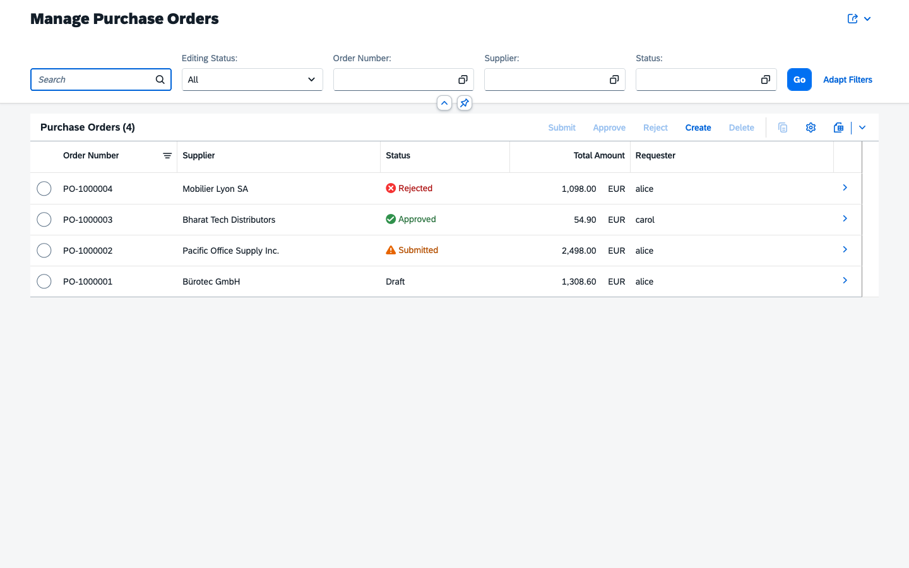
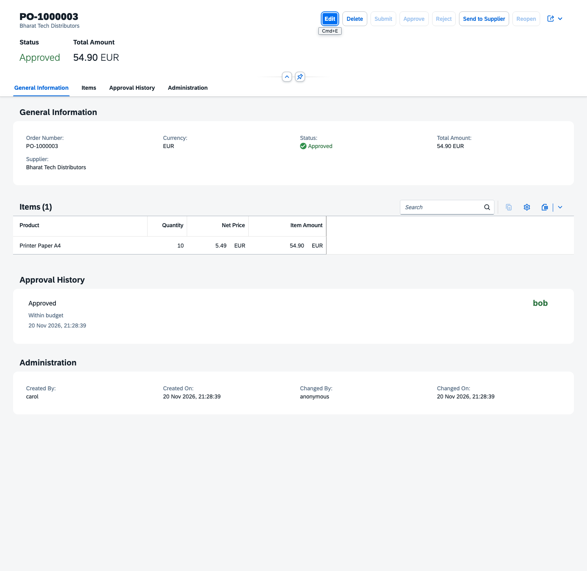
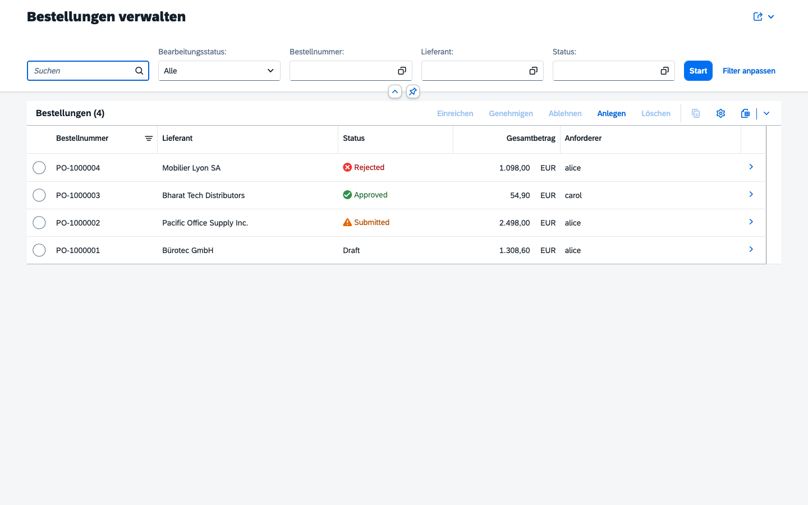
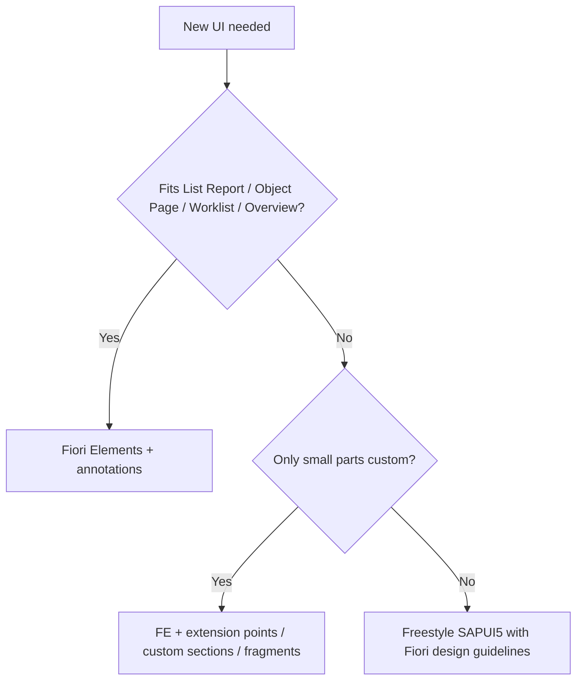

<!--
What: Guide for stage 05 (Fiori Elements): the "Manage Purchase Orders" List Report / Object Page
    app, driven by CDS annotations, with value helps, side effects, status colours, action buttons
    and a custom Approval History section.
Why: [CAP-STAGE-05] / [CAP-M09] [CAP-M10] [CAP-M14] - explains which annotation produces which UI
    element, when Fiori Elements is the right choice, and how to extend it without freestyle code.
If missing or unlinked: Learners see annotations without the mapping to the UI, and the DoD
    report marks the stage incomplete.
-->

# Stage 05 - Fiori Elements

## Purpose

Put a standard SAP Fiori UI on top of `ProcurementService`: a List Report and an Object Page for
purchase orders, generated at runtime by Fiori Elements from CDS annotations. Users create orders
as drafts, add items with a product value help (price defaulted by the server), see the total
refresh live, and drive the lifecycle with Submit / Approve / Reject / Send / Reopen buttons that
are enabled only in the right status. A custom section shows the approval history.

## Module reference

- [CAP-M09 Fiori Elements UI](../CAP_DEVELOPMENT_GUIDE.md#cap-m09-fiori-elements-ui) - [CAP-DEC-06]
- [CAP-M10 Fiori Custom Extensions](../CAP_DEVELOPMENT_GUIDE.md#cap-m10-fiori-custom-extensions)
- [CAP-M14 Localization (i18n)](../CAP_DEVELOPMENT_GUIDE.md#cap-m14-localization-i18n) (annotation labels in en/de)

## Prerequisites

As [stage 04](../stage-04-custom-logic/README.md), plus:

| Tool | Version used | Note |
|------|--------------|------|
| SAPUI5 | 1.148.13 (LTS) | loaded from `https://ui5.sap.com` by `index.html` - needs internet access |
| Browser | any current Chrome / Edge / Firefox / Safari | |
| SAP Fiori tools (optional) | VS Code / SAP Business Application Studio extension | to generate or edit the app with wizards and the Page Map |

## Folder structure

```
stage-05-fiori-elements/
├─ app/services.cds                              # NEW includes the annotations of every app
├─ app/_i18n/i18n.properties, i18n_de.properties # NEW annotation labels (en, de)
├─ app/procurement/annotations.cds               # NEW all UI annotations of the app
├─ app/procurement/webapp/
│  ├─ index.html                                 # NEW standalone start page (UI5 from CDN)
│  ├─ Component.js                               # NEW sap.fe.core.AppComponent, no code
│  ├─ manifest.json                              # NEW data source, routing, custom section
│  ├─ i18n/i18n.properties, i18n_de.properties   # NEW app title, custom section texts
│  └─ ext/fragment/ApprovalHistory.fragment.xml  # NEW custom section (XML fragment)
├─ srv/procurement-service.cds                   # CHANGED virtual statusCriticality
├─ srv/procurement-service.js                    # CHANGED after-READ fills statusCriticality
├─ srv/lib/status.js                             # CHANGED criticality per status
├─ test/ui.test.js                               # NEW app served, annotations, draft UI flow
├─ test/requests.http                            # CHANGED requests 15-17 (what the app sends)
└─ db/, _i18n/, srv/external/, other tests       # unchanged from stage 04
```

## How to run

```sh
cd stage-05-fiori-elements
npm run watch
```

Open <http://localhost:4004> and click `/procurement/webapp/index.html`, or open
<http://localhost:4004/procurement/webapp/index.html> directly. Add `?sap-language=de` for German.

Try the flow the acceptance check asks for:

1. **Create** - the object page opens a draft; the order number is drawn at once.
2. Choose a **Supplier** from the value help (shows names, not UUIDs).
3. In **Items**, add a row, pick a **Product** - the net price is filled by the server and the
   **Total Amount** in the header refreshes (side effects).
4. **Save** (activates the draft), then **Submit** - the status turns orange (*Submitted*).
5. Sign in as another user to approve: open a private window and use `bob` with an empty
   password (mocked auth). Approving as the requester `alice` answers 403 (four-eyes rule).

The browser asks for credentials when an action needs a user; mocked users are `alice`, `bob`,
`carol` ... with an empty password.

## How to test

```sh
npm test
```

26 tests pass (5 files). `test/ui.test.js` needs no browser: it checks that the app files are
served, that `$metadata` contains the UI annotations with translated labels, that every status gets
the right colour, and runs "create draft → add item → activate → submit" through the same OData
requests the app sends.

Screenshots (made with headless Chrome against `cds serve --in-memory`) are in
[`docs/images`](../docs/images):

| List Report | Object Page | List Report (de) |
|---|---|---|
|  |  |  |

## Key concepts

- **Annotations in CDS, not in XML** - `app/procurement/annotations.cds` annotates the *service*
  entities; CAP compiles them into `$metadata`. `app/services.cds` is the entry point CAP loads.
- **Labels via i18n** - `@title: '{i18n>OrderNo}'` is resolved server-side from
  `app/_i18n/i18n_<lang>.properties` per request language.
- **Virtual element for UI state** - `virtual null as statusCriticality : Integer` in the
  projection, filled in an `after('READ')` handler; never stored.
- **Side effects** - tell the UI what to re-read after a change:
  ```cds
  Common.SideEffects #ItemsChanged: { SourceEntities: [ items ], TargetProperties: [ 'totalAmount' ] }
  ```
- **Action availability** - buttons are disabled unless the transition is allowed:
  ```cds
  submit @Core.OperationAvailable: ($self.status = 'Draft')
  ```
- **Custom section** - `manifest.json` → `content.body.sections.ApprovalHistory` points to an XML
  fragment; it binds to the `approvals` association, no controller needed.

### Annotation cheat sheet (annotation → UI effect)

| Annotation | UI effect |
|------------|-----------|
| `UI.HeaderInfo` | object page title / subtitle, table title ("Purchase Orders (4)") |
| `UI.SelectionFields` | filter fields in the List Report filter bar |
| `UI.LineItem` | table columns; `DataFieldForAction` entries become toolbar buttons |
| `UI.PresentationVariant` | default sort order of the list |
| `UI.DataPoint` + `UI.HeaderFacets` | key figures in the object page header (Status, Total) |
| `UI.Identification` (actions) | buttons in the object page header |
| `UI.Facets` → `UI.ReferenceFacet` | object page sections (General, Items, Administration) |
| `UI.FieldGroup#X` | a form with the listed fields |
| `Criticality` on a data field | coloured status with icon (0 neutral, 1 red, 2 orange, 3 green) |
| `Common.Text` + `TextArrangement` | show the name instead of the key (UUID) |
| `Common.ValueList` | value help dialog / dropdown for a field |
| `Common.SideEffects` | refresh of dependent fields after an edit or action |
| `Core.OperationAvailable` | enables/disables an action button per instance |
| `Measures.ISOCurrency` | amount formatted with its currency |
| `UI.Hidden` | field never shown (still available to expressions) |
| `UI.MultiLineText` | text area instead of a single-line input |
| `@title` / `Common.Label` | field label |
| `@mandatory` | required-field asterisk and client check |
| `@odata.draft.enabled` (service) | Edit / Save / Discard buttons, "Editing Status" filter |

### Fiori design guideline checklist

| Guideline | Done here |
|-----------|-----------|
| standard floorplan (List Report + Object Page) | ✅ |
| every label translatable, no hard-coded text | ✅ `{i18n>...}` everywhere; German included |
| semantic types (currency, criticality) | ✅ `Measures.ISOCurrency`, `Criticality` |
| names instead of technical keys | ✅ `Common.Text` + `#TextOnly` for UUIDs |
| actions only when allowed | ✅ `Core.OperationAvailable` |
| no custom CSS, no controller code | ✅ |
| responsive (desktop, tablet, phone) | ✅ `deviceTypes` + responsive tables |
| theme | ✅ `sap_horizon` |

## When to use / When not to use



- **Use Fiori Elements** for CRUD-style business objects with standard floorplans - here, POs.
- **Use extensions** (in increasing cost: annotations → manifest settings → fragment →
  controller extension) for small gaps like the approval history list.
- **Use freestyle UI5** only for unique UX (dashboards with custom visuals, complex wizards).
- **Do not** add business rules in the UI - the buttons are only a view of the server-side rules.

## Impact & trade-offs

| Aspect | Impact |
|--------|--------|
| Maintenance | almost no UI code; UI5 upgrades bring new features for free |
| Flexibility | limited to what floorplans and extension points allow |
| Performance | `autoExpandSelect` requests only shown columns; side effects add small extra reads |
| Draft | every edit is a server round trip and creates draft rows (see stage 03) |
| Security | the UI hides buttons, but only server checks protect data (roles follow in stage 06) |
| Dependency | `index.html` loads UI5 from the CDN; in production the launchpad / HTML5 repo provides it (stage 10) |

## Visuals

Request flow of the app:

```mermaid
sequenceDiagram
  participant B as Browser (Fiori Elements)
  participant C as CAP (cds watch)
  B->>C: GET /procurement/webapp/index.html, manifest.json (static)
  B->>C: GET /odata/v4/procurement/$metadata (annotations + i18n labels)
  B->>C: GET PurchaseOrders?$select=...&$expand=supplier (list)
  B->>C: POST PurchaseOrders (Create = new draft)
  B->>C: POST PurchaseOrders(...,IsActiveEntity=false)/items
  C-->>B: item with netPrice; side effect -> GET totalAmount
  B->>C: POST .../draftActivate (Save), then .../submit
```

Screenshots: see [How to test](#how-to-test).

## Deviations from guide

| Guide | Here | Reason |
|-------|------|--------|
| generate the app with SAP Fiori tools | files written by hand, same structure as the generator output | reproducible without an IDE; Fiori tools can still open and edit it |
| `{ Value: supplier.name }` in `UI.LineItem` | `{ Value: supplier_ID }` + `Common.Text: supplier.name` | the column stays filterable/sortable by key and shows the name |
| UI5 version not specified | 1.148 LTS from the CDN, `minUI5Version` 1.148.0 | LTS release current at the time of writing |
| `docs/images/*.png` | `docs/images/stage-05-fiori-elements-*.png` | the DoD report looks for screenshots per folder by prefix |
| annotations `TextFirst` for products | `TextOnly` | the key is a UUID and must not be shown |

Known limitation: status values (`Draft`, `Approved`, ...) are enum values and stay English in the
German UI. Translating them needs a code list entity (`sap.common.CodeList`) for the status - a
good exercise.

## Troubleshooting

| Symptom | Cause | Fix |
|---------|-------|-----|
| blank page | no internet - UI5 cannot load from `ui5.sap.com` | connect, or use `npx ui5 serve` with a local UI5 |
| table without columns, raw `{i18n>...}` labels | `app/services.cds` missing or not loaded | make sure `app/services.cds` has `using from './procurement/annotations'` |
| UUID shown next to names | `TextArrangement` not `#TextOnly` | set `#TextOnly` for UUID keys |
| total does not refresh | missing `Common.SideEffects` | add side effect on `items` → `totalAmount` |
| all action buttons enabled | `Core.OperationAvailable` missing | annotate each action with the status expression |
| custom section "could not find fragment" | wrong `template` name in manifest | `acme.procurement.ext.fragment.<Name>` = `sap.app.id` + path |
| 403 on Approve | approver is the requester (four-eyes rule) | log in as another mocked user (private window) |
| date empty in the approval history | explicit `type` in the binding not loaded in async mode | bind `{createdAt}` and let the V4 model derive the type |

## References

- https://cap.cloud.sap/docs/advanced/fiori
- https://cap.cloud.sap/docs/advanced/odata#annotations
- https://ui5.sap.com/#/topic/03265b0408e2432c9571d6b3feb6b1fd (SAP Fiori elements - see "Side Effects" and "Extension Points for Sections on the Object Page")
- https://experience.sap.com/fiori-design-web/
- https://help.sap.com/docs/SAP_FIORI_tools
