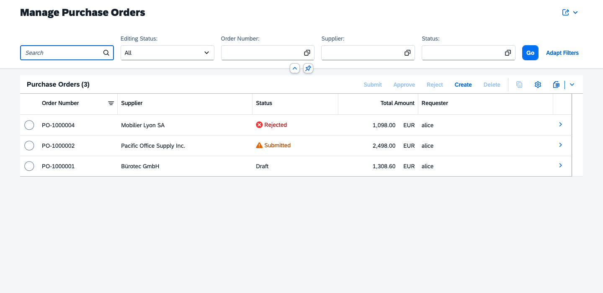
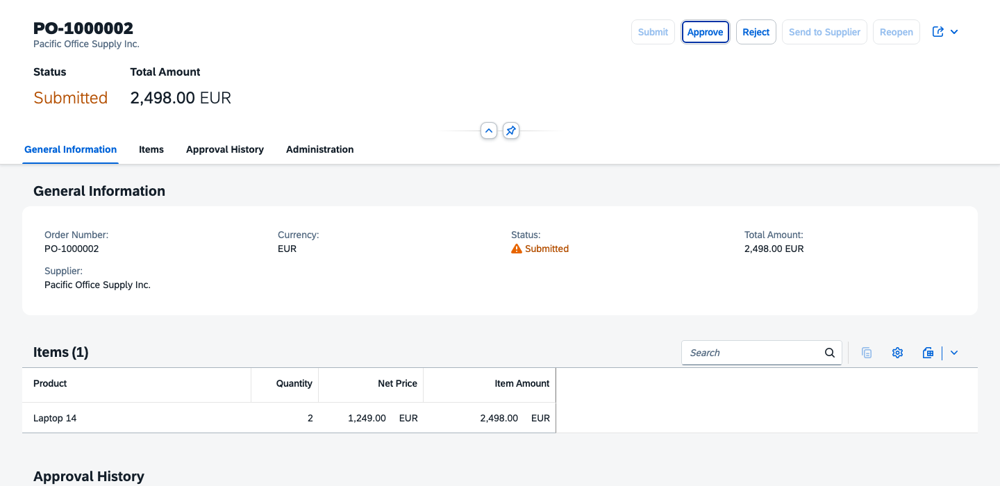
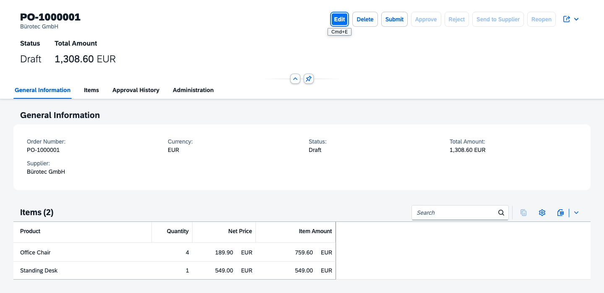
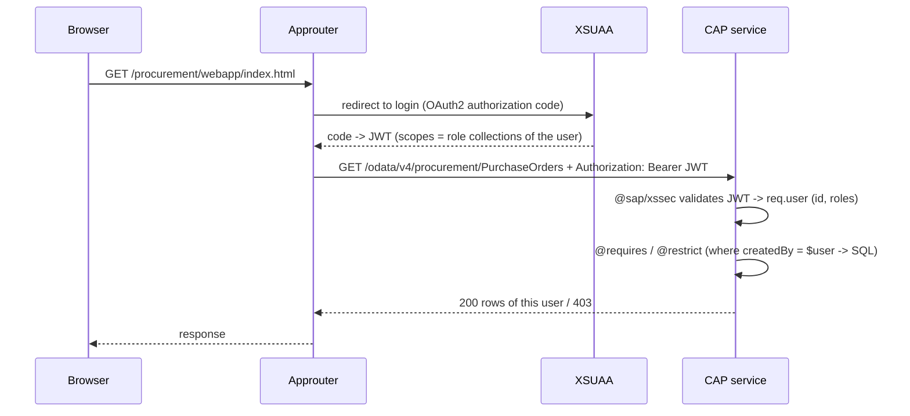

<!--
What: Guide for stage 06 (security): authentication, role-based and instance-based authorization
    of ACME Procurement with @requires / @restrict, mocked users for development, XSUAA
    (xs-security.json) and the application router for production.
Why: [CAP-STAGE-06] / [CAP-M11] / [CAP-DEC-07] - explains the role matrix, how CAP enforces it, how
    development and production authentication differ, and what happens when restrictions are missing.
If missing or unlinked: Learners copy restrictions without understanding them, and the DoD report
    marks the stage incomplete.
-->

# Stage 06 - Security

## Purpose

Secure the procurement app: every request needs a user, each of the five business roles gets
exactly the operations from the role table of the guide (Section 2.5), requesters see and change
only their own orders, and the Fiori app shows only the buttons a user may press. Development uses
mocked users; production uses XSUAA tokens via an application router.

## Module reference

- [CAP-M11 Authentication & Authorization](../CAP_DEVELOPMENT_GUIDE.md#cap-m11-authentication--authorization) - [CAP-DEC-07]
- [CAP-M09 Fiori Elements UI](../CAP_DEVELOPMENT_GUIDE.md#cap-m09-fiori-elements-ui) (Edit/Delete buttons per user)
- [CAP-M24 Testing Strategy](../CAP_DEVELOPMENT_GUIDE.md#cap-m24-testing-strategy) ("each authorization rule tested")

## Prerequisites

As [stage 05](../stage-05-fiori-elements/README.md), plus:

| Tool | Version used | Note |
|------|--------------|------|
| `@sap/xssec` | 4.x | added by `cds add xsuaa`; validates XSUAA tokens in production |
| `@sap/approuter` | 23.x | only in `.deploy/app-router`, not installed by the root `npm install` |
| SAP BTP subaccount with XSUAA | - | only for the *manual* production / hybrid steps |

## Folder structure

```
stage-06-security/
├─ srv/authorizations.cds              # NEW @requires / @restrict for both services
├─ srv/lib/permissions.js              # NEW canEdit(user, order) - UI hint mirroring the rules
├─ srv/procurement-service.cds         # CHANGED virtual canEdit
├─ srv/procurement-service.js          # CHANGED computes canEdit, reads inputs of virtual elements
├─ app/procurement/annotations.cds     # CHANGED UI.UpdateHidden / UI.DeleteHidden: (not canEdit)
├─ package.json                        # CHANGED mocked users with roles, [production] auth xsuaa, @sap/xssec
├─ xs-security.json                    # NEW scopes + role templates (cds add xsuaa)
├─ .deploy/app-router/                 # NEW application router (cds add approuter)
│  ├─ package.json                     #   @sap/approuter, start script
│  ├─ xs-app.json                      #   routes: everything -> srv-api, XSUAA login, logout
│  └─ default-env.json                 #   local destination srv-api (git-ignored, generated)
├─ test/authz.test.js                  # NEW 19 tests: 401, visibility, role x operation, XSUAA config
├─ test/actions|handlers|remote|ui.test.js  # CHANGED requests now carry users with the right role
├─ test/units.test.js                  # CHANGED canEdit unit tests
└─ test/requests.http                  # CHANGED Authorization headers, requests 18-24
```

## How to run

```sh
cd stage-06-security
npm run watch
```

Open <http://localhost:4004/procurement/webapp/index.html>. The browser asks for a user - enter a
user name below with an **empty password**. Use private windows to be several users at once.

| User | Roles | Try |
|------|-------|-----|
| `alice` | Requester | sees only PO-1000001/2/4; Create, Edit (own drafts), Submit |
| `fred` | Requester | sees no order at first; creates his own |
| `bob` | Approver | sees all orders; Approve / Reject; no Edit / Delete buttons |
| `carol` | Buyer | Send to Supplier; maintains suppliers and products (AdminService) |
| `dave` | Admin | everything |
| `erin` | Auditor | reads everything incl. approval log; every change is 403 |
| `gina` | Requester + Approver | team lead - the four-eyes rule stops her approving her own order |

Any other user name answers 401 (`"*": false`). Run requests 18-24 of `test/requests.http` to
see 401, 404 and 403 answers.

Production-like run (*manual*, needs BTP): create an XSUAA instance from `xs-security.json`, bind
it (`cds bind auth --to <instance>`), and start `cds watch --profile hybrid`; the approuter in
`.deploy/app-router` (`npm install && npm start` there) then handles the login. Deployment
follows in stage 10.

## How to test

```sh
npm test
```

58 tests pass (7 files). `test/guardrails.test.js` (11 tests) holds the regression tests of the [security and code review](../docs/security-guardrails.md). `test/authz.test.js` is the role × operation matrix:

| Operation | Requester (own) | Requester (other) | Approver | Buyer | Admin | Auditor | anonymous |
|-----------|:-:|:-:|:-:|:-:|:-:|:-:|:-:|
| read orders | ✅ own only | 404 | ✅ | ✅ | ✅ | ✅ | 401 |
| create draft | ✅ | ✅ | 403 | 403 | ✅ | 403 | 401 |
| edit / delete (status Draft) | ✅ | 403 | 403 | 403 | ✅ | 403 | 401 |
| edit / delete (after submit) | 403 | 403 | 403 | 403 | ✅ | 403 | 401 |
| submit, reopen | ✅ | 403 | 403 | 403 | ✅ | 403 | 401 |
| approve, reject | 403 | 403 | ✅ | 403 | ✅ | 403 | 401 |
| send | 403 | 403 | 403 | ✅ | ✅ | 403 | 401 |
| approval log | own orders | - | ✅ | ✅ | ✅ | ✅ | 401 |
| `topSuppliers` | 403 | 403 | ✅ | ✅ | ✅ | ✅ | 401 |
| `RemoteSuppliers` | 403 | 403 | 403 | ✅ | ✅ | 403 | 401 |
| AdminService suppliers / products | 403 | 403 | 403 | ✅ | ✅ | read | 401 |
| AdminService categories | 403 | 403 | 403 | read | ✅ | read | 401 |

Screenshots: alice's list (3 of 4 orders), bob's object page (Approve/Reject, no Edit/Delete),
alice's own draft (Edit, Delete, Submit):

| alice - List Report | bob - Object Page | alice - Object Page |
|---|---|---|
|  |  |  |

## Key concepts

- **`@requires`** - who may use a service, entity, action or function at all:
  ```cds
  annotate ProcurementService with @(requires: 'authenticated-user');
  annotate ProcurementService.RemoteSuppliers with @(requires: ['Buyer', 'Admin']);
  ```
- **`@restrict`** - which role may do which event, optionally only on some rows (`where`):
  ```cds
  { grant: ['READ', 'CREATE', 'submit', 'reopen'], to: 'Requester', where: 'createdBy = $user' },
  { grant: ['UPDATE', 'DELETE'], to: 'Requester', where: 'createdBy = $user and status = ''Draft''' },
  ```
  The `where` is added to the SQL of reads (rows of others are simply not found → 404) and checked
  against the target row for writes and bound actions (→ 403).
- **Path expressions** in conditions: items and approval log follow their order
  (`where: 'parent.createdBy = $user'`).
- **Draft** events map to the standard events: creating a draft = `CREATE`, Edit (`draftEdit`),
  saving and discarding = `UPDATE` / `DELETE`. One restriction protects both draft and active data.
- **Internal calls are not restricted** - handlers that use `SELECT`/`UPDATE` on `cds.db` bypass
  `@restrict`; they run *after* CAP checked the request. Tests that call a service directly need a
  user: `srv.tx({ user: cds.User.privileged }, ...)`.
- **Mocked users** (`package.json` → `cds.requires.auth.users`) replace the login in development;
  `"*": false` rejects unknown names.
- **Production** - `[production]` → `auth.kind: xsuaa`; `cds add xsuaa` derives scopes and role
  templates in `xs-security.json` from the roles used in the model. Administrators assign role
  collections in the BTP cockpit.
- **UI follows, never enforces** - Fiori Elements does not read `@restrict`. The virtual element
  `canEdit` (computed by `srv/lib/permissions.js`) drives `UI.UpdateHidden` / `UI.DeleteHidden`.
  The **Create** button stays visible to approvers (it does not depend on a row); in a launchpad,
  approvers would get an "Approve Purchase Orders" app instead of this one.

## When to use / When not to use

| Need | Use | Not |
|------|-----|-----|
| everybody must log in | `@requires: 'authenticated-user'` on the service | relying on the approuter alone |
| role per operation | `@restrict` with `grant` + `to` | `if (req.user.is(...))` in handlers |
| row-level ("own data") | `@restrict` `where` with `$user` (pushed to SQL) | filtering in `after READ` (breaks paging and `$count`) |
| rule depends on data outside the row or complex logic | handler (`req.reject(403)`) like the four-eyes rule | stuffing it into `where` |
| development | `mocked` users | real IdP for unit tests |
| production on BTP | XSUAA (this stage) or IAS + AMS ([CAP-DEC-07]) | basic auth |

## Impact & trade-offs

| Aspect | Impact |
|--------|--------|
| Security | missing `@requires` / `@restrict` = open endpoint: in development *any* user, in production any authenticated user of the subaccount can call it |
| Performance | `where` conditions become SQL predicates - no extra round trips; path conditions add a join/`EXISTS` |
| Privacy | 404 instead of 403 for other users' orders - existence is not revealed |
| UX | without UI hints users see buttons that fail; hints must mirror the rules (tested in `units.test.js`) |
| Operations | role collections are assigned per user in BTP; renaming a role changes `xs-security.json` and needs a redeploy |
| Testing | every rule is a test case; the matrix grows with roles × operations |

## Visuals

Authentication flow in production:



Development vs production:

```mermaid
flowchart LR
  subgraph Development
    B1[Browser / test] -- "Basic alice:" --> M[mocked auth: users from package.json] --> R1[@requires / @restrict]
  end
  subgraph Production
    B2[Browser] --> AR[Approuter] -- JWT --> XS[xssec: XSUAA token] --> R2[@requires / @restrict]
  end
```

## Deviations from guide

| Guide | Here | Reason |
|-------|------|--------|
| approuter in `app/router/` | `.deploy/app-router/` | `cds add approuter` in CAP 10 generates it there; the docs win ([CAP-VERIFY]) |
| `grant: ['READ','CREATE','UPDATE','DELETE'] ... where: 'createdBy = $user'` | `UPDATE`/`DELETE` additionally need `status = 'Draft'`; `submit`/`reopen` granted | without it a requester could edit an order after approval (found by the tests of this stage) |
| Auditor `READ` on POs | also approval log, master data and `topSuppliers` | role table says "read-only on all" |
| `"alice": { "roles": ["Requester"] }, "bob": ...` | 7 users incl. `gina` (Requester + Approver), `"*": false` | every role testable; four-eyes rule needs a user with both roles |
| IAS "recommended, check docs" | XSUAA | the stage spec asks for `xs-security.json`; switching is `cds add ias` (+ `cds add ams` for policies) - verify the current recommendation at https://cap.cloud.sap/docs/guides/security/authentication |
| no UI handling | `canEdit` + `UI.UpdateHidden` / `UI.DeleteHidden` | Fiori guideline: do not offer actions that must fail |

## Troubleshooting

| Symptom | Cause | Fix |
|---------|-------|-----|
| 401 for every request | no user sent / user not in `cds.requires.auth.users` | send `Authorization: Basic alice:`; check `npx cds env requires.auth` |
| 401 with the right user in tests | `@cap-js/cds-test` sends the password `undefined` if none is given | `auth: { username: 'alice', password: '' }` |
| 403 although the role is right | `where` condition false for this row (e.g. not `Draft`) | check the row; read `srv/authorizations.cds` |
| 404 for an existing order | instance-based `where` hides other users' rows | expected - log in as the owner or an auditor |
| tests calling `srv.run(...)` fail with 403 | no user outside an HTTP request | `srv.tx({ user: cds.User.privileged }, ...)` |
| Edit button shown but 403 on click | UI hint and `@restrict` diverged | keep `srv/lib/permissions.js` in sync (unit tests) |
| `canEdit` always false | its inputs (`status`, `createdBy`) not read | the `before READ` handler adds them - keep it when changing columns |
| approuter: "No destination srv-api" | `default-env.json` missing (git-ignored) | re-run `npx cds add approuter` or create it with destination `srv-api` → `http://localhost:4004` |

## References

- https://cap.cloud.sap/docs/guides/security/
- https://cap.cloud.sap/docs/guides/security/authorization
- https://cap.cloud.sap/docs/guides/security/authentication
- https://cap.cloud.sap/docs/node.js/authentication#mocked
- https://cap.cloud.sap/docs/advanced/fiori#draft-support (draft events)
- https://help.sap.com/docs/btp/sap-business-technology-platform/application-security-descriptor-configuration-syntax
- https://www.npmjs.com/package/@sap/approuter
