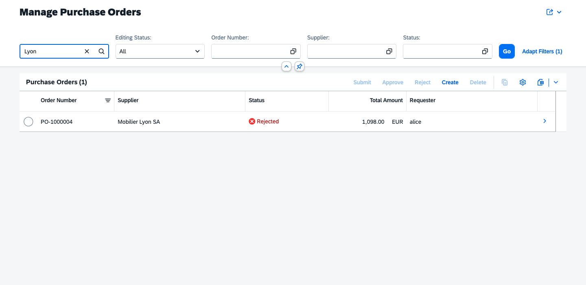
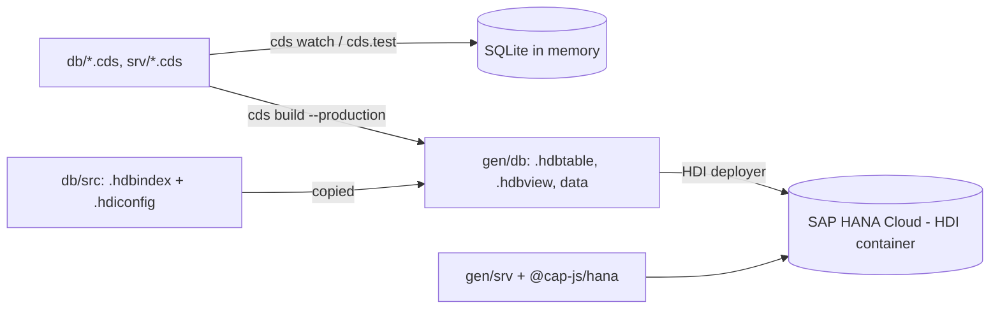
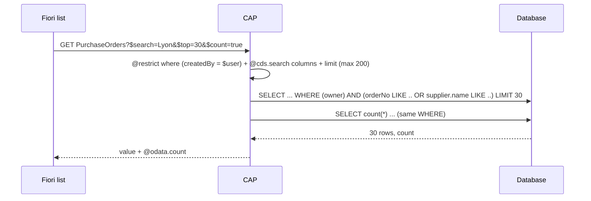

<!--
What: Guide for stage 07 (data persistence): SAP HANA Cloud as production database, the
    production build into an HDI deployment module, a native index, free-text search, paging limits
    and a performance check.
Why: [CAP-STAGE-07] / [CAP-M12] [CAP-M13] / [CAP-DEC-08] - explains what changes between SQLite in
    development and HANA in production, the data-loss risks of schema changes, and how to keep
    queries fast.
If missing or unlinked: Learners deploy to HANA without knowing the differences, and the DoD
    report marks the stage incomplete.
-->

# Stage 07 - Data persistence

## Purpose

Make ACME Procurement production-ready on the database side: SAP HANA Cloud in production (SQLite
stays for development and tests), a `cds build --production` that generates the HDI deployment
module, a native HANA index for the most frequent filter, a focused free-text search, page-size
limits that protect the database, and a script that measures the typical Fiori queries on 20,000
orders.

## Module reference

- [CAP-M12 Persistence: SQLite → SAP HANA Cloud](../CAP_DEVELOPMENT_GUIDE.md#cap-m12-persistence-sqlite--sap-hana-cloud) - [CAP-DEC-08]
- [CAP-M13 Advanced Querying & Performance](../CAP_DEVELOPMENT_GUIDE.md#cap-m13-advanced-querying--performance)
- Details: [docs/hana-notes.md](docs/hana-notes.md) (build output, hybrid testing, SQLite vs HANA, schema evolution, indexes)

## Prerequisites

As [stage 06](../stage-06-security/README.md), plus:

| Tool | Version used | Note |
|------|--------------|------|
| `@cap-js/hana` | 3.x | added by `cds add hana`; database service for production |
| `@sap/hdi-deploy`, `hdb` | 5.x / 2.x | only in the generated `gen/db/package.json` (installed at deploy time) |
| SAP BTP subaccount with SAP HANA Cloud, `cf` CLI | - | only for the *manual* hybrid steps |

## Folder structure

```
stage-07-data-persistence/
├─ srv/query-options.cds                       # NEW @cds.search + @cds.query.limit
├─ db/src/PurchaseOrders_owner_status.hdbindex # NEW native HANA index (createdBy, status)
├─ db/src/.hdiconfig                           # NEW maps .hdbindex to the HDI index plugin
├─ docs/hana-notes.md                          # NEW build output, hybrid, SQLite vs HANA, migration, indexes
├─ package.json                                # CHANGED @cap-js/hana; scripts build, perf
├─ test/persistence.test.js                    # NEW search, paging, production DB, cds build --production
├─ test/perf/queries.bench.js                  # NEW npm run perf - timings on 20,000 orders
├─ test/requests.http                          # CHANGED requests 25-28 (search, paging)
├─ gen/                                        # build output (git-ignored), created by npm run build / tests
└─ ... everything else unchanged from stage 06
```

## How to run

Development is unchanged (SQLite in memory):

```sh
cd stage-07-data-persistence
npm run watch
```

Try requests 25-28 of `test/requests.http`, or the search field in the Fiori app
(<http://localhost:4004/procurement/webapp/index.html>, user `erin`, empty password) - type
`Lyon` or `1000002`.



Production build:

```sh
npm run build          # = cds build --production
ls gen/db/src gen/db/src/gen | head
```

Expected: `build completed`, `gen/db/src/gen/*.hdbtable|*.hdbview|data/*`, the native
`gen/db/src/PurchaseOrders_owner_status.hdbindex`, and `gen/srv` with `@cap-js/hana`.

Performance check:

```sh
npm run perf                   # 20,000 orders / 60,000 items in SQLite
ORDERS=100000 npm run perf     # more volume
```

Example output (MacBook, SQLite in memory - absolute numbers vary, compare *relative* costs):

| request | rows | $count | median ms |
|---------|-----:|-------:|----------:|
| list page 30 + $count (Auditor, all rows) | 30 | 20004 | 19.6 |
| list page 30 + $count (Requester, own rows) | 30 | 5003 | 7.1 |
| `$search` by supplier name | 30 | | 11.1 |
| `$filter` status + `$orderby` | 30 | | 5.1 |
| deep `$expand` items/product (30 orders) | 30 | | 41.4 |
| no `$top` → server page | 50 | | 0.9 |
| `$top=100000` → capped | 200 | | 1.2 |

Deploying to HANA and running against it (*manual*, needs BTP): see
[docs/hana-notes.md - Hybrid testing](docs/hana-notes.md#2-hybrid-testing-manual---needs-a-btp-subaccount-with-sap-hana-cloud).

## How to test

```sh
npm test
```

55 tests pass (7 files). `test/persistence.test.js` (8 tests) checks search, paging, that the
production profile uses HANA, and runs `cds build --production` (writes `gen/`, ~5 s) to verify the
HDI module: tables, views, draft tables, CSV data, the native index with its `.hdiconfig`, the
deployer `package.json` and `@cap-js/hana` in `gen/srv`.

## Key concepts

- **Profiles** - `@cap-js/hana` in the dependencies makes `[production]` use `kind: hana`
  automatically; development and tests keep `@cap-js/sqlite`:
  ```sh
  npx cds env requires.db.kind                       # sqlite
  npx cds env requires.db.kind --profile production  # hana
  ```
- **HDI** - HANA Deployment Infrastructure: the generated `.hdbtable` / `.hdbview` files are
  deployed into an HDI container by the `gen/db` app; HDI computes the difference to the deployed
  state and migrates.
- **Native artefacts** ([CAP-DEC-08]) - only for what CDS cannot express; put them in `db/src` with
  a `.hdiconfig`. They exist on HANA only, so dev and prod differ - keep them rare.
- **Search** - `@cds.search: { orderNo, supplier }` restricts `$search` to these elements; an
  association (`supplier`) searches the target's searchable elements (its `name`).
- **Paging** - `@cds.query.limit: { default: 50, max: 200 }`: no `$top` → 50 rows and an
  `@odata.nextLink`; `$top` above 200 → 200 rows.
- **Costs** - `$count` doubles the work on large sets, deep `$expand` multiplies rows; instance-based
  restrictions are just another `WHERE` (fast with the right index).

## When to use / When not to use

| Need | Use | Avoid |
|------|-----|-------|
| production on BTP | SAP HANA Cloud with HDI | SQLite (single file, no HA) |
| development, unit tests | SQLite in memory | a shared HANA instance for every test run |
| integration test of HANA specifics | hybrid mode (`cds deploy --to hana`, `--profile hybrid`) | assuming SQLite behaves the same |
| table/view the model can express | CDS ([CAP-DEC-08]) | hand-written `.hdbtable` |
| index, calculation view, procedure, full-text index | native artefact in `db/src` | business logic in procedures |
| free-text search | `@cds.search` on few, meaningful elements | searching every string column |

## Impact & trade-offs

| Aspect | Impact |
|--------|--------|
| Portability | native artefacts are HANA-only; each one widens the gap between dev and prod |
| Data safety | renames/removals drop columns - see [schema evolution](docs/hana-notes.md#4-schema-evolution---data-loss-warning); use `@cds.persistence.journal` for important tables |
| Performance | page limits bound the worst case; `$count` and deep `$expand` are the expensive options |
| Cost | HANA Cloud is billed by memory/compute; indexes and `localized` views use memory |
| Operations | HDI deployer runs on every deployment; long migrations extend downtime unless blue-green (stage 10) |
| Testing | the build is tested on every run; HANA behaviour itself only in hybrid mode |

## Visuals

From model to database:



Paging and search in one request:



## Deviations from guide

| Guide | Here | Reason |
|-------|------|--------|
| `package.json` (hana profile) | no explicit `[production]` entry | with `@cap-js/hana` installed, CAP 10 uses HANA in production by default (`cds env ... --profile production` → `hana`, tested) |
| `@sap.index` / native `.hdbindex` | native `.hdbindex` + `db/src/.hdiconfig` | `@sap.index` is not a CAP annotation; CDS has no index syntax |
| "performance test scripts" | `test/perf/queries.bench.js` via `npm run perf` | uses the real OData stack (auth, restrictions, paging) instead of raw SQL; not part of `npm test` (timings are machine-dependent) |
| hybrid run | documented in `docs/hana-notes.md`, marked *manual* | no BTP access while writing; the HANA deployment, the `.hdbindex` and the hybrid perf run are **not verified** against a live HANA |
| `docs/hana-notes.md` | in the stage folder | [CAP-S00] 0.2: paths are relative to the stage folder |

## Troubleshooting

| Symptom | Cause | Fix |
|---------|-------|-----|
| `cds build` creates no `gen/db` | no HANA in the production profile | `npx cds add hana` (adds `@cap-js/hana`) |
| HDI: "no plugin for suffix hdbindex" | `db/src/.hdiconfig` missing | add it (see this stage) |
| HDI: "invalid table name" in `.hdbindex` | wrong case | HANA upper-cases unquoted names: `ACME_PROCUREMENT_PURCHASEORDERS` |
| deployment wants to drop a column | element renamed/removed | two-step rename; `@cds.persistence.journal`; check with a data copy |
| `$search` finds nothing on a field | element not listed in `@cds.search` | add it (or the association) |
| only 50 rows although more exist | `@cds.query.limit` default | page with `$skip` / follow `@odata.nextLink` |
| value too large for column on HANA only | SQLite does not enforce `String(n)` | validate lengths; test in hybrid mode |
| `WARNING: custom action 'reject()' conflicts with method in base class` | action names `reject`/`send` equal `cds.Service` methods (since stage 04) | harmless here (handlers use `this.on`); avoid such names in new models |

## References

- https://cap.cloud.sap/docs/guides/databases
- https://cap.cloud.sap/docs/guides/databases-hana
- https://cap.cloud.sap/docs/guides/databases-hana#native-hana-features
- https://cap.cloud.sap/docs/guides/databases-hana#schema-evolution
- https://cap.cloud.sap/docs/guides/providing-services#searching-data
- https://cap.cloud.sap/docs/guides/providing-services#pagination-sorting
- https://cap.cloud.sap/docs/advanced/hybrid-testing
- SAP HANA Cloud documentation on help.sap.com - "SAP HDI Artifact Types and Build Plug-ins Reference" (`.hdbindex`, `.hdiconfig`)
