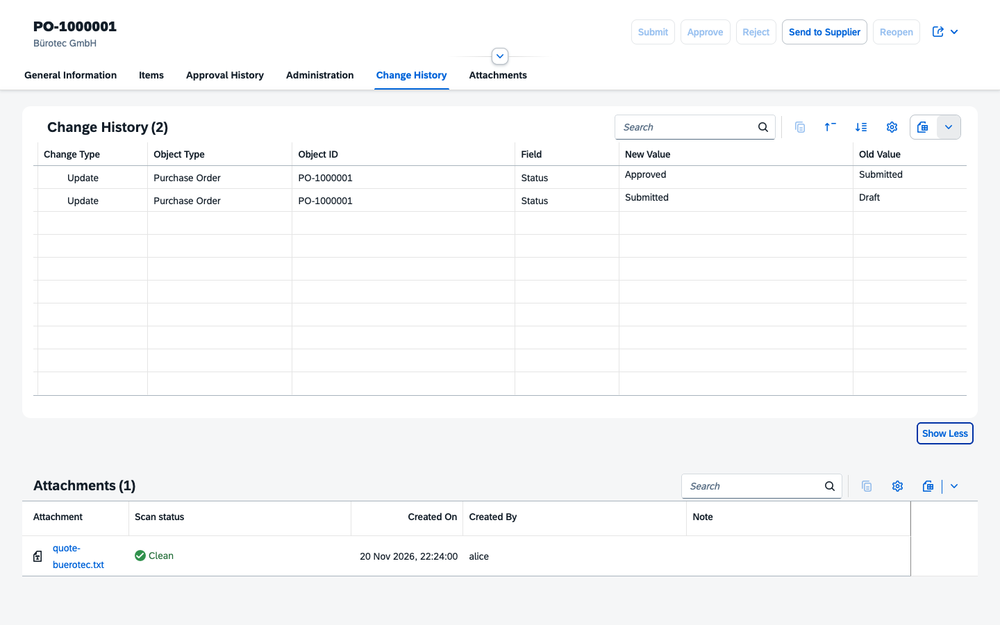
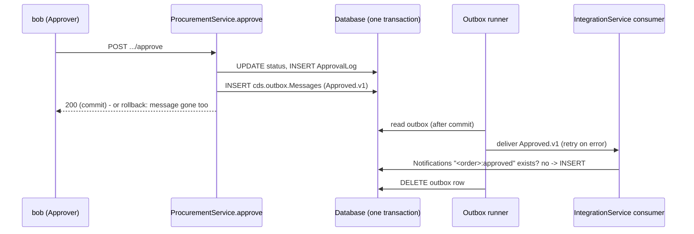
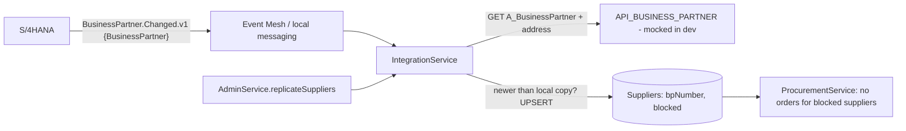

<!--
What: Guide for stage 08 (advanced features): attachments, change tracking, audit logging and data
    privacy, the transactional outbox with messaging and idempotent consumers, S/4HANA business
    partner replication, telemetry - each with when to use it and its impact.
Why: [CAP-STAGE-08] / [CAP-M07] [CAP-M08] [CAP-M15]-[CAP-M19] - these are the CAP plugins and
    patterns production apps need for compliance and integration; the README explains the
    trade-offs and the idempotency rules.
If missing or unlinked: Learners add plugins without knowing their costs and failure modes, and the
    DoD report marks the stage incomplete.
-->

# Stage 08 - Advanced features

## Purpose

Turn the procurement app into something an auditor and an integration architect would accept:
files on orders (**attachments**), a field-level **change history**, **audit logs** for personal
data with **data-privacy** annotations, reliable messaging through the **transactional outbox**
with **idempotent consumers**, **replication** of S/4HANA business partners (with the "blocked
supplier" rule that needs the local copy), and **telemetry** traces - mostly by adding `@cap-js`
plugins and annotations, with little code.

## Module reference

- [CAP-M15 Attachments & Media](../CAP_DEVELOPMENT_GUIDE.md#cap-m15-attachments--media)
- [CAP-M16 Change Tracking & Audit Logging](../CAP_DEVELOPMENT_GUIDE.md#cap-m16-change-tracking--audit-logging)
- [CAP-M17 Data Privacy](../CAP_DEVELOPMENT_GUIDE.md#cap-m17-data-privacy)
- [CAP-M18 Async Processing: Outbox, Queues, Jobs](../CAP_DEVELOPMENT_GUIDE.md#cap-m18-async-processing-outbox-queues-jobs)
- [CAP-M07 Events & Messaging](../CAP_DEVELOPMENT_GUIDE.md#cap-m07-events--messaging) - [CAP-DEC-04]
- [CAP-M08 Consuming Remote Services](../CAP_DEVELOPMENT_GUIDE.md#cap-m08-consuming-remote-services) - [CAP-DEC-05] (replicate)
- [CAP-M19 Observability](../CAP_DEVELOPMENT_GUIDE.md#cap-m19-observability)

## Prerequisites

As [stage 07](../stage-07-data-persistence/README.md), plus (installed by `npm install` at the root):

| Package | Version used | Purpose |
|---------|--------------|---------|
| `@cap-js/attachments` | 4.0.0 | `Attachments` aspect, upload/download, malware-scan status; DB storage in dev, object store in prod |
| `@cap-js/change-tracking` | 2.2.3 | `@changelog` → database triggers + Change History facet |
| `@cap-js/audit-logging` | 1.3.0 | `@PersonalData` → audit log events (console in dev, Audit Log service in prod) |
| `@cap-js/telemetry` | 2.2.0 | OpenTelemetry traces/metrics (console in dev) |

Production services (*manual*, BTP): Object Store, Malware Scanning, Audit Log, SAP Event Mesh,
Cloud Logging - bound in stage 10.

## Folder structure

```
stage-08-advanced-features/
├─ db/extensions.cds                     # NEW Suppliers.bpNumber/blocked/bpLastChanged, PurchaseOrders.attachments, Notifications
├─ db/change-tracking.cds                # NEW @changelog + labels for the Change History
├─ db/data-privacy.cds                   # NEW @PersonalData on SupplierContacts / Suppliers
├─ db/undeploy.json                      # NEW written by @cap-js/change-tracking (HDI trigger cleanup)
├─ db/data/acme.procurement-Suppliers.csv     # CHANGED bpNumber, blocked, bpLastChanged
├─ db/data/sap.common-Countries*.csv     # CHANGED + Sweden (replicated partner Nordic Paper AB)
├─ srv/integration-service.cds           # NEW internal IntegrationService (@protocol: 'none')
├─ srv/integration/integration-service.js     # NEW subscriptions + replicateAll
├─ srv/integration/bp-replication.js     # NEW idempotent replication of one business partner
├─ srv/integration/approval-notifications.js  # NEW idempotent consumer of the "approved" message
├─ srv/admin-service.cds / .js           # CHANGED/NEW replicateSuppliers action (Admin)
├─ srv/procurement-service.cds           # CHANGED Suppliers.blocked, Notifications
├─ srv/procurement-service.js            # CHANGED outboxed message on approve, blocked-supplier rule, drafts-only creation
├─ srv/authorizations.cds                # CHANGED attachments, notifications, replicateSuppliers
├─ app/procurement/annotations.cds       # CHANGED "blocked" in the supplier value help
├─ _i18n/messages*.properties            # CHANGED ORDER_DRAFT_ONLY, SUPPLIER_BLOCKED
├─ package.json                          # CHANGED 4 plugins, messaging (local + outbox / Event Mesh)
├─ test/advanced.test.js                 # NEW 18 tests for all features
├─ test/handlers.test.js                 # CHANGED direct create is now rejected
└─ test/requests.http                    # CHANGED requests 29-39
```

## How to run

```sh
cd stage-08-advanced-features
npm run watch                       # telemetry prints a trace per request
NO_TELEMETRY=true npm run watch     # quiet logs
```

In the app (<http://localhost:4004/procurement/webapp/index.html>): as `alice` open PO-1000001 →
**Edit** → **Attachments** → upload a file → **Save** → **Submit**; as `bob` **Approve**; as `erin`
open the order → **Change History** (click *Show More*) and **Attachments**. As `carol` the
notification "PO-1000001 was approved" is in `GET /odata/v4/procurement/Notifications`.

Or run requests 29-39 of `test/requests.http`. Things to watch in the server log:

```
[audit-log] - PersonalDataModified: { data_subject: { role: 'SupplierContact', ... }, attributes: [ { name: 'email', old: ..., new: ... } ], user: 'carol' }
[replication] - supplier updated from S/4HANA { bpNumber: '17100005', blocked: true }
[telemetry] - elapsed times:  ... audit-log - emit PersonalDataModified -> db - UPSERT cds.outbox.Messages
```



## How to test

```sh
npm test
```

73 tests pass (8 files). `test/advanced.test.js` (18 tests) covers:

| Feature | What is proven |
|---------|----------------|
| change tracking | status changes made by actions are logged with user, labels (en/de), order number; item changes from a draft |
| attachments | upload into a draft, mocked malware scan → *Clean*, download after activation, 404 for other requesters |
| audit logging | `PersonalDataModified` with old/new e-mail and user when a contact changes |
| outbox | message stored in `cds.outbox.Messages` **inside** the transaction, delivered **after** commit, **dropped** on rollback |
| idempotency | a redelivered message creates no second notification; repeated/stale business-partner events change nothing |
| replication | full load counts (1 created, 1 updated, 4 unchanged), second load all unchanged, Admin only |
| business rule | no orders for suppliers blocked in S/4HANA (localized message) |
| robustness | `POST` with `IsActiveEntity: true` → 400, server keeps running; S/4HANA failure during replication → 502 without details |

## Key concepts

- **Plugins** - `npm add @cap-js/<plugin>`: they register themselves (`cds-plugin.js`), add model
  aspects, handlers, UI facets and configuration with profiles (dev vs prod).
- **Attachments** - one line in the model:
  ```cds
  extend my.PurchaseOrders with { attachments: Composition of many Attachments; }
  ```
  Upload = create the row (filename, mimeType) in the draft, then `PUT .../content`. Access rules
  must be added for the composition (`up_.createdBy = $user`).
- **Change tracking** - annotate *what* to track; v2 generates **database triggers**, so writes
  from actions and `cds.db` are captured too:
  ```cds
  annotate my.PurchaseOrders with @changelog: [orderNo] { status @changelog; totalAmount @changelog; }
  ```
- **Data privacy + audit log** - `@PersonalData.EntitySemantics: 'DataSubject'`,
  `FieldSemantics: 'DataSubjectID'`, `IsPotentiallyPersonal` on the fields; the audit-log plugin
  emits `PersonalDataModified` (and `SensitiveDataRead` for `IsPotentiallySensitive`).
- **Transactional outbox** - `cds.requires.messaging.queued: true` (brokers are queued by default):
  ```js
  await this.messaging.emit('acme.procurement.PurchaseOrder.Approved.v1', event) // INSERT into cds.outbox.Messages
  ```
  The row commits or rolls back with the business data; a background runner delivers it and
  retries on failure (at-least-once).
- **Idempotent consumers** - derive the key from the message (`<order>:approved`), check before
  insert; for replication compare `LastChangeDate` with the local copy (also handles out-of-order).
- **Replication vs delegation** ([CAP-DEC-05]) - `RemoteSuppliers` (stage 04) stays live
  delegation; `Suppliers` now carries a replicated copy (`bpNumber`, `blocked`) used in joins and
  validation.
- **Telemetry** - `@cap-js/telemetry` traces every request down to SQL statements; exporters per
  environment (`telemetry-to-console`, `-to-cloud-logging`, `-to-dynatrace`, `-to-otlp` ...).

## When to use / When not to use

| Feature | Use when | Avoid when | Impact |
|---------|----------|------------|--------|
| Attachments in DB (dev) / object store (prod) | documents belong to a business object | huge media files, streaming video | storage cost; needs malware scanning for uploads |
| Change tracking | audit trail per field, compliance | high-volume technical tables | one trigger per table/event, extra rows per change |
| Audit logging | personal data (GDPR) | non-personal data | outboxed log writes; Audit Log service cost |
| Outbox | messages / remote calls inside a transaction | caller needs the result synchronously | extra table, asynchronous delivery, at-least-once |
| Replication | joins, filters, validation on remote data, offline | data must be real-time | sync logic, idempotency, storage |
| Delegation (stage 04) | small, fresh, rarely joined data | lists sorted/filtered on remote fields | latency, availability coupling |
| Telemetry | production diagnosis, performance work | - (always in prod, sampled) | small CPU overhead; log volume in dev |

## Impact & trade-offs

| Aspect | Impact |
|--------|--------|
| Consistency | outbox: business data and message commit together; without it a rollback may still have sent the message |
| Delivery | at-least-once → every consumer must be idempotent (keys, version checks) |
| Performance | change-tracking triggers and audit logs add writes per change; telemetry adds per-request work |
| Storage | `sap.changelog.Changes`, `cds.outbox.Messages`, attachments - plan retention (`preserveDeletes` keeps change logs of deleted data) |
| Security | auto-exposed compositions (attachments) need their own `@restrict`; uploads need malware scanning (mocked in dev) |
| Robustness | a plugin bug can crash the server (see Deviations); guard unsupported paths |
| Privacy | annotations are the input for audit logs, Personal Data Manager and retention - keep them complete |

## Visuals

Outbox: approval message from action to consumer:



Replication from S/4HANA:



## Deviations from guide

| Guide | Here | Reason |
|-------|------|--------|
| attachments "check current name/status" | `@cap-js/attachments` 4.0.0 | current plugin; `LargeBinary` + `@Core.MediaType` would need own storage/scan handling |
| outbox via `cds.queued(srv)` or `"outbox": true` | `cds.requires.messaging.queued: true` | `outbox` config is deprecated in CAP 10 (`queued` is the new name); brokers are queued by default |
| "Event Mesh" | `local-messaging` in dev, `enterprise-messaging` (SAP Event Mesh) in production | no broker needed locally; production binding in stage 10; for Event Mesh in SAP Integration Suite use kind `event-mesh` |
| `srv/integration/` replication handler | internal `IntegrationService` (`@protocol: 'none'`) with code in `srv/integration/` | one place for event-driven and on-demand replication; not reachable over HTTP |
| - | `POST` with `IsActiveEntity: true` rejected (`ORDER_DRAFT_ONLY`) | `@cap-js/attachments` 4.0.0 crashes the server (TypeError in its SAVE handler → CAP shuts down) on direct creation of draft-enabled entities; it also skipped order number and defaults. Stage 04-07 test "total on direct create" replaced |
| - | `@title` on DB entities in `db/change-tracking.cds` | the Change History shows DB labels, not the projection's |
| telemetry "to Cloud Logging" | console exporter in all profiles | production exporter is chosen with `cds add cloud-logging --with-telemetry` in stage 10 (needs BTP service) |
| privacy integration with Personal Data Manager | annotations only | PDM is a BTP service; *manual* |

Not verified against live services (no BTP access while writing): object store, malware scanning,
Audit Log service, SAP Event Mesh, Cloud Logging. Everything else is covered by the tests.

## Troubleshooting

| Symptom | Cause | Fix |
|---------|-------|-----|
| server shuts down after `POST ... IsActiveEntity: true` | attachments plugin 4.0 bug | keep the `ORDER_DRAFT_ONLY` guard in `srv/procurement-service.js` |
| Change History section empty | the table sits in the "more" part of the section | click **Show More** |
| Change History shows `acme.procurement.PurchaseOrders` / `status` | no `@title` on DB entity/elements | labels in `db/change-tracking.cds` |
| no `[audit-log]` output | entity not annotated as `DataSubject` or no `DataSubjectID` field | complete `@PersonalData` annotations |
| notification never appears | messaging not queued / consumer threw | `npx cds env requires.messaging` shows `queued: true`; check log for retries |
| duplicate notifications | consumer not idempotent | derive the key from the message; check before insert |
| `SUPPLIER_BLOCKED` unexpectedly | the supplier is blocked in S/4HANA (`blocked: true` after replication) | expected; unblock in S/4HANA, then replicate |
| attachment download 404 | other user's order (restriction) or content not uploaded | check `@restrict` on `PurchaseOrders.attachments`; `PUT .../content` before saving |
| very noisy log | telemetry console exporter | `NO_TELEMETRY=true npm run watch` |
| `db/undeploy.json` appears | written by change-tracking on build | commit it - HDI needs it to remove old triggers |

## References

- https://cap.cloud.sap/docs/plugins/
- https://github.com/cap-js/attachments
- https://github.com/cap-js/change-tracking
- https://github.com/cap-js/audit-logging
- https://github.com/cap-js/telemetry
- https://cap.cloud.sap/docs/guides/data-privacy/
- https://cap.cloud.sap/docs/guides/messaging/
- https://cap.cloud.sap/docs/node.js/queue
- https://cap.cloud.sap/docs/guides/using-services#replicated-data
