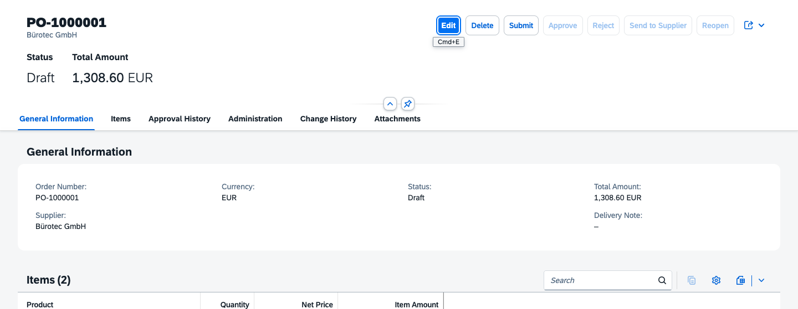
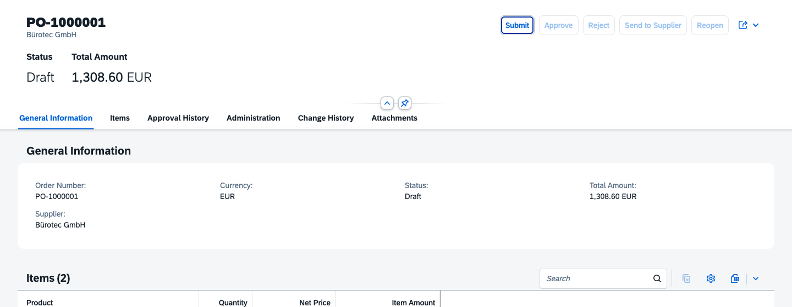
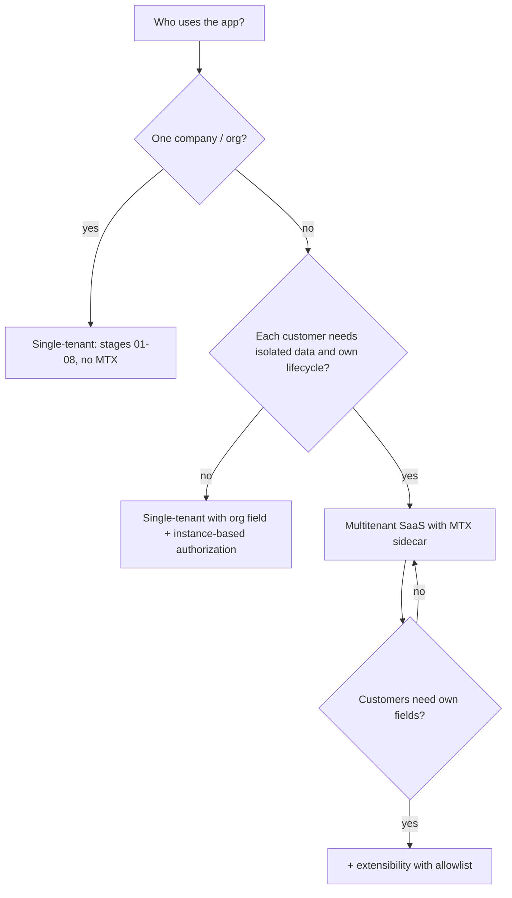
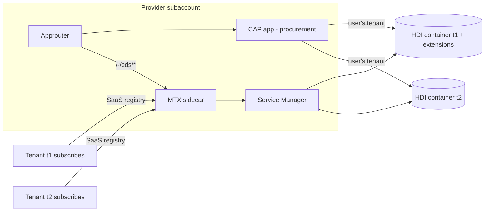
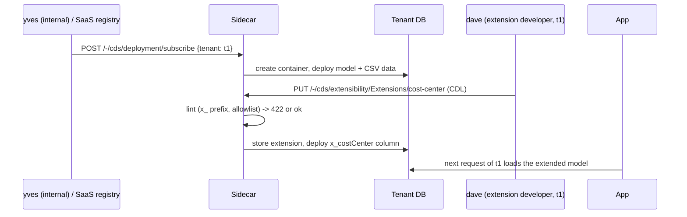

<!--
What: Guide for stage 09 (extensibility and multitenancy): ACME Procurement as a multitenant SaaS
    app with the MTX sidecar - tenant subscription with one database per tenant, upgrades,
    tenant-specific extensions with provider rules, and a sample extension project.
Why: [CAP-STAGE-09] / [CAP-M20] [CAP-M21] / [CAP-DEC-09] - explains when multitenancy is worth its
    operational cost, how the local setup mirrors BTP, the upgrade strategy and the extension rules.
If missing or unlinked: Learners run two processes without understanding their roles, and the DoD
    report marks the stage incomplete.
-->

# Stage 09 - Extensibility & multitenancy (MTX)

## Purpose

Turn ACME Procurement into a **SaaS application**: several customer companies (tenants) subscribe
to one deployed app, each gets its own database container, and each may add its own fields
(extensions) within rules the provider defines - without the provider redeploying anything.

## Module reference

- [CAP-M20 Multitenancy (SaaS)](../CAP_DEVELOPMENT_GUIDE.md#cap-m20-multitenancy-saas) - [CAP-DEC-09]
- [CAP-M21 Extensibility](../CAP_DEVELOPMENT_GUIDE.md#cap-m21-extensibility)

## Prerequisites

As [stage 08](../stage-08-advanced-features/README.md), plus `@sap/cds-mtxs` 4.x (added by
`cds add multitenancy`, installed by `npm install` at the root). Two terminals for the local
multitenant run. Production (*manual*, stage 10): SaaS Provisioning (SaaS registry), Service
Manager, SAP HANA Cloud.

## Folder structure

```
stage-09-extensibility-mtx/
├─ mtx/sidecar/package.json        # NEW MTX sidecar: tenant lifecycle, extension rules, change-tracking plugin
├─ ext-sample/                     # NEW sample tenant extension project (see its README)
│  ├─ package.json, .gitignore
│  └─ srv/extension.cds            #   x_deliveryNote + UI annotation
├─ scripts/subscribe.sh            # NEW subscribe t1 and t2 locally
├─ package.json                    # CHANGED @sap/cds-mtxs, profile with-mtx-sidecar, [with-mtx], extensibility,
│                                  #         users with tenants, scripts watch:sidecar / watch:mtx / subscribe
├─ xs-security.json                # CHANGED + mtcallback, cds.ExtensionDeveloper (by cds add)
├─ .deploy/app-router/xs-app.json  # CHANGED /-/cds/* routed to the sidecar (mtx-api)
├─ srv/admin-service.js            # CHANGED replication errors -> 502 (also in stage 08)
├─ test/mtx.test.js                # NEW end-to-end: sidecar + app processes, 2 tenants, extension, rules
├─ test/authz.test.js              # CHANGED expects the MTX scopes
├─ test/requests.http              # CHANGED requests 40-48
└─ .gitignore                      # CHANGED *.sqlite-* (tenant databases' WAL files)
```

## How to run

Single-tenant development works as before (`npm run watch`) - the default profile
`with-mtx-sidecar` only switches to multitenancy together with `with-mtx`.

Multitenant, like on BTP:

```sh
cd stage-09-extensibility-mtx
npm run watch:sidecar      # terminal 1: MTX sidecar on http://localhost:4005
npm run subscribe          # terminal 2: tenants t1, t2 -> db-t1.sqlite, db-t2.sqlite
npm run watch:mtx          # terminal 2: the app on http://localhost:4004, profile with-mtx
```

| Tenant | Users (empty password) |
|--------|------------------------|
| t1 | alice (Requester), bob (Approver), carol (Buyer), dave (Admin + extension developer), gina |
| t2 | erin (Auditor), fred (Requester) |
| - | yves (`internal-user`: subscribe, upgrade, unsubscribe) |

Then:

1. As `fred` create an order in the Fiori app → `erin` (t2) sees it, `dave` (t1) does not.
2. Push an extension to t1 - either request 41 of `test/requests.http`, or the extension project:
   ```sh
   cd ext-sample && npx cds pull --from http://localhost:4005 -u dave: && npm install \
     && npx cds push --to http://localhost:4005 -u dave:
   ```
3. ~10 s later the object page in t1 shows **Delivery Note**; t2 is unchanged:

| tenant t1 (alice) - extended | tenant t2 (erin) |
|---|---|
|  |  |

Reset: stop both processes and delete `db*.sqlite*`.

## How to test

```sh
npm test
```

80 tests pass (9 files). `test/mtx.test.js` (7 tests, ~4 s) starts the sidecar and the app as
child processes (databases in a temp folder) and checks: one database per tenant, isolated data,
per-tenant number ranges and change history, the extension field in t1 only, the extension rules
(422 for a missing `x_` prefix and a non-allowlisted entity), and that only extension developers
may push.

## Key concepts

- **Sidecar** - `mtx/sidecar` is its own CAP app (`@sap/cds-mtxs`): subscribe / unsubscribe /
  upgrade tenants, deploy their database containers, accept extensions. The app stays lean and
  scales separately.
- **Profiles** - `"profile": "with-mtx-sidecar"` + `[with-mtx]: { multitenancy: true }`:
  development without `with-mtx` stays single-tenant (fast tests); `--profile with-mtx` is the
  local SaaS mode; `[production]` is always multitenant.
- **Tenant isolation** - each tenant has its own schema (HDI container on HANA, SQLite file
  locally). The tenant comes from the user (JWT zone on BTP, `tenant` of the mocked user locally).
- **Extensions** - stored per tenant (`cds.xt.Extensions`), compiled with the base model, deployed
  to the tenant's database; the app loads the tenant's model on demand
  (`extensibility: true`).
- **Provider rules** (sidecar `package.json`, where the linter runs):
  ```json
  "cds.xt.ExtensibilityService": {
    "element-prefix": ["x_"],
    "namespace-blocklist": ["sap.", "cds."],
    "extension-allowlist": [ { "for": ["acme.procurement.PurchaseOrders", "acme.procurement.Suppliers"], "new-fields": 5 },
                             { "for": ["ProcurementService"], "new-entities": 0 } ]
  }
  ```
- **Plugins in the sidecar** - plugins that create database artefacts (change-tracking triggers)
  must be dependencies of the sidecar, otherwise tenant databases lack them
  (`no such table: ProcurementService_ChangeView`).

### Upgrade strategy

| Step | How | Note |
|------|-----|------|
| 1. deploy new app version | `cf deploy` (stage 10) | app and sidecar together |
| 2. upgrade all tenant databases | `POST /-/cds/saas-provisioning/upgrade` `{ "tenants": ["*"] }` (internal user) | runs as asynchronous jobs per tenant; `cds-mtx upgrade` in the sidecar container does the same |
| 3. check results | job status / sidecar logs | a failing tenant does not block the others |
| 4. extensions | re-validated during upgrade | provider renames of extended entities break tenant extensions - avoid them |

Never call `/-/cds/deployment/upgrade` with `"*"`: that API takes *one* tenant ID and treats `*`
literally.

## When to use / When not to use



[CAP-DEC-09]: multitenancy only when several customers each need isolated data and their own
subscription lifecycle. Extensibility only when customers really need own fields - every opened
entity is a support promise.

## Impact & trade-offs

| Aspect | Impact |
|--------|--------|
| Operations | two apps (app + sidecar), subscription callbacks, per-tenant upgrade jobs and monitoring |
| Cost | SaaS Provisioning, Service Manager, one HDI container per tenant (HANA memory) |
| Schema changes | must be rolled out to **all** tenants; destructive changes multiply data-loss risk |
| Extensibility | allowlisted entities become a contract; renames/removals break customer extensions |
| Testing | tenant-aware tests (this stage's `mtx.test.js`), upgrade tests with extended tenants |
| Security | tenant isolation by schema; extension developers get a dedicated role (`cds.ExtensionDeveloper`) |
| Development | without `--profile with-mtx` everything stays single-tenant and fast |

## Visuals

Topology (local / BTP):



Subscription and extension:



## Deviations from guide

| Guide | Here | Reason |
|-------|------|--------|
| `cds-mtx upgrade` | `POST /-/cds/saas-provisioning/upgrade {"tenants":["*"]}` (verified locally); CLI mentioned | HTTP API works the same locally and on BTP |
| `extension-allowlist` in `cds.requires.extensibility` | in the sidecar's `package.json` under `cds.xt.ExtensibilityService` | the linter runs in the sidecar and reads its own configuration (rules in the app's package.json were ignored - tested) |
| `scripts/subscribe.sh` | same, plus `npm run subscribe` | |
| sample extension via `cds push` | `ext-sample/` + Extensions REST API in tests/requests | the REST API needs no build; `cds push` is shown in `ext-sample/README.md` (verified locally) |
| mocked users | users carry a `tenant` explicitly; `dave` is also `cds.ExtensionDeveloper` | CAP's default users have hidden tenants; explicit is clearer. In development the sidecar uses the **app's** users |
| - | `@cap-js/change-tracking` in the sidecar's dependencies | the plugin's README requires it; without it tenant DBs miss the change views |
| mocked S/4HANA in multitenant mode | not available (`RemoteSuppliers` → 502, `replicateSuppliers` → 502) | mock tables are not part of tenant databases; use single-tenant `npm run watch` for those features |

Not verified against BTP (no access while writing): SaaS registry callbacks, Service Manager HDI
containers, approuter tenant routing.

## Troubleshooting

| Symptom | Cause | Fix |
|---------|-------|-----|
| app answers 401/404 for every user in `--profile with-mtx` | tenant not subscribed | `npm run subscribe` (sidecar must run) |
| `no such table: ProcurementService_ChangeView` | change-tracking plugin missing in the sidecar | add `@cap-js/change-tracking` to `mtx/sidecar/package.json`, re-subscribe |
| `no such table: API_BUSINESS_PARTNER_...` / 502 | remote mock has no tables in tenant DBs | single-tenant mode for remote features |
| extension accepted although it breaks the rules | rules not in the sidecar config | `cds.requires.cds.xt.ExtensibilityService` in `mtx/sidecar/package.json` |
| `403 lacking required roles: [cds.ExtensionDeveloper,internal-user]` | user lacks the role (in dev: the **app's** user config counts) | use `dave` or add the role in the app's `package.json` |
| extension field not visible | app caches the tenant model (~10 s) | wait or restart `npm run watch:mtx` |
| a file `db-*.sqlite` appears | `/-/cds/deployment/upgrade` called with `*` | use `/-/cds/saas-provisioning/upgrade {"tenants":["*"]}`; delete the file |
| port 4005 in use | sidecar already running | stop it or `cds watch mtx/sidecar --port 4006` |

## References

- https://cap.cloud.sap/docs/guides/multitenancy/
- https://cap.cloud.sap/docs/guides/multitenancy/mtxs
- https://cap.cloud.sap/docs/guides/extensibility/
- https://cap.cloud.sap/docs/guides/extensibility/customization
- https://github.com/cap-js/change-tracking (MTX note)
