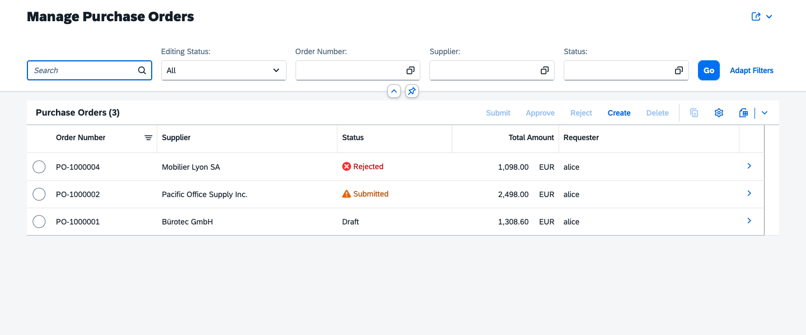
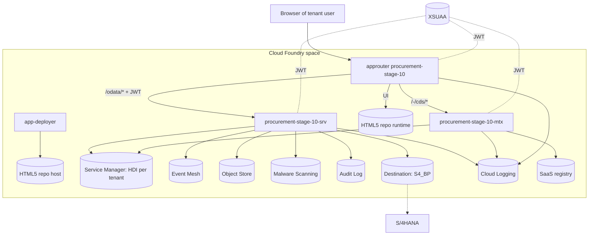
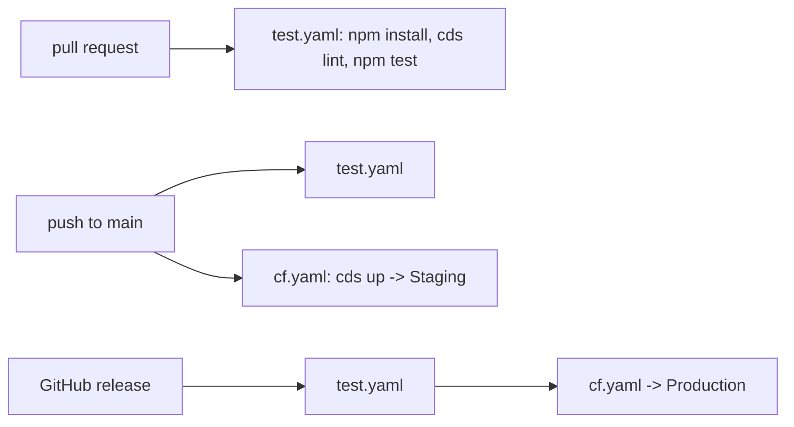

<!--
What: Guide for stage 10 (deployment & CI/CD): the MTA for SAP BTP Cloud Foundry (multitenant SaaS
    with approuter, HTML5 repository and all BTP services), building the .mtar, deploying, the
    runbook, and the CI/CD pipelines.
Why: [CAP-STAGE-10] / [CAP-M22] [CAP-M23] - the last step from a local app to a running SaaS
    offering; explains what is deployed, how to deploy and roll back safely, and which checks gate it.
If missing or unlinked: Learners have an mta.yaml without knowing how to build, deploy, verify or roll
    back, and the DoD report marks the stage incomplete.
-->

# Stage 10 - Deployment & CI/CD

## Purpose

Package the multitenant procurement app of stage 09 as one **multitarget application (MTA)** for
SAP BTP Cloud Foundry - service, MTX sidecar, approuter, the Fiori app in the HTML5 Application
Repository and every BTP service it needs - build the archive, deploy it with a repeatable script,
operate it with a runbook, and gate changes with CI/CD pipelines.

## Module reference

- [CAP-M22 Deployment to BTP Cloud Foundry](../CAP_DEVELOPMENT_GUIDE.md#cap-m22-deployment-to-btp-cloud-foundry)
- [CAP-M23 CI/CD & Quality Gates](../CAP_DEVELOPMENT_GUIDE.md#cap-m23-cicd--quality-gates)
- [CAP-M19 Observability](../CAP_DEVELOPMENT_GUIDE.md#cap-m19-observability) (Cloud Logging exporter)
- Operations: [docs/runbook.md](docs/runbook.md)

## Prerequisites

As [stage 09](../stage-09-extensibility-mtx/README.md), plus:

| Tool / account | Version used | Note |
|----------------|--------------|------|
| Cloud MTA Build Tool `mbt` | 1.2.53 | fetched by `npx --yes mbt@1` in `scripts/build-mtar.sh`; needs `make` (macOS: Xcode CLT) |
| network access | - | `mbt build` runs `npm ci` per module and `ui5 build` |
| `cf` CLI + MultiApps plugin | v8+ | *manual*: `cf install-plugin multiapps` |
| SAP BTP subaccount (provider) | - | *manual*: entitlements in [runbook § 1](docs/runbook.md#1-one-time-setup-provider-subaccount) |

## Folder structure

```
stage-10-deploy-cicd/
├─ mta.yaml                          # NEW modules + BTP services (cds add mta,html5-repo,malware-scanner,cloud-logging)
├─ event-mesh.json                   # NEW SAP Event Mesh instance parameters (namespace, topic rules)
├─ app/procurement/package.json      # NEW the Fiori app as UI5 project (@ui5/cli, ui5-task-zipper)
├─ app/procurement/package-lock.json # NEW lock file for npm ci in mbt build
├─ app/procurement/ui5.yaml          # NEW UI5 build + zip for the HTML5 repository
├─ app/procurement/xs-app.json       # NEW routes inside the HTML5 app
├─ .deploy/app-router/xs-app.json    # CHANGED routes: /-/cds -> sidecar, /odata -> service, rest -> HTML5 repo
├─ mtx/sidecar/package-lock.json     # NEW lock file for npm ci of the sidecar module
├─ mtx/sidecar/package.json          # CHANGED html5-host (by cds add)
├─ xs-security.json                  # CHANGED Event Mesh scopes (by cds add)
├─ package.json                      # CHANGED html5-repo, malware-scanner, [production] telemetry to Cloud Logging,
│                                    #         OTLP exporters, eslint, scripts build:mtar / deploy
├─ scripts/build-mtar.sh             # NEW builds mta_archives/*.mtar from a clean copy
├─ scripts/deploy.sh                 # NEW cf deploy with pre-flight checks (STRATEGY=blue-green)
├─ docs/runbook.md                   # NEW setup, deploy, onboarding, smoke tests, upgrade, rollback, monitoring
├─ .github/workflows/test.yaml       # NEW lint + tests (PRs, main)
├─ .github/workflows/cf.yaml         # NEW deploy to Cloud Foundry (cds up)
├─ .github/workflows/release.yaml    # NEW release = tests -> production deployment
├─ eslint.config.mjs, .vscode/settings.json  # NEW cds lint configuration (cds add lint)
├─ test/deployment.test.js           # NEW 10 tests: mta.yaml, production config, build output, routes, workflows
└─ ext-sample/                       # CHANGED extends procurement-stage-10
```

## How to run

Local development is unchanged (`npm run watch`, or the multitenant setup of stage 09).

Build the deployable archive:

```sh
cd stage-10-deploy-cicd
npm run build:mtar
```

Expected (2-3 minutes):

```
INFO finished building the "procurement-stage-10-srv" module
INFO finished building the "procurement-stage-10-mtx" module
INFO finished building the "procurement-stage-10" module
INFO finished building the "procurementstage10procurement" module
INFO finished building the "procurement-stage-10-app-deployer" module
INFO the MTA archive generated at: .../mta_archives/procurement-stage-10_1.0.0.mtar
```

Deploy (*manual*, needs BTP - see [runbook](docs/runbook.md)):

```sh
cf login -a https://api.cf.<region>.hana.ondemand.com --sso
npm run deploy                         # or: STRATEGY=blue-green npm run deploy
```

## How to test

```sh
npm test
```

90 tests pass (10 files). `test/deployment.test.js` (10 tests) checks without BTP:
modules and their types, one BTP service per production feature (with plans), the service's
bindings, the tenant-upgrade hook, tenant host routing, the UI5 build of the Fiori app, role
collections = role templates, the effective production configuration, a production build into a
temp folder (lock files present for `npm ci`), approuter route order and welcome file, and the
release gate in the workflows. `npm run build:mtar` is the integration test of the archive
(verified while writing this guide: 32 MB `.mtar`, Fiori zip with `manifest.json` + `xs-app.json`).

The Fiori app **as built for the HTML5 repository** (`procurement.zip` taken out of the `.mtar`)
was served the way the approuter does it - `/acmeprocurement/*` from the zip, `/odata/*` (root
route) and `/acmeprocurement/odata/*` (the app's own `xs-app.json` route) to a local CAP server:



Note: the UI5 build rewrites the data source to the relative `odata/v4/procurement/`; in
production the app's `app/procurement/xs-app.json` routes it to `srv-api`.

## Key concepts

- **MTA** - one descriptor (`mta.yaml`) for all modules and services; `mbt build` → `.mtar`;
  `cf deploy` creates services, deploys apps in dependency order, runs hooks.
- **Modules** - `-srv` (gen/srv, CAP service), `-mtx` (gen/mtx/sidecar, tenant lifecycle),
  `procurement-stage-10` (approuter), `-app-deployer` (uploads `procurement.zip` to the HTML5 repo),
  `procurementstage10procurement` (builds the zip with UI5 tooling).
- **Tenant upgrade hook** - `cds-mtx upgrade '*'` runs as a CF task before the sidecar starts, also
  in blue-green deployments.
- **Routing** - the approuter resolves the tenant from the host (`TENANT_HOST_PATTERN`), forwards
  `/odata/*` with the user's JWT to the service, `/-/cds/*` to the sidecar, everything else to the
  HTML5 repository (`/acmeprocurement/index.html` = `sap.app.id` without dots).
- **Lock files** - every Node module of the MTA is installed with `npm ci`: `cds build` copies the
  project's and `mtx/sidecar`'s `package-lock.json` into `gen/`; the Fiori app has its own.
- **Pipelines** - `test.yaml` (lint + tests) on every PR, `cf.yaml` deploys main to *Staging*,
  `release.yaml` runs tests then deploys to *Production* on a GitHub release. They are active when
  this folder is the root of its own repository; in this guide repository the root
  [`.github/workflows/ci.yml`](../.github/workflows/ci.yml) tests all stages.

## When to use / When not to use

| Option | Use when | Not when |
|--------|----------|----------|
| MTA + `cf deploy` (this stage) | Cloud Foundry, several modules and services, multitenancy | single small app without services |
| `cds up` | quick deploys from CI/laptop (builds and deploys the MTA) | you need to keep and promote the exact same archive across environments |
| blue-green (`STRATEGY=blue-green`) | production, zero downtime | first deployment, destructive schema changes needing a maintenance window |
| Kyma / Helm (`cds add kyma`) | Kubernetes-based landscape | Cloud Foundry |
| SAP Continuous Integration and Delivery service | managed pipelines in BTP | GitHub Actions already standard |

## Impact & trade-offs

| Aspect | Impact |
|--------|--------|
| Cost | ~11 service instances (HANA Cloud is the largest), 3 apps + tasks; per tenant one HDI container |
| Quotas | sidecar 256 MB, upgrade task 512 MB, approuter 256 MB, service default memory - raise for many tenants |
| Build | 2-3 min, network-dependent (`npm ci` per module, UI5 build) |
| Downtime | blue-green avoids it for compatible changes; schema changes run before the switch |
| Rollback | apps: redeploy previous `.mtar`; databases: additive changes only, otherwise backup/restore ([runbook § 6](docs/runbook.md#6-rollback)) |
| Security | secrets only in BTP bindings and GitHub secrets (`CF_PASSWORD`); nothing in the repository |
| Supply chain | `npx --yes mbt@1` and `cap-js/cf-setup@v2` are external - pin versions in regulated environments |

## Visuals

Deployment on SAP BTP Cloud Foundry:



Pipeline:



## Deviations from guide

| Guide | Here | Reason |
|-------|------|--------|
| `cds add mta,approuter,xsuaa,hana,html5-repo` | approuter/xsuaa/hana came from stages 06/07; added `mta,html5-repo,malware-scanner,cloud-logging,github-actions,lint` | facets confirmed with `cds add --help` (CAP 10) |
| `app/router` | `.deploy/app-router` | CAP 10 layout (stage 06) |
| `mbt build -t gen --mtar procurement.mtar` | `npm run build:mtar` (copy → lock file → `npx mbt build -t mta_archives`) | in a npm-workspace repository the stage has no own lock file; `npm ci` in `mbt` needs one |
| `cf deploy --dry-run` | not available (no `cf` CLI/BTP here); `test/deployment.test.js` checks the descriptor, `deploy.sh` checks prerequisites | documented manual deployment |
| `.github/workflows/ci.yml` | `test.yaml`, `cf.yaml`, `release.yaml` (by `cds add github-actions`) + root `ci.yml` of the guide | generated workflows; reusable-workflow references changed to local paths; `test.yaml` now runs lint and tests |
| telemetry kind | `to-cloud-logging` (as written by `cds add cloud-logging --with-telemetry`) | resolves to the OTLP/gRPC exporters + `cloud-logging` binding (tested) |
| OpenTelemetry exporter versions `>=0.200` (generated) | `^0.223` / host-metrics `^0.6` | newer versions need `@opentelemetry/api` 1.10 while `@cap-js/telemetry` 2.2 uses 1.9 → npm nested them and the plugin could not load them |
| Fiori app as static folder | UI5 project (`@ui5/cli`, `ui5.yaml`) | the HTML5 repository needs a zip with `manifest.json` at its root |

Not verified on BTP (no access while writing): the actual `cf deploy`, subscriptions through the
SaaS registry, approuter tenant routing, Event Mesh, Object Store, Malware Scanning, Audit Log and
Cloud Logging bindings. Verified locally: `mbt build` produces the `.mtar` with all five modules.

## Troubleshooting

| Symptom | Cause | Fix |
|---------|-------|-----|
| `npm ci can only install with an existing package-lock.json` | module without lock file | `npm run build:mtar` (creates it in the copy); `mtx/sidecar` and `app/procurement` have their own |
| `make: command not found` | `mbt` needs GNU make | macOS: `xcode-select --install`; Linux: `apt install make` |
| `Cannot find module '@opentelemetry/instrumentation-host-metrics'` | incompatible exporter versions nested under the stage | keep the pinned versions; `rm -rf node_modules && npm install` at the root |
| `ESLint is not installed` in `cds lint` | stand-alone copy without dev dependencies | `npm install` (eslint is a dev dependency) |
| HTML5 deployer: `manifest.json not found` | zip built from the folder, not by UI5 tooling | `build-result: dist` and `npm run build` in the html5 module |
| deployed UI blank, `.../acmeprocurement/odata/v4/...$metadata` 404 | app-level route missing | keep `app/procurement/xs-app.json` (route `^/?odata/(.*)$` → `srv-api`) inside the zip (`additionalFiles` in `ui5.yaml`) |
| `cf deploy` fails: service plan not entitled | missing entitlement | add it in the subaccount ([runbook § 1](docs/runbook.md#1-one-time-setup-provider-subaccount)) |
| more | operations | [docs/runbook.md § 8](docs/runbook.md#8-incidents) |

## References

- https://cap.cloud.sap/docs/guides/deployment/
- https://cap.cloud.sap/docs/guides/deployment/to-cf
- https://cap.cloud.sap/docs/guides/deployment/cicd
- https://cap.cloud.sap/docs/guides/multitenancy/#deploy-to-cloud
- https://sap.github.io/cloud-mta-build-tool/
- https://help.sap.com/docs/btp/sap-business-technology-platform/multitarget-applications-in-cloud-foundry-environment
- https://github.com/cap-js/cf-setup
